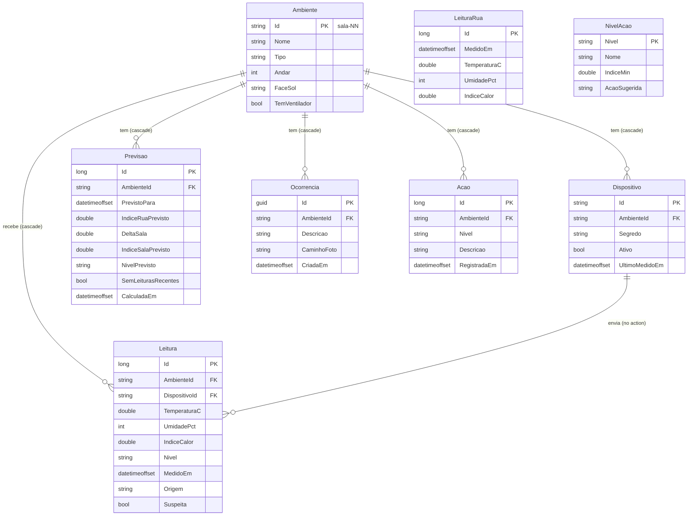

# Termômetro da Sala — API

O mesmo sensor avisa calor no verão (escolas) e frio no inverno (dormitórios e abrigos).

Global Solution 2026.2 (CitizenTech) — Engenharia de Software, 3º ano, FIAP.

## Ficha da CitizenTech

| Campo | Conteúdo |
|---|---|
| Nome da CitizenTech | Termômetro da Sala |
| Cidade e bairro | São Paulo, [bairro da escola entrevistada] |
| Cidadão beneficiado | Professor(a) e turma de uma sala sem climatização. Quem opera o sistema é a coordenação pedagógica |
| Problema, em uma frase | Nas tardes quentes, a sala passa do limite seguro sem que ninguém meça, e a escola só reage quando alguém passa mal |
| Como funciona | Um sensor na porta da sala mede o calor e acende verde, amarelo ou vermelho. O sistema prevê o nível da sala para daqui a 2 h. A coordenação vê todas as salas, decide e registra a ação tomada. O professor acompanha pelo app e registra ocorrências com foto |
| O que cada parte faz | ESP32 (Wokwi) mede e envia a leitura assinada; API (ASP.NET Core + SQL Server) valida, grava e prevê; modelo (Python, dados do INMET) prevê o índice de calor da rua; app (React Native + Expo) para o professor; desktop (Windows Forms) para a coordenação; Windows Server hospeda a API e o painel web no IIS |
| Link do repositório | https://github.com/sbaecker2005/termometro-da-sala |
| Indicador de impacto | Aulas no nível "Perigo" sem ação registrada (meta: zero) e minutos entre o alerta e a ação |
| ODS conectados | 3 (meta 3.d), 4 (meta 4.a), 11 (meta 11.b) e 13 (meta 13.1) |

## Integrantes

- Samuel Baecker - RM [preencher]

## Como rodar

Requisitos: .NET 8 e SQL Server (a conexão está em `TermometroDaSala.Api/appsettings.json`). Os testes não precisam de SQL Server: usam SQLite em memória.

```bash
cd api
dotnet tool restore
dotnet ef database update --project TermometroDaSala.Api
dotnet run --project TermometroDaSala.Api --launch-profile http
dotnet test
```

A API e o painel sobem em `http://localhost:5080`. O painel é a raiz (`/`). Swagger em `/swagger` fora de Production.

Modo demonstração (a rota `/demo/semear` só existe nesse ambiente; fora dele responde 404):

```bash
ASPNETCORE_ENVIRONMENT=Demo dotnet run --project TermometroDaSala.Api --launch-profile http
```

No PowerShell: `$env:ASPNETCORE_ENVIRONMENT="Demo"`.

O assinante MQTT conecta em `broker.hivemq.com:1883`, tópico `fiap-gs/termometro-da-sala/leituras` (configurável em `Mqtt`). Para desligar: `Mqtt__Desligado=true`. Mensagem acima de 1024 bytes é descartada antes de ler o JSON (uma leitura assinada tem cerca de 250 bytes).

Semente: salas `sala-01` a `sala-04`, dispositivo `esp32-sala-0N` em cada uma, segredo de demonstração `segredo-de-teste-sala-0N` (a sala 03 continua com o vetor público do contrato). Cada um é revogável por `POST /dispositivos/{id}/revogar`. Não é segredo de produção.

A coordenação autentica `POST /ambientes`, `PUT` e `DELETE /ambientes/{id}`, `POST /acoes`, `POST /dispositivos/{id}/revogar` e `GET /ocorrencias/{id}/foto` com o cabeçalho `X-Chave-Coordenacao`. O valor vem da configuração `ChaveCoordenacao` (variável de ambiente de mesmo nome) e não entra no git. Sem ela, ou com valor diferente, a resposta é 401 e nada é gravado. `POST /leituras` continua só com HMAC. `POST /ocorrencias` não exige essa chave, mas a foto gravada só abre com ela: pode mostrar pessoas.

As rotas de escrita (`POST /ambientes`, `PUT` e `DELETE /ambientes/{id}`, `POST /acoes`, `/leituras`, `/ocorrencias`, `/dispositivos/{id}/revogar` e `/demo/semear`) aceitam 30 pedidos por minuto por IP. O seguinte responde 429.

Toda resposta leva `X-Content-Type-Options: nosniff`, para o navegador não interpretar uma foto ou um CSV como outro tipo. Em Production a API redireciona para HTTPS e manda `Strict-Transport-Security` (HSTS). Teste: `RespostasLevamNosniffEProducaoLevaHsts`.

## Rotas

| Método | Rota | O que faz |
|---|---|---|
| GET | `/ambientes` | Salas com nível e índice atuais, `temVentilador` e `dispositivoId` (null sem sensor) |
| POST | `/ambientes` | Cadastra sala sem criar ou vincular um sensor. 201 com `Location: /ambientes/{id}`. Exige `X-Chave-Coordenacao` |
| GET | `/ambientes/{id}` | Uma sala, no mesmo formato de cada item de `GET /ambientes`. 404 se não existe |
| PUT | `/ambientes/{id}` | Altera nome, andar, face e ventilador. Corpo igual ao do POST, com o `id` da rota (senão 400 `id-divergente`). Exige `X-Chave-Coordenacao` |
| DELETE | `/ambientes/{id}` | 204. Leva junto dispositivos, ocorrências (e as fotos delas no disco), ações e previsões da sala. Com leituras, 409 `ambiente-com-leituras`. Exige `X-Chave-Coordenacao` |
| GET | `/ambientes/{id}/ocorrencias` | Ocorrências da sala (`id`, `ambienteId`, `descricao`, `criadaEm`), da mais recente à mais antiga, sem a foto |
| GET | `/ambientes/{id}/leituras` | Leituras em JSON. `?formato=csv` devolve CSV |
| GET | `/ambientes/{id}/previsao` | Rua daqui a 2 h, delta da sala e nível previsto. Sem rua, usa a última leitura válida da sala (`ruaDisponivel: false`); 503 sem rua e sem leitura válida recente |
| POST | `/leituras` | Mesma leitura assinada do MQTT |
| POST | `/ocorrencias` | Multipart: `ambienteId`, `descricao`, `foto` JPEG até 5 MB. Exige a estrutura de um JPEG (quadro SOF com altura e largura e início da varredura SOS); os pixels não são decodificados. A API regrava o JPEG sem o segmento APP1 (EXIF) |
| GET | `/ocorrencias/{id}/foto` | A foto da ocorrência pelo id. Exige `X-Chave-Coordenacao` (401 sem ela) |
| GET | `/acoes?dia=AAAA-MM-DD` | Ações do dia civil de São Paulo; data ausente/inválida retorna 400 |
| POST | `/acoes` | Ação tomada: `ambienteId`, `nivel`, `descricao`. 201 com `Location: /acoes?dia=` do dia; 400 `nivel` ou `descricao`. Exige `X-Chave-Coordenacao` |
| GET | `/niveis` | As 5 faixas da tabela `NiveisAcao`: `nivel`, `nome`, `indiceMin` e `acaoSugerida` |
| POST | `/dispositivos/{id}/revogar` | Marca o dispositivo como inativo. É uma ação de estado (não apaga nem substitui o recurso), por isso POST com verbo em vez de PUT/DELETE. Exige `X-Chave-Coordenacao` |
| POST | `/demo/semear?ambienteId=` | Só com `ASPNETCORE_ENVIRONMENT=Demo`. 409 sem leitura ao vivo |

`POST /leituras`:

```json
{ "ambienteId": "sala-03", "dispositivo": "esp32-sala-03",
  "temperaturaC": 33.4, "umidadePct": 58, "medidoEm": 1794331200,
  "assinatura": "2f7c847dc59835d4a9bacbf9f4b642af0cc563cbf1bf90efb91d127f38297ba0" }
```

O `medidoEm` de uma leitura real precisa estar a no máximo 10 min do relógio do servidor. Recusa com `{ "motivo": "..." }`: `assinatura-invalida`, `reenvio`, `dispositivo-revogado`, `atrasada`, `fora-da-faixa`. Salto maior que 5 °C, ou sala mais de 8 °C abaixo da rua num dia acima de 30 °C, grava com `suspeita: true` e fica fora da previsão. A regra da rua só vale com leitura da rua medida no mesmo instante: no Demo a rua é um dia de exemplo reproduzido e não marca o sensor ao vivo como suspeito.

A coleção do Insomnia está em [insomnia.json](insomnia.json).

## Previsão

O índice de calor é o da NOAA (Rothfusz), em °C com 1 casa. Faixas: abaixo de 18 frio, de 18 até menos de 27 normal, 27 a 32 atenção, 32 a 41 cuidado, 41 ou mais perigo. O mínimo interno de 18 °C é a recomendação da OMS para moradias. Na tabela, o início físico da faixa de frio é o zero absoluto (−273,15 °C); o limite superior é 18 °C. A nova migração `AlertaFrio` inclui a ação de frio e ajusta o início de Normal, preservando os registros existentes.

O delta é a média de (índice da sala − índice da rua) nas últimas 3 h, com no mínimo 3 pares no mesmo instante UTC, sem as leituras suspeitas. A previsão da sala é o índice da rua daqui a 2 h mais o delta. Sem pares suficientes, `deltaSala` e `indiceSalaPrevisto` vêm `null` e `semLeiturasRecentes` vem `true`: mostra-se só a rua.

Fora do Demo nenhuma rotina grava `LeiturasRua`, então pode não haver rua. Nesse caso a API não inventa a rua nem devolve "normal" por falta de dado: `ruaDisponivel` vem `false`, `indiceSalaPrevisto` é o índice da última leitura válida da sala nas últimas 3 h (a hipótese é que a sala se mantenha), `nivelPrevisto` é o nível desse índice, `deltaSala` vem `null`, `semLeiturasRecentes` vem `false` e `indiceRuaPrevisto` vem `0`, sem significado. Sem rua e sem leitura válida recente, a rota responde 503 `{"motivo":"sem-dados-para-prever"}`. Testes: `SemRuaForaDoDemoAPrevisaoSegueASalaENaoDizNormal` e `DemoComRuaQuenteNaoMarcaSalaFrescaComoSuspeita`.

A rua daqui a 2 h vem da árvore de regressão em `TermometroDaSala.Api/modelo/modelo.json` (cópia de `ml/modelo.json`, profundidade 12 e folha mínima 24, treinada no notebook com o horário do INMET, estação A701, 2022–2025). No teste de 2025 o MAE foi 0,909 °C, contra 1,442 °C do baseline "daqui a 2 h = agora". O recall do nível "cuidado" ainda é baixo; a análise está em `ml/README.md`. O caminho fica em `Modelo:Caminho`. `ModeloRua` lê o arquivo, confere a árvore e monta os mesmos atributos do notebook (temperatura, umidade, hora e mês em seno e cosseno, variação da última hora e índice de calor atual (`indice_agora`)). Sem o arquivo, ou com JSON inválido, a API registra no log e cai na regra provisória.

- Fora do Demo (`PrevisorRuaModelo`), a entrada do modelo é a rua gravada em `LeiturasRua`. Sem modelo, repete o índice da rua de agora.
- No Demo (`PrevisorRuaDemo`), a rua vem de `demo/rua-dia-quente.csv` (dia quente de exemplo) projetado na hora local de São Paulo. A entrada do modelo é a hora atual do CSV, com a variação desde a hora anterior do CSV e o mês de hoje, e o `indiceRuaPrevisto` que app, desktop e painel mostram é a saída do modelo. Sem modelo, usa a hora do CSV duas horas à frente.

O teste `PrevisorModeloTestes.DemoAplicaOModeloAoDiaDoCsvEDaOMesmoValor` monta um CSV com o vetor da seção 6 do notebook (15/01/2026 14h, 30 °C, 50%, 28,5 °C uma hora antes) e confere que o Demo e o previsor do banco devolvem o mesmo valor, 27,16 °C. `DemoComRuaQuenteNaoMarcaSalaFrescaComoSuspeita` confere pela rota que, no Demo, `indiceRuaPrevisto` é a saída do modelo para a hora do CSV, e não a hora do CSV duas horas à frente.

`POST /demo/semear` lê `demo/leituras-simuladas.csv` e desloca a curva para terminar na última leitura ao vivo (`origem = dispositivo`), gravando as 3 h anteriores com `origem = simulada`.

Cada previsão devolvida com 200 é gravada em `Previsoes`, com `CalculadaEm`, para comparar depois o previsto com o que a sala mediu (teste `PrevisaoServidaEntraNoHistorico`).

Limitação: o delta assume que a diferença das últimas 3 h se mantém nas próximas 2 h. No fim da tarde ele tende a superestimar.

## Dados

As leituras do sensor no Wokwi, as leituras do modo demonstração e as ocorrências são simuladas. Os dados meteorológicos de exemplo em `demo/` não substituem a série real do INMET. Nenhum dado de aluno é coletado. A foto é salva com nome GUID na pasta `Fotos:Pasta` e só é servida pelo id da ocorrência, com a chave da coordenação. A lista de ocorrências da sala não leva a foto.

## Camadas

| Pasta | Responsabilidade |
|---|---|
| `Dominio/Entidades` | As 8 entidades persistidas e os enums `Nivel`, `Origem`, `FaceSol` e `TipoAmbiente`. `Dispositivo.Revogar()` desativa o sensor sem apagar o histórico |
| `Dominio/Contrato.cs` | Regras puras, sem banco: `IndiceCalor` (NOAA e faixas, devolve o enum `Nivel`), `Assinatura` (HMAC do texto canônico), `ValidadorLeitura` (motivos de recusa e leitura suspeita) e `Relogio` (hora de São Paulo) |
| `Contratos` | Entradas e saídas da API (DTOs). A entrada de ambiente valida com DataAnnotations; as saídas não devolvem as entidades do banco |
| `Servicos` | Casos de uso: `ServicoLeituras` (recebe, valida e grava a leitura, vinda de HTTP ou MQTT), `ConsultaPrevisao` (monta e grava a previsão) com os previsores da rua (`PrevisorRuaModelo`, `PrevisorRuaBaseline`, `PrevisorRuaDemo`) e `ModeloRua` (lê e avalia o `modelo.json`) e `AssinanteMqtt` (serviço em segundo plano) |
| `Filtros` | `ExigeChaveCoordenacao`: devolve 401 sem o cabeçalho `X-Chave-Coordenacao` correto |
| `Controllers` | Rotas HTTP: traduzem a requisição, chamam o domínio ou o serviço e devolvem o status |
| `Dados` | `SalaDb` (EF Core: mapeamento, FKs e semente), `SalaDbFactory` (design-time) e `Migrations` |

## Modelo de dados



`LeituraRua` e `NivelAcao` não têm FK: a primeira guarda a série da rua e a segunda as
faixas de nível com a ação sugerida, servidas por `GET /niveis` (o teste
`NiveisVemDaTabelaEBatemComAsFaixasDoCodigo` confere que a tabela e `IndiceCalor` dizem
o mesmo). `Previsoes` guarda cada previsão servida. Os enums são gravados como texto.
`Leituras` tem índice em `(AmbienteId, MedidoEm)`, a consulta mais usada.

Os filtros rodam no banco: `GET /ambientes` busca só a última leitura de cada sala por
subconsulta, `GET /acoes` converte o dia de São Paulo num intervalo UTC e a previsão filtra
as últimas 3 h e a rua no `WHERE`. Nada traz a tabela inteira para a memória.

## Configuração do banco e migrações

A aplicação e `SalaDbFactory` carregam `appsettings.json`, a configuração do ambiente e
`ConnectionStrings__Sala`; a variável prevalece sobre o arquivo. A factory usa os arquivos
copiados para a saída do build: recompile depois de mudar um appsettings.
Exemplos em PowerShell, a partir de `api/`:

```powershell
# LocalDB (Windows, instalado separadamente)
$env:ConnectionStrings__Sala='Server=(localdb)\MSSQLLocalDB;Database=TermometroDaSala;Integrated Security=True;TrustServerCertificate=True'
dotnet build --no-restore
dotnet ef migrations list --project TermometroDaSala.Api --no-build
dotnet ef database update --project TermometroDaSala.Api --no-build
dotnet run --no-build --project TermometroDaSala.Api --launch-profile http
```

Alternativa: SQL Server 2022 em Docker. Defina `MSSQL_SA_PASSWORD` no ambiente local
com uma senha forte, sem registrá-la em arquivos, histórico ou capturas. O comando abaixo
usa essa variável existente, preserva o banco num volume e publica somente no localhost:

```powershell
docker run --name termometro-sql --env ACCEPT_EULA=Y --env MSSQL_SA_PASSWORD -p 127.0.0.1:14333:1433 -v termometro-sql:/var/opt/mssql -d mcr.microsoft.com/mssql/server:2022-latest
$env:ConnectionStrings__Sala="Server=localhost,14333;Database=TermometroDaSala;User Id=sa;Password=$env:MSSQL_SA_PASSWORD;TrustServerCertificate=True"
# Aguarde o SQL Server ficar pronto; depois execute build, migrations list e database update acima.
```

Ao subir, a API aplica as migrações pendentes (`Database.Migrate()`). Para desligar,
use `Banco__Migrar=false`.

### Migrações

| Ordem | Migração | O que faz |
|---|---|---|
| 1 | `20261105025544_Inicial` | Cria as 8 tabelas, as chaves, os índices e a semente (4 salas, 4 dispositivos e as 4 faixas de `NiveisAcao`) |
| 2 | `20261105033613_Enums` | Mantém os valores textuais dos enums e reduz as colunas ao tamanho deles: Tipo (4), FaceSol (5), Nivel/NivelPrevisto (7) e Origem (11). Como `NiveisAcao.Nivel` é chave primária, a migração solta a PK, altera a coluna e recria a PK (o SQL Server não altera coluna de PK). Não remove tabelas nem linhas |
| 3 | `20261105050515_SegredosPorDispositivo` | Troca o segredo de demonstração das salas 01, 02 e 04 para um por dispositivo. A sala 03 mantém o vetor público do contrato |
| 4 | `20261107033211_AlertaFrio` | Acrescenta Frio e sua ação; Normal passa a começar em 18 °C. As faixas e ações de calor permanecem iguais |

Exclusão em cascata: apagar um ambiente apaga seus dispositivos, leituras, previsões,
ocorrências e ações; a API apaga também os arquivos de foto das ocorrências. A FK `Leituras -> Dispositivos` é `NO ACTION` (`Restrict` no EF):
o SQL Server não aceita que uma tabela receba cascata por dois caminhos
(`Ambientes -> Leituras` e `Ambientes -> Dispositivos -> Leituras`, erro 1785), e um
dispositivo com leituras não deve sumir com o histórico. O teste `EsquemaTestes` confere
o modelo e o script gerado para o SQL Server, inclusive que nenhuma coluna de chave primária
é alterada com a PK ativa.

Em banco que já tenha dados, confira antes da migração 2 se há valores fora do domínio
ou maiores que esses limites e faça backup. Para conferir sem banco:

```powershell
dotnet ef migrations has-pending-model-changes --project TermometroDaSala.Api
dotnet ef migrations script --idempotent --project TermometroDaSala.Api -o evidencias/migracoes-idempotente.sql
```

## Cadastro e ações do desktop

`POST /ambientes` recebe:

```json
{"id":"sala-05","nome":"Sala 5","andar":1,"faceSol":"oeste","temVentilador":true}
```

Retorna 201 com `{"id":"sala-05"}` e `Location: /ambientes/sala-05`. ID no formato `sala-NN`,
nome de 1 a 80 caracteres (não só espaços), andar de 0 a 20 e face `leste`, `norte`,
`oeste` ou `sul`. Entrada inválida retorna 400; ID existente retorna 409. O tipo é `sala`.
`PUT /ambientes/sala-05` recebe o mesmo corpo e altera a sala; `DELETE /ambientes/sala-05`
apaga a sala que ainda não tem leituras (com leituras, 409, para não perder o histórico).
O cadastro não provisiona credenciais de sensor: `dispositivoId` fica null até haver
um dispositivo vinculado. Os sensores da semente continuam disponíveis no GET.

`GET /acoes?dia=2026-11-05` devolve um array, do registro mais recente ao mais antigo,
com `id`, `ambienteId`, `nivel`, `descricao` e `registradoEm` (instante com offset).
O filtro usa a data civil de São Paulo, incluindo meia-noite e excluindo a meia-noite
do dia seguinte. Um dia sem ações retorna `[]`.

## Roteiro do Insomnia

Importe `insomnia.json` numa versão do Insomnia com scripts de requisição e resposta e
`require('crypto-js')`. Ajuste `base_url` e `dia` no ambiente Base. Preencha
`chave_coordenacao` só nesse ambiente local: é o valor de `ChaveCoordenacao`, e o arquivo
versionado deixa o campo vazio. As escritas compartilham o limite de 30 por minuto por IP.
Use um banco de
**demonstração**, pois a revogação persiste; para repetir os testes de leitura, o
`esp32-sala-01` precisa estar ativo no início. Desligue MQTT (`Mqtt__Desligado=true`)
e o simulador durante o roteiro para não disputar os timestamps.

As requisições estão em pastas por recurso (Leituras, Dispositivos, Ambientes, Ações e
níveis, Ocorrências, Demonstração) e numeradas na ordem do roteiro. Cada uma confere o
status esperado na aba de testes do Insomnia (after-response com `insomnia.expect`).

1. `01 POST /leituras - sucesso`: o pre-request script gera `medidoEm` atual, assina o
   texto canônico com a chave pública de teste e guarda o corpo em `leitura_aceita`.
   Espere 201. Para outra leitura nova, aguarde ao menos um segundo.
2. `02 POST /leituras - reenvio`: reutiliza exatamente o corpo anterior; 400 `reenvio`.
3. `03 POST /leituras - assinatura-invalida`: 400 com esse motivo.
4. `04 POST /leituras - fora-da-faixa`: assina 70 °C para o sensor da sala 04; 400 com esse motivo.
5. `05 POST /dispositivos/{id}/revogar` (sala 01): 200. Depois
   `06 POST /leituras - dispositivo-revogado`: 400 com esse motivo.
6. `07 POST /ambientes`: 201 com `Location: /ambientes/sala-05`. `08` repete o corpo: 409
   `ambiente-existente`. `09` vai sem `X-Chave-Coordenacao`: 401 e nada gravado.
7. `10 GET /ambientes/{id}` (200), `11 PUT /ambientes/{id}` (200, nome novo),
   `12 DELETE /ambientes/{id} - com leituras` na sala 03 (409 `ambiente-com-leituras`;
   rode depois do `01`, porque sem leitura a sala 03 seria apagada de verdade) e
   `13 DELETE /ambientes/{id}` na sala 05 (204). Como a sala 05 sai no passo 13, o roteiro
   pode ser repetido.
8. `14 POST /acoes` e `15 GET /acoes?dia=AAAA-MM-DD`, ajustando `dia` para hoje em
   São Paulo: 201 e 200 com a ação registrada.
9. No multipart de `16 POST /ocorrencias`, selecione um JPEG real de uma sala vazia,
   sem alunos ou dados pessoais (até 5 MB; nome simples, por exemplo `sala.jpg`).
   Espere 201. O script guarda `id` em `ocorrencia_id`. `17 GET /ambientes/{id}/ocorrencias`
   mostra a ocorrência no topo. `18` pede a foto sem a chave (401) e `19` com a chave
   (200, `image/jpeg`).
10. `20` a `24`: `GET /ambientes`, leituras em JSON e CSV, previsão (200; 503 sem rua e sem
    leitura válida recente) e `GET /niveis`. `25 POST /demo/semear` exige ambiente Demo e
    uma leitura ao vivo: 404 fora de Demo, 409 sem leitura, 201 após ela.

As fotos locais ficam em `TermometroDaSala.Api/fotos/`, ignorada pelo repositório.
Cada passo tem o print correspondente em [evidencias/](evidencias/README.md), sem dados
pessoais ou credenciais.

## Testes automatizados

```powershell
dotnet test
```

São 81 testes xUnit: vetores do contrato (HMAC, índice de calor, relógio de São Paulo),
leitura do modelo de previsão (no banco e no Demo, com o mesmo valor), rotas da API (CRUD de
salas, ocorrências, foto com chave, níveis, cabeçalhos de segurança), previsão sem rua e
histórico, alerta da sala com delta e arredondamento nos limites 18/27/32/41 °C (frio incluído), mapa térmico (IDW, precauções e autorização do PUT),
limite do MQTT, estrutura do JPEG e o esquema do banco. Os testes de rota usam
SQLite em memória, só no projeto de testes (a API referencia apenas o provedor do SQL
Server). Como o SQLite não ordena `DateTimeOffset`, os testes gravam as datas como ticks UTC
(`SqliteDeTeste.cs`), e as consultas com `WHERE` e `ORDER BY` por data rodam no banco do mesmo
jeito que no SQL Server. `EsquemaTestes` monta o modelo com o provedor do SQL Server, sem
conectar, e confere as FKs e o script das migrações. A saída da última execução está em
[evidencias/dotnet-test.txt](evidencias/dotnet-test.txt).
