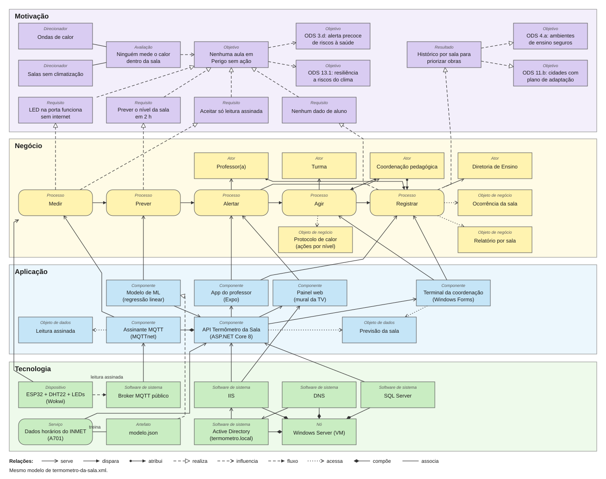

# Termômetro da Sala: documento descritivo da arquitetura

Global Solution 2026.2 (CitizenTech). Disciplina: Testing, Compliance & Quality Assurance, Arquitetura de Soluções baseada no TOGAF.

Equipe: Samuel Baecker - RM [preencher]

## Ficha da CitizenTech

| Campo | Conteúdo |
|---|---|
| Nome da CitizenTech | Termômetro da Sala |
| Cidade e bairro | São Paulo, [bairro da escola entrevistada] |
| Cidadão beneficiado | Professor(a) e turma de uma sala sem climatização. Quem opera o sistema é a coordenação pedagógica |
| Problema, em uma frase | Nas tardes quentes, a sala passa do limite seguro sem que ninguém meça, e a escola só reage quando alguém passa mal |
| Como funciona | Um sensor na porta da sala mede o calor e acende verde, amarelo ou vermelho. O sistema prevê o nível da sala para daqui a 2 h. A coordenação vê todas as salas, decide e registra a ação tomada. O professor acompanha pelo app e registra ocorrências com foto |
| Link do repositório | [preencher] |
| Indicador de impacto | Aulas no nível "Perigo" sem ação registrada (meta: zero) e minutos entre o alerta e a ação |
| ODS conectados | 3 (meta 3.d), 4 (meta 4.a), 11 (meta 11.b) e 13 (meta 13.1) |

## 1. Visão da arquitetura (Fase A do TOGAF)

Nas tardes quentes, ninguém sabe o quanto a sala de aula esquentou. A estação meteorológica mede a rua e o alerta público fala da cidade, mas nenhum dos dois diz que a sala 3 vai passar do limite às 14h. A escola só reage quando alguém passa mal.

O Termômetro da Sala mede cada sala, prevê o nível dela para daqui a 2 horas e faz a decisão chegar a quem pode agir: a coordenação. Cada ação fica registrada, e o histórico vira evidência para pedir climatização à Diretoria de Ensino.

**Objetivo da arquitetura:** nenhuma aula em Perigo sem ação.

**Escopo:** uma escola pública de São Paulo, com as salas sem climatização. A rede estadual aparece só como destino da evolução e como base da estimativa de impacto (seção 7).

**Fora do escopo:** controlar ventiladores ou ar-condicionado, guardar dado de aluno e substituir a decisão da coordenação. O sistema informa e registra, e quem decide é uma pessoa.

## 2. Público-alvo e partes interessadas

| Parte interessada | Papel | O que ganha |
|---|---|---|
| Turma | Beneficiária. Não usa o sistema e não é cadastrada | Aula com o calor sob controle |
| Professor(a) | Usa o app: acompanha a sala e registra ocorrências | Sabe o nível atual e o previsto, com a ação sugerida |
| Coordenação pedagógica | Opera o terminal: vê as salas, decide, registra a ação e revoga sensores | Um lugar só para decidir, antes de alguém passar mal |
| Famílias e comunidade escolar | Veem o painel web, só de leitura | Transparência sobre o nível das salas |
| Diretoria de Ensino / Seduc-SP | Recebe o relatório por sala | Dado para decidir onde climatizar primeiro |
| INMET | Fornece dados públicos | Não se aplica: é fonte de dados |

## 3. Requisitos

| Id | Requisito | Tipo | Onde aparece |
|---|---|---|---|
| R1 | Medir temperatura e umidade em cada sala | Funcional | ESP32 + DHT22 |
| R2 | Mostrar o nível na porta mesmo sem internet | Funcional | LED; o ESP32 calcula o nível no aparelho |
| R3 | Prever o nível da sala para daqui a 2 h | Funcional | Modelo + delta da sala, aplicados pela API |
| R4 | Mostrar nível, previsão e ação sugerida | Funcional | App, terminal e painel |
| R5 | Registrar ação e ocorrência com foto | Funcional | Terminal e app |
| R6 | Aceitar só leitura assinada, recusando forjada ou reenviada | Segurança | HMAC-SHA256 e ordem estrita do `medidoEm` |
| R7 | Não guardar nenhum dado de aluno | Privacidade | Ocorrência por sala, sem campo de aluno; foto sem pessoas |
| R8 | Nunca inventar dado | Qualidade | Sem leituras recentes, a tela mostra só a previsão da rua e o aviso |
| R9 | Recuperar sozinho de falha do serviço | Disponibilidade | Pool sempre ligado e recuperação do serviço no IIS |

Os níveis usam o índice de calor nas faixas da NOAA: abaixo de 27 °C é Normal, de 27 a 32 °C é Atenção, de 32 a 41 °C é Cuidado extremo e a partir de 41 °C é Perigo.

## 4. Diagrama de Arquitetura de Soluções

Os arquivos são `termometro-da-sala.xml` (modelo ArchiMate, formato Open Exchange 3.1) e `diagrama.svg` (a mesma visão como imagem). Para abrir o modelo no Archi: **File > Import > Open Exchange XML Model**. Depois, **File > Save** gera o arquivo nativo `.archimate`.

### 4.1 Motivação

Dois direcionadores explicam o problema: **ondas de calor** e **salas sem climatização**. A avaliação que os liga é que **ninguém mede o calor dentro da sala**. Daí sai o objetivo **"nenhuma aula em Perigo sem ação"**, sustentado por quatro requisitos: LED sem internet, previsão em 2 h, leitura assinada e nenhum dado de aluno.

| ODS e meta | Contribuição | Ligação no modelo |
|---|---|---|
| 3.d, alerta precoce de riscos à saúde | O nível previsto chega 2 h antes, com ação sugerida | Influenciado pelo objetivo |
| 13.1, resiliência a riscos do clima | A escola ganha um protocolo de calor e registra se ele foi cumprido | Influenciado pelo objetivo |
| 4.a, ambientes de aprendizagem seguros | Mede sala por sala e mostra quais precisam de obra primeiro | Realizado pelo histórico por sala |
| 11.b, planos de adaptação das cidades | O relatório dá à Diretoria de Ensino um dado que ela não tem hoje | Realizado pelo histórico por sala |

### 4.2 Negócio

O processo tem cinco passos em sequência:

| Processo | O que acontece | Quem participa |
|---|---|---|
| Medir | O sensor lê a sala a cada 10 s e acende o LED | ESP32 |
| Prever | Rua prevista + delta da sala = nível em 2 h | API e modelo |
| Alertar | O nível aparece no app, no terminal e no painel | Serve professor(a) e coordenação |
| Agir | A coordenação decide com base no protocolo de calor (água, pausa, troca de sala, adiar Educação Física, tirar a turma) | Coordenação, em favor da turma |
| Registrar | Ação e ocorrência ficam gravadas e alimentam o relatório por sala | Coordenação e professor(a); serve a Diretoria de Ensino |

A previsão é sempre um apoio. O registro é o que permite medir o indicador de impacto: aulas em Perigo sem ação e minutos entre o alerta e a ação.

### 4.3 Aplicação

| Componente | Responsabilidade | Tecnologia |
|---|---|---|
| API | Valida e grava leituras, calcula o índice e a previsão, guarda ocorrências e ações | ASP.NET Core 8, EF Core |
| Assinante MQTT | Parte da API. Recebe as leituras do broker e aplica a mesma checagem do `POST /leituras` | MQTTnet |
| Modelo de ML | Prevê o índice de calor da rua em 2 h | Árvore de decisão treinada em Python (MAE 0,958 °C no teste 2025), aplicada pela API em C# a partir do modelo.json |
| App do professor | Salas, detalhe com previsão e ocorrência com foto | Expo + TypeScript |
| Terminal da coordenação | Salas, registro de ação, cadastro e revogação de sensor | Windows Forms |
| Painel web | Mural de só leitura para a TV da escola | Página estática no `wwwroot` da API |

**Resultado do modelo.** Dados reais do INMET (A701), treino em 2022–2023, validação em 2024 e teste em 2025. A árvore (profundidade 8, folha 30) foi a escolhida pelo menor MAE na validação. No teste, o MAE foi de 0,958 °C contra 1,442 °C da regra "daqui a 2 h igual a agora". O F1 macro dos níveis foi 0,660 contra 0,667 do baseline: o menor erro médio não melhorou o alerta de cuidado extremo. Detalhes em `ml/README.md`.

**A previsão da sala** é a rua prevista somada ao delta da sala, que é a média da diferença entre sala e rua nas últimas 3 h, com no mínimo 3 leituras. Exemplo: rua prevista em 34 + delta 4 = 38, Cuidado extremo. **Limitação:** o delta assume que a diferença se mantém nas próximas 2 h, e no fim da tarde tende a superestimar.

### 4.4 Tecnologia

| Elemento | Papel |
|---|---|
| ESP32 + DHT22 + LEDs (Wokwi) | Mede, acende o LED sem depender da rede e publica a leitura assinada |
| Broker MQTT público | Entrega as leituras à API. A conexão sai da VM para fora, sem abrir porta |
| Windows Server (VM) | Hospeda IIS, Active Directory, DNS e SQL Server |
| IIS | Publica a API e o painel, com pool sempre ligado |
| Active Directory e DNS | Domínio `termometro.local`, GPO e auditoria. O AD depende do DNS |
| SQL Server | Guarda salas, dispositivos, leituras, previsões, ocorrências e ações |
| INMET (A701) | Dados horários públicos: treinam o modelo e, no modo demonstração, reproduzem a rua de um dia quente |
| `modelo.json` | Artefato com os coeficientes, carregado pela API |

## 5. Estado da implementação

Situação deste ramo em 05/11/2026.

| Parte | Situação |
|---|---|
| Modelo de ML | Notebook executado. Árvore (profundidade 8, folha 30) escolhida pelo MAE de validação. No teste de 2025, MAE 0,958 °C (`ml/modelo.json`) |
| App do professor | Quatro telas em Expo. O modo simulado vem ligado; com `EXPO_PUBLIC_API_MOCK=0` o app chama a API |
| API | Rotas de salas, leituras, previsão, ocorrências, ações, revogação e demonstração. Painel em `wwwroot`. 27 testes: 17 `[Fact]` e 10 casos `[InlineData]` |
| Terminal da coordenação | Windows Forms: salas, ação, cadastro, revogação e CSV. Se a API cai, usa a reserva local |
| ESP32 | `sketch.ino`, `diagram.json` e `libraries.txt` para o Wokwi. O `esp32/README.md` descreve a simulação e o vetor de HMAC |
| Windows Server | Roteiro em `infra/README.md` e scripts `01-rede.ps1` a `09-teste-de-falha.ps1` |
| Relatório de riscos | `seguranca/RELATORIO-RISCOS.md`. O trecho "estado observado" desse arquivo ainda descreve uma API anterior; o código de hoje é o desta tabela |

O que é real: os dados do INMET e a pessoa entrevistada. O que é simulado: as leituras do sensor no Wokwi, as leituras semeadas no modo demonstração, as ocorrências e o dia reproduzido da rua. Na tela, a etiqueta DEMONSTRAÇÃO marca a previsão que usa leitura simulada.

## 6. Decisões de arquitetura

**Por que MQTT.** O ESP32 no Wokwi sai para a internet pública, mas não alcança uma VM local. Com um broker no meio, os dois lados só fazem conexão de saída, e o servidor não precisa de porta aberta. O tópico é público de propósito, porque a segurança vem da assinatura. O custo é depender de um broker externo. Por isso existe o `POST /leituras`, com a mesma checagem, e o LED da porta segue funcionando sem rede.

**Por que o modelo em JSON.** Rodar Python dentro do IIS traria um segundo runtime só para uma conta. O notebook exporta a árvore escolhida em `modelo.json` (`tipo: arvore`), e a API em C# percorre a árvore. Dá para auditar o arquivo sem o notebook. O custo é trocar o arquivo sempre que o modelo for treinado de novo.

**Por que nenhum dado de aluno.** Os alunos são menores de idade, e dado que não existe não vaza. A unidade do sistema é a sala. O formulário pergunta "o que aconteceu", e não "com quem". A foto é da sala ou do equipamento, sem pessoas, e sai sem EXIF, para não levar localização. O painel público não mostra fotos. O custo é não acompanhar a saúde de cada aluno, o que nunca foi objetivo do sistema, e a identificação do professor fica só no aparelho dele.

**Por que HMAC por dispositivo.** Num tópico público, um token dentro da mensagem seria copiado por quem assinasse o tópico. Só a assinatura viaja, e a ordem estrita do `medidoEm` impede o reenvio. Como cada dispositivo tem seu segredo, vazar um não permite assinar por outro.

**Por que o nível é calculado duas vezes.** O ESP32 calcula para o LED funcionar sem internet. A API recalcula, e o valor dela é o oficial.

## 7. Público-alvo e estimativa de impacto

**Legenda:** **[MEDIDO]** é um número contado neste repositório, sobre dados públicos. **[PREMISSA]** é um valor assumido para a conta. **[A CONFERIR]** indica que o valor ou o link ainda não foi confirmado na fonte oficial.

### 7.1 Quantas pessoas o problema alcança

| Letra | Dado | Valor | Situação | Fonte |
|---|---|---|---|---|
| A | Alunos da rede estadual de SP | cerca de 3,5 milhões | Valor aproximado publicado pela Seduc-SP. Não é a matrícula inteira do Censo | Referência 1. Acesso em 05/11/2026 |
| A' | O mesmo contingente, noutra nota da Seduc | 3 milhões de estudantes | Frase lida na notícia de 20/12/2024. Arredondamento diferente do da página institucional | Referência 9. Acesso em 05/11/2026 |
| B | Alunos por turma | 35 | **[PREMISSA]** O indicador do INEP existe; a planilha do ano não abriu nesta consulta | Referência 4. Acesso em 05/11/2026 |
| C | Salas da rede estadual de SP sem climatização | 67.468 de 70.346 (95,91 %) | Tabulação dos microdados do Censo 2024. Não é um total publicado pelo Inep | Referências 10 e 11. Acesso em 05/11/2026 |

O item de climatização existe: o caderno de conceitos do Censo descreve sala climatizada como a que tem ar-condicionado, aquecedor ou climatizador em funcionamento (referência 11). O código da coluna no dicionário xlsx não foi reaberto nesta data. A Seduc, em notícia de 13/02/2025, informa 595 escolas com todas as salas climatizadas (referência 12). Isso é escola, não sala, e não entra no lugar de C.

A conta de pessoas usa as matrículas e a parcela de salas. **[PREMISSA]** a parcela de salas vale para os alunos: o microdado não foi ponderado matrícula a matrícula. Com a base de 3.500.000:

3.500.000 × 67.468 / 70.346 = 3.356.807,8, isto é **3.356.808** alunos, cerca de **3,36 milhões**.

Com a base de 3 milhões da notícia de 20/12/2024, a mesma conta dá 2.877.263,8, isto é 2.877.264 alunos, cerca de 2,88 milhões. O pitch usa os 3,36 milhões e cita as duas bases.

**Turmas**, só com a premissa B: 3.500.000 ÷ 35 = **100.000 turmas**. A mesma parcela dá cerca de 95.900 turmas sem climatização. Contar 67.468 salas × 35 deixaria de fora quem estuda noutro turno.

**O piloto:** uma escola com [nº de salas da escola entrevistada] salas × 35 alunos × [nº de turnos] = [alunos por dia na escola].

Esta seção estima quantas pessoas estão expostas ao problema, e não quantas seriam protegidas. A redução real só pode ser medida num piloto, pelo indicador "aulas em Perigo sem ação".

### 7.2 Com que frequência faz calor em São Paulo

Contagem feita em `ml/dados/inmet_a701.csv`, com os dados horários da estação A701 (Mirante de Santana) de 2022 a 2025, 34.786 horas válidas. Todos os números da tabela são **[MEDIDO]**, exceto a última coluna.

| Ano | Horas com a rua a 32 °C ou mais | Horas a 34 °C ou mais | Dias a 34 °C ou mais | Desses, em dia útil de aula [PREMISSA] |
|---|---:|---:|---:|---:|
| 2022 | 29 | 0 | 0 | 0 |
| 2023 | 136 | 45 | 10 | 4 |
| 2024 | 124 | 15 | 5 | 5 |
| 2025 | 97 | 15 | 6 | 1 |
| **Total** | **386** | **75** | **21** | **10** |

Episódios de três dias seguidos ou mais a 34 °C: 11 a 15/11/2023, 24 a 26/09/2024 e 25 a 28/12/2025.

Pelo índice de calor, a rua ficou em Normal por 30.792 horas, em Atenção por 3.745 e em Cuidado extremo por 249, ou 0,7 % das horas. Perigo nunca apareceu na rua. É exatamente aí que a sala importa: o que falta saber é quanto a sala passa da rua, e essa medida hoje não existe. O delta de +4 °C usado nos exemplos é **[PREMISSA]**, e não uma medição.

**Limites desta contagem:**
- 34 °C é um corte deste trabalho, e não a definição oficial de onda de calor. O INMET adota o critério da OMM: máximas diárias pelo menos 5 °C acima da média mensal, por no mínimo cinco dias consecutivos, numa área ampla (referência 5, acesso em 05/11/2026). Nesta consulta não apareceu uma série do INMET com a contagem anual de ondas só na capital em 2022–2025. Os 21 dias da tabela não são essa contagem. Aplicar a definição à série A701 exigiria a normal climatológica de 30 anos, que não foi usada aqui.
- Os valores são os de cada hora cheia, e não a máxima do dia. O pico real pode ser maior.
- 278 horas do período (0,8 %) não têm leitura válida.
- A estação representa a capital, e não o estado. Por isso a frequência não foi multiplicada pelas turmas da rede.
- "Dia útil de aula" é premissa: segunda a sexta, de fevereiro a meados de dezembro, sem feriados, sem conferir o calendário escolar de cada ano.

### 7.3 Referências

| Nº | Fonte | Link | Situação |
|---|---|---|---|
| 1 | Seduc-SP, a secretaria: aproximadamente 3,5 milhões de alunos e 5,3 mil escolas | https://www.educacao.sp.gov.br/institucional/a-secretaria/ | Acesso em 05/11/2026. A página exigiu JavaScript; o número está no texto público indexado dessa URL |
| 2 | INEP, Censo Escolar | https://www.gov.br/inep/pt-br/areas-de-atuacao/pesquisas-estatisticas-e-indicadores/censo-escolar | Acesso em 05/11/2026. Portal do levantamento; a matrícula inteira de SP não foi lida numa tabela do Inep |
| 3 | INEP, microdados do Censo Escolar | https://www.gov.br/inep/pt-br/acesso-a-informacao/dados-abertos/microdados/censo-escolar | Acesso em 05/11/2026. Os arquivos não foram reprocessados neste repositório |
| 4 | INEP, média de alunos por turma. Página atualizada em 03/07/2026 | https://www.gov.br/inep/pt-br/acesso-a-informacao/dados-abertos/indicadores-educacionais/media-de-alunos-por-turma | Acesso em 05/11/2026. Planilha não aberta; B continua premissa |
| 5 | INMET, definição de onda de calor (critério da OMM), notícia de 05/03/2025 | https://portal.inmet.gov.br/noticias/onda-de-calor-em-areas-do-centro-sul-do-pais-persiste-ate-sabado-8 | Acesso em 05/11/2026 |
| 6 | INMET, dados históricos (A701, 2022–2025) | https://portal.inmet.gov.br/dadoshistoricos | Dados contidos no repositório. Contagem feita em 04/11/2026 |
| 7 | ONU Brasil, texto das metas dos ODS | https://brasil.un.org/pt-br/sdgs | [A CONFERIR] Acesso em: [data] |
| 8 | NOAA, índice de calor | https://www.wpc.ncep.noaa.gov/html/heatindex_equation.shtml | [A CONFERIR] Acesso em: [data] |
| 9 | Seduc-SP, notícia de 20/12/2024: mais de 5 mil escolas e 3 milhões de estudantes | https://www.educacao.sp.gov.br/educacao-de-sao-paulo-anuncia-maior-investimento-da-historia-para-2025/ | Acesso em 05/11/2026. Frase lida no HTML da página |
| 10 | CIEPP, Almada, J. *Saunas de aula*, 2. ed., dez/2025. Censo 2024: SP estadual, 70.346 salas e 2.878 climatizadas (4,09 %) | https://www.ciepp.org/_files/ugd/25b93e_3d80dd7bd40241f199473a55747e208c.pdf | Acesso em 05/11/2026 |
| 11 | INEP, caderno de conceitos do Censo Escolar 2026: salas de aula climatizadas | https://download.inep.gov.br/publicacoes/institucionais/estatisticas_e_indicadores/cadernos_de_conceitos_2026.pdf | Acesso em 05/11/2026 |
| 12 | Seduc-SP, notícia de 13/02/2025: 595 escolas estaduais climatizadas | https://www.educacao.sp.gov.br/em-dois-anos-governo-de-sp-aumenta-em-mais-de-60-vezes-o-numero-de-escolas-climatizadas/ | Acesso em 05/11/2026. Unidade é escola, não sala |

## 8. Riscos

| Risco | Impacto | Tratamento |
|---|---|---|
| Quem tem o link do Wokwi vê o segredo de demonstração e forja leituras daquele dispositivo | Médio | Segredo por dispositivo e revogável. A decisão final é da coordenação, e o LED mede sozinho |
| Broker público fora do ar ou com o tópico inundado | Médio | `POST /leituras` como reserva. A sala aparece como "sem leitura recente" e o LED segue funcionando |
| Previsão errada no fim da tarde, porque o delta superestima | Baixo | Limitação declarada. O erro é para o lado da cautela, e a leitura ao vivo prevalece |
| Sensor na porta não representar o meio da sala | Médio | Calibrar com termo-higrômetro no piloto |
| O modelo não prevê acima do que viu: a rua nunca passou de Cuidado extremo nos dados | Médio | O Perigo da sala vem da medição e do delta. Treinar de novo a cada ano com dados novos |
| Foto de ocorrência com rosto de aluno | Alto | Aviso na tela, sem EXIF, foto fora do painel e acesso por id, nunca por caminho |
| Assinante MQTT parar com o pool ocioso | Alto | Pool sempre ligado e recuperação automática, testados em Operating Systems |
| Coordenação sem tempo de olhar o terminal | Médio | Indicador de minutos entre alerta e ação, para mostrar o gargalo. Notificação como evolução |

## 9. Evolução

| Horizonte | O que muda |
|---|---|
| Piloto em uma escola | Termo-higrômetro por uma semana, medindo o delta real. Sensor físico. Segredo gravado na memória do ESP32 |
| Mais de uma escola | Broker próprio com usuário, senha e TLS. Busca do INMET ao vivo. Notificação no app. Login do terminal com o AD |
| Rede de ensino | Relatório consolidado para a Diretoria de Ensino decidir onde climatizar primeiro. Novo treino anual do modelo. Modelo por sala, depois de haver histórico real |

Como o código usa a entidade neutra `Ambiente`, a mesma solução pode atender outros lugares quentes trocando dados, e não código.
