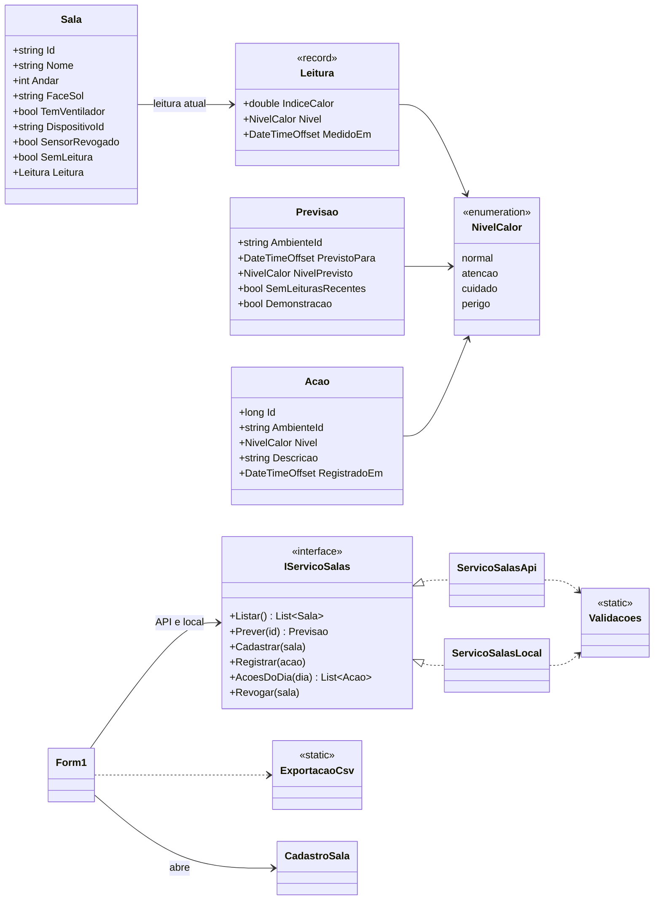

# Termômetro da Sala — desktop da coordenação

## Ficha da CitizenTech

| Campo | Conteúdo |
|---|---|
| Nome da CitizenTech | Termômetro da Sala |
| Cidade e bairro | São Paulo, [bairro da escola entrevistada] |
| Cidadão beneficiado | Professor(a) e turma de uma sala sem climatização. Quem opera o sistema é a coordenação pedagógica |
| Problema, em uma frase | Nas tardes quentes, a sala passa do limite seguro sem que ninguém meça, e a escola só reage quando alguém passa mal |
| Como funciona | Um sensor na porta da sala mede o calor e acende verde, amarelo ou vermelho. O sistema prevê o nível da sala para daqui a 2 h. A coordenação vê todas as salas, decide e registra a ação tomada. O professor acompanha pelo app e registra ocorrências com foto |
| O que cada parte faz | ESP32 (Wokwi) mede e envia a leitura assinada; API (ASP.NET Core + SQL Server) valida, grava e prevê; modelo (Python, dados do INMET) prevê o índice de calor da rua; app (React Native + Expo) para o professor; desktop (Windows Forms) para a coordenação; Windows Server hospeda a API e o painel web no IIS |
| Link do repositório | https://github.com/sbaecker2005/termometro-da-sala |
| Indicador de impacto | Aulas no nível "Perigo" sem ação registrada (meta: zero) e minutos entre o alerta e a ação |
| ODS conectados | 3 (meta 3.d), 4 (meta 4.a), 11 (meta 11.b) e 13 (meta 13.1) |

## Problema e pessoa real beneficiada

Nas tardes quentes, a coordenação não sabe quais salas passaram do limite seguro de calor. O terminal mostra o nível de cada sala, a previsão para as próximas 2 horas e as ações tomadas no dia, e permite revogar um sensor suspeito.

Pessoa real: **[preencher nome, cargo, escola e data da entrevista]**. Relato: [preencher 2 ou 3 frases do que a pessoa contou]. A entrevista não coleta dados de alunos.

Equipe: **Termômetro da Sala**. Integrante: Samuel Baecker — RM [preencher]. Demais integrantes: [preencher, se houver].

## Abrir no Visual Studio 2022

1. Instale o Visual Studio 2022 (17.8 ou mais novo) com a carga de trabalho **Desenvolvimento para desktop com .NET**, que traz o .NET 8 e o Windows Forms.
2. Abra `TermometroDaSala.Desktop.sln`, nesta pasta.
3. No **Gerenciador de Soluções**, clique com o botão direito em `TermometroDaSala.Desktop` e escolha **Definir como Projeto de Inicialização**.
4. Aperte **F5**. Os testes ficam em **Teste > Gerenciador de Testes > Executar Todos os Testes**.

## Executar pela linha de comando (Windows e SDK .NET 8)

Dentro da pasta `desktop`, no PowerShell:

```powershell
dotnet build TermometroDaSala.Desktop.sln
dotnet run --project TermometroDaSala.Desktop
```

A primeira compilação baixa do NuGet os pacotes de teste (xUnit). O executável não usa pacote externo.

Configure `ApiUrl` em `TermometroDaSala.Desktop/appsettings.json` e compile novamente para copiar a configuração para a saída.
O padrão é `http://localhost:5080/`. Não coloque credenciais nesse arquivo. O cliente usa HttpClient com timeout de 5 segundos.

## Uso

- **Atualizar** recarrega salas, previsões e ações; ocorre também a cada 30 segundos. O nível sempre tem texto e cor. Avisos identificam leitura antiga, previsão da rua e DEMONSTRAÇÃO.
- **Cadastrar sala** exige `sala-NN`, nome, andar entre 0 e 20 e face norte/sul/leste/oeste. Há opção de ventilador e mensagens por campo via ErrorProvider.
- Selecione uma sala, escolha o nível e descreva a ação (5–300 caracteres), depois use **Registrar ação**. A hora aparece no horário de São Paulo.
- **Exportar dia** gera CSV UTF-8 com BOM, separador ponto e vírgula, aspas escapadas e proteção contra fórmulas de planilha. O dia usa UTC−3, independentemente do fuso do computador.
- **Revogar sensor** pede confirmação, com "Não" como padrão. Na API, depende do `dispositivoId` que vem no cadastro da sala. Nunca é deduzido a partir do ID da sala.
- Teclado: Tab percorre os controles; Alt+A atualiza, Alt+C cadastra, Alt+V revoga, Alt+E exporta, Alt+N escolhe nível, Alt+D foca descrição e Alt+R registra. No cadastro, Enter salva e Esc cancela.

### Legenda de cores

O nível aparece sempre por texto e cor, para não depender só da cor.

| Texto na grade | Cor da célula | Significado |
|---|---|---|
| Normal | verde claro | Índice de calor seguro |
| Atenção | amarelo | Calor subindo: acompanhar a sala |
| Cuidado extremo | laranja claro | Agir: ventilar, oferecer água, pausar atividade física |
| Perigo | vermelho claro | Tirar a turma da sala |
| Sem leitura / Sem previsão | branco | A sala ainda não tem medição do sensor, ou a previsão não veio |

### Telas

[preencher: prints da grade com salas coloridas, do cadastro com erro por campo, de uma ação registrada, do CSV aberto no Excel, da confirmação de revogação e do aviso MODO LOCAL]

## API e modo local

O cliente segue os contratos de `api/TermometroDaSala.Api/Contratos`. Níveis JSON: `normal`, `atencao`, `cuidado`, `perigo` (texto exibido: Normal, Atenção, Cuidado extremo, Perigo).

| Rota | Entrada / resposta |
|---|---|
| `GET /ambientes` | Array de `{id, nome, andar, faceSol, nivelAtual, indiceAtual, ultimaLeituraEm, semLeitura, temVentilador, dispositivoId}` |
| `GET /ambientes/{id}/previsao` | `{ambienteId, previstoPara, indiceRuaPrevisto, deltaSala, indiceSalaPrevisto, nivelPrevisto, semLeiturasRecentes, demonstracao, ruaDisponivel}`; 404 sala inexistente; 503 `{motivo: "sem-dados-para-prever"}` |
| `POST /ambientes` | `{id, nome, andar, faceSol, temVentilador, tipo: "sala"}` |
| `POST /acoes` | `{ambienteId, nivel, descricao}`; a API grava a hora do servidor e devolve `{id}` numérico |
| `GET /acoes?dia=yyyy-MM-dd` | Array de `{id, ambienteId, nivel, descricao, registradoEm}`, com `id` numérico; dia de São Paulo |
| `POST /dispositivos/{dispositivoId}/revogar` | Corpo `{}`; sucesso HTTP 2xx |

Sala que nunca foi medida chega com `semLeitura: true`, `ultimaLeituraEm: ""`, `nivelAtual: "normal"` e `indiceAtual: 0`. O terminal mostra **Sem leitura**, e não Normal.
Sem `dispositivoId`, a revogação remota apresenta uma mensagem e não envia uma requisição para um sensor presumido.

Falha de conexão, timeout ou HTTP 5xx ao listar salas ativa o aviso **MODO LOCAL**.
HTTP 4xx e JSON inválido são erros apresentados ao operador. Uma falha isolada de previsão aparece na linha da sala. O 503 `sem-dados-para-prever` não é falha: a linha mostra "Sem previsão" e o aviso "Sem dados para prever". O 404 aparece como "Sala não encontrada na API". Com `ruaDisponivel: false`, o aviso diz que a previsão usa a última leitura válida da sala.
Gravações não são repetidas automaticamente em outro serviço: após falha de conexão, confira se o servidor recebeu a operação antes de tentar novamente.

O arquivo local é `%LOCALAPPDATA%/TermometroDaSala/dados.json`, separado dos dados da API.
Começa vazio: cadastre salas para demonstrar sem API. As ações (numeradas em sequência) e a marcação de revogação persistem após fechar o programa.
Sem sensor/API, os níveis aparecem como **Sem leitura / Sem previsão**; não há medição ou previsão artificial.
Uma revogação local **não bloqueia o sensor no servidor**. A cada atualização o cliente tenta novamente a API e sinaliza a troca de origem.
Não há sincronização automática: cadastros e ações locais continuam no arquivo local quando a API retorna.
Use uma instância por computador para evitar gravações concorrentes no arquivo local.
Arquivo inválido gera erro e é preservado; faça uma cópia antes de corrigir ou recuperar o JSON.

As leituras do Wokwi e do modo demonstração são simuladas. O desktop apenas exibe o marcador recebido da API.
Não calcula delta térmico: sem leituras recentes, exibe a previsão da rua com aviso, conforme a API.
O delta pressupõe que a diferença sala–rua das últimas 3 h persiste por 2 h; pode superestimar ao fim da tarde.

## Chave da coordenação

As rotas de escrita da API (cadastro de sala, ação, revogação) exigem a chave da coordenação. Defina a variável de ambiente `TERMOMETRO_CHAVE_COORDENACAO` com o mesmo valor configurado na API antes de abrir o terminal; sem ela, essas ações voltam 401 e o terminal avisa.

## Diagrama de classes



`ServicoSalasApi` fala com a API por HTTP e `ServicoSalasLocal` grava no arquivo JSON. A tela usa só a interface `IServicoSalas`, então troca de origem sem mudar o resto do código.

## Tecnologias e verificação

C# / .NET 8, Windows Forms, System.Text.Json, HttpClient e arquivo JSON. Nenhum pacote externo no executável. Testes com xUnit 2.5.3 e Microsoft.NET.Test.Sdk 17.8.0.

```powershell
dotnet test TermometroDaSala.Desktop.sln
dotnet run --project TermometroDaSala.Desktop -- --autoteste
```

O autoteste não depende de pacote e retorna 0 em sucesso e 1 em falha. Os quatro casos verificam limites dos campos, CSV/relógio, persistência/arquivo inválido e o contrato HTTP com um handler em memória, sem rede.
As respostas usadas no teste de contrato são as que a API devolve: sala com leitura, sala sem leitura (`ultimaLeituraEm: ""`), previsão da rua, previsão sem a rua (`ruaDisponivel: false`), 503 `sem-dados-para-prever`, 503 sem esse motivo, 404 e ação com `id` numérico.

## Versões

O projeto segue versionamento semântico. O histórico completo está no [CHANGELOG.md](CHANGELOG.md).

| Versão | Data | Resumo |
|---|---|---|
| `v0.2.0` | 2026-11-05 | Contrato com a API real (sala sem leitura e id numérico da ação), solução do Visual Studio e README |
| `v0.1.0` | 2026-11-04 | Primeira versão do terminal da coordenação |

Pull request da versão: [preencher link do PR]. Tags: [v0.1.0](https://github.com/sbaecker2005/termometro-da-sala/releases/tag/v0.1.0) e [v0.2.0](https://github.com/sbaecker2005/termometro-da-sala/releases/tag/v0.2.0).

## Entrega

ZIP desta pasta sem `bin/` e `obj/`, com o [integrantes.txt](integrantes.txt) (RM, nome completo e link do repositório).
