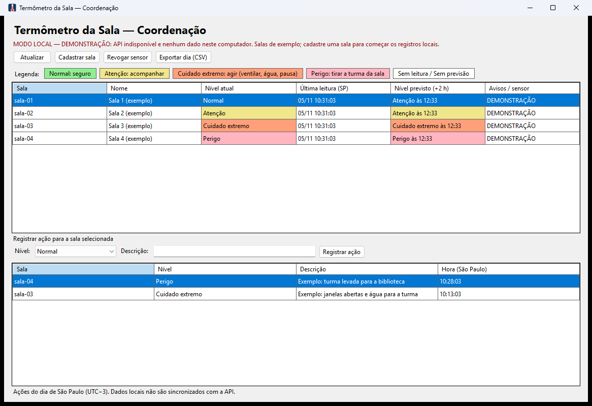
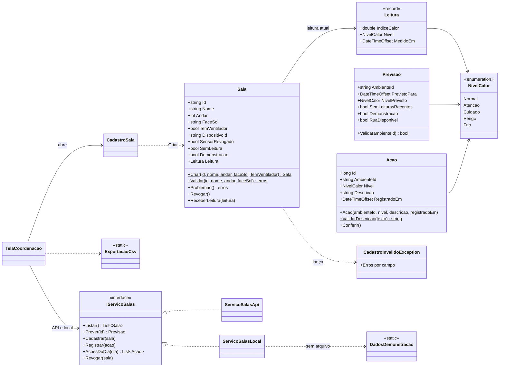

# Termômetro da Sala — desktop da coordenação

O mesmo sensor avisa calor no verão (escolas) e frio no inverno (dormitórios e abrigos).

## Ficha da CitizenTech

| Campo | Conteúdo |
|---|---|
| Nome da CitizenTech | Termômetro da Sala |
| Cidade e bairro | São Paulo, bairro da escola [a confirmar] |
| Cidadão beneficiado | Professor(a) e turma de uma sala sem climatização. Quem opera o sistema é a coordenação pedagógica |
| Problema, em uma frase | Nas tardes quentes, a sala passa do limite seguro sem que ninguém meça, e a escola só reage quando alguém passa mal |
| Como funciona | Um sensor na porta da sala mede o calor e acende verde, amarelo ou vermelho. O sistema prevê o nível da sala para daqui a 2 h. A coordenação vê todas as salas, decide e registra a ação tomada. O professor acompanha pelo app e registra ocorrências com foto |
| O que cada parte faz | ESP32 (Wokwi) mede e envia a leitura assinada; API (ASP.NET Core + SQL Server) valida, grava e prevê; modelo (Python, dados do INMET) prevê o índice de calor da rua; app (React Native + Expo) para o professor; desktop (Windows Forms) para a coordenação; Windows Server hospeda a API e o painel web no IIS |
| Link do repositório | https://github.com/sbaecker2005/termometro-da-sala |
| Indicador de impacto | Aulas no nível "Perigo" sem ação registrada (meta: zero) e minutos entre o alerta e a ação |
| ODS conectados | 3 (meta 3.d), 4 (meta 4.a), 11 (meta 11.b) e 13 (meta 13.1) |

## Problema e pessoa real beneficiada

Nas tardes quentes, a coordenação não sabe quais salas passaram do limite seguro de calor. O terminal mostra o nível de cada sala, a previsão para as próximas 2 horas e as ações tomadas no dia, e permite revogar um sensor suspeito.

Pessoa real: **Monalisa Daniela Pereira Amaral, coordenadora do CRAS Santo Amaro (São Paulo)**. Data da entrevista: **07/11/2026**, por escrito, com autorização para citar o nome e as frases. O CRAS entra como referência de ambiente público; a escola continua sendo o cenário principal.

Relato: No CRAS Santo Amaro, em São Paulo, passam no mínimo 150 pessoas por dia, porque ali também funciona um posto do Cadastro Único. A sala dos técnicos recebe sol à tarde, e o calor pesa de janeiro a março; a unidade conta só com janelas e ventiladores e nunca teve climatização, por limitação orçamentária. A coordenadora gostaria de receber o aviso no celular, para ligar ventiladores, abrir janelas e providenciar água gelada e leques, e de ter o histórico de temperatura para levar à Supervisão de Assistência Social, junto com o pedido de manutenção que já fez.

A entrevista não coleta dados de alunos. Os números do CRAS não substituem os da escola do piloto, ainda [a confirmar].

Equipe: **Termômetro da Sala**. Integrante: Samuel Baecker — RM [preencher]. Demais integrantes: [preencher, se houver].

## Abrir no Visual Studio 2022

1. Instale o Visual Studio 2022 (17.8 ou mais novo) com a carga de trabalho **Desenvolvimento para desktop com .NET**, que traz o .NET 8 e o Windows Forms.
2. Abra `TermometroDaSala.Desktop.sln`, nesta pasta.
3. No **Gerenciador de Soluções**, clique com o botão direito em `TermometroDaSala.Desktop` e escolha **Definir como Projeto de Inicialização**.
4. Aperte **F5**. Os testes ficam em **Teste > Gerenciador de Testes > Executar Todos os Testes**.
5. Para ver o layout no Designer, dê dois cliques em `Telas/TelaCoordenacao.cs` (tela principal) ou em `Telas/CadastroSala.cs` (cadastro). Os controles ficam no `.Designer.cs` de cada tela; o código ao lado só carrega dados e trata os cliques.

## Executar pela linha de comando (Windows e SDK .NET 8)

Dentro da pasta `desktop`, no PowerShell:

```powershell
dotnet build TermometroDaSala.Desktop.sln
dotnet run --project TermometroDaSala.Desktop
```

A primeira compilação baixa do NuGet os pacotes de teste (xUnit). O executável não usa pacote externo.

Configure `ApiUrl` em `TermometroDaSala.Desktop/appsettings.json` e compile novamente para copiar a configuração para a saída.
O padrão é `http://localhost:5080/`. Não coloque credenciais nesse arquivo. O cliente usa HttpClient com timeout de 5 segundos.

## Uso

- No topo ficam o nome do sistema, a situação da conexão (API, MODO LOCAL ou DEMONSTRAÇÃO) e a legenda de cores. A janela e o executável usam o ícone do termômetro (`termometro.ico`).
- **Atualizar** recarrega salas, previsões e ações; ocorre também a cada 30 segundos. O nível sempre tem texto e cor. Avisos identificam leitura antiga, previsão da rua e DEMONSTRAÇÃO.
- **Cadastrar sala** exige `sala-NN`, nome, andar entre 0 e 20 e face norte/sul/leste/oeste. Há opção de ventilador e mensagens por campo via ErrorProvider.
- Selecione uma sala, escolha o nível e descreva a ação (5–300 caracteres), depois use **Registrar ação**. A hora aparece no horário de São Paulo.
- **Exportar dia** gera CSV UTF-8 com BOM, separador ponto e vírgula, aspas escapadas e proteção contra fórmulas de planilha. O dia usa UTC−3, independentemente do fuso do computador.
- **Revogar sensor** pede confirmação, com "Não" como padrão. Na API, depende do `dispositivoId` que vem no cadastro da sala. Nunca é deduzido a partir do ID da sala.
- Teclado: Tab percorre os controles; Alt+A atualiza, Alt+C cadastra, Alt+V revoga, Alt+E exporta, Alt+N escolhe nível, Alt+D foca descrição e Alt+R registra. No cadastro, Enter salva e Esc cancela.

### Legenda de cores

O nível aparece sempre por texto e cor, para não depender só da cor. A mesma legenda fica na tela, logo acima da grade, e o autoteste confere que as cores dela são as da grade.

| Texto na grade | Cor da célula | Significado |
|---|---|---|
| Frio | azul claro | Agasalhar e oferecer cobertor |
| Normal | verde claro | Índice de calor seguro |
| Atenção | amarelo | Calor subindo: acompanhar a sala |
| Cuidado extremo | laranja claro | Agir: ventilar, oferecer água, pausar atividade física |
| Perigo | vermelho claro | Tirar a turma da sala |
| Sem leitura / Sem previsão | branco | A sala ainda não tem medição do sensor, ou a previsão não veio |

### Telas

Tela principal sem API e sem dados neste computador (modo DEMONSTRAÇÃO, uma sala de exemplo por nível):



[preencher: prints com a API ligada: grade com salas coloridas, cadastro com erro por campo, ação registrada, CSV aberto no Excel, confirmação de revogação e aviso MODO LOCAL]

## API e modo local

O cliente segue os contratos de `api/TermometroDaSala.Api/Contratos`. Níveis JSON: `frio`, `normal`, `atencao`, `cuidado`, `perigo` (texto exibido: Frio, Normal, Atenção, Cuidado extremo, Perigo).

| Rota | Entrada / resposta |
|---|---|
| `GET /ambientes` | Array de `{id, nome, andar, faceSol, nivelAtual, indiceAtual, ultimaLeituraEm, semLeitura, temVentilador, dispositivoId}` |
| `GET /ambientes/{id}/previsao` | `{ambienteId, previstoPara, indiceRuaPrevisto, deltaSala, indiceSalaPrevisto, nivelPrevisto, semLeiturasRecentes, demonstracao, ruaDisponivel}`; 404 sala inexistente; 503 `{motivo: "sem-dados-para-prever"}` |
| `POST /ambientes` | `{id, nome, andar, faceSol, temVentilador, tipo: "sala"}` |
| `POST /acoes` | `{ambienteId, nivel, descricao}`; a API grava a hora do servidor e devolve `{id}` numérico |
| `GET /acoes?dia=yyyy-MM-dd` | Array de `{id, ambienteId, nivel, descricao, registradoEm}`, com `id` numérico; dia de São Paulo |
| `POST /dispositivos/{dispositivoId}/revogar` | Corpo `{}`; sucesso HTTP 2xx |

Sala que nunca foi medida chega com `semLeitura: true`, `ultimaLeituraEm: ""`, `nivelAtual: "normal"` e `indiceAtual: 0`. O terminal mostra **Sem leitura**, e não Normal.
Sem `dispositivoId`, a revogação remota apresenta uma mensagem e não envia uma requisição para um sensor presumido.

Falha de conexão, timeout ou HTTP 5xx ao listar salas ativa o aviso **MODO LOCAL**.
HTTP 4xx e JSON inválido são erros apresentados ao operador. Uma falha isolada de previsão aparece na linha da sala. O 503 `sem-dados-para-prever` não é falha: a linha mostra "Sem previsão" e o aviso "Sem dados para prever". O 404 aparece como "Sala não encontrada na API". Com `ruaDisponivel: false`, o aviso diz que a previsão usa a última leitura válida da sala.
Gravações não são repetidas automaticamente em outro serviço: após falha de conexão, confira se o servidor recebeu a operação antes de tentar novamente.

O arquivo local é `%LOCALAPPDATA%/TermometroDaSala/dados.json`, separado dos dados da API.
As ações (numeradas em sequência) e a marcação de revogação persistem após fechar o programa.

**DEMONSTRAÇÃO.** Enquanto esse arquivo não existe (por exemplo, quem abre o ZIP sem a API), o modo local mostra cinco salas de exemplo, uma por nível, com previsão e duas ações. A faixa de situação diz "MODO LOCAL — DEMONSTRAÇÃO", cada linha traz o aviso DEMONSTRAÇÃO, os nomes terminam em "(exemplo)" e as duas ações começam com "DEMONSTRAÇÃO:", inclusive no CSV exportado. Os exemplos nunca são gravados: registrar ação ou revogar sensor numa sala de exemplo é recusado, e o primeiro cadastro de sala cria o arquivo só com a sala cadastrada. A partir daí, sem sensor nem API, as salas aparecem como **Sem leitura / Sem previsão**; fora da demonstração não há medição ou previsão artificial.
Uma revogação local **não bloqueia o sensor no servidor**. A cada atualização o cliente tenta novamente a API e sinaliza a troca de origem.
Não há sincronização automática: cadastros e ações locais continuam no arquivo local quando a API retorna.
Use uma instância por computador para evitar gravações concorrentes no arquivo local.
Arquivo inválido gera erro e é preservado; faça uma cópia antes de corrigir ou recuperar o JSON.

As leituras do Wokwi e do modo demonstração da API são simuladas. Com a API ligada, o desktop apenas exibe o marcador recebido dela e não calcula delta térmico: sem leituras recentes, exibe a previsão da rua com aviso, conforme a API.
Sem API e sem `dados.json`, os exemplos da DEMONSTRAÇÃO (acima) trazem leitura, previsão e delta fixos, só ilustrativos; nada é calculado a partir de sensor.
O delta pressupõe que a diferença sala–rua das últimas 3 h persiste por 2 h; pode superestimar ao fim da tarde.

## Chave da coordenação

As rotas de escrita da API (cadastro de sala, ação, revogação) exigem a chave da coordenação. Defina a variável de ambiente `TERMOMETRO_CHAVE_COORDENACAO` com o mesmo valor configurado na API antes de abrir o terminal; sem ela, essas ações voltam 401 e o terminal avisa.

## Organização do código

| Pasta | Conteúdo |
|---|---|
| `Dominio/` | Uma classe por arquivo: `Sala`, `Acao`, `Previsao`, `Leitura`, o enum `NivelCalor` (com o texto de cada nível), `HorarioEscola` e `CadastroInvalidoException` |
| `Servicos/` | `IServicoSalas` e as duas implementações (`ServicoSalasApi` e `ServicoSalasLocal`), `DadosLocais`, `DadosDemonstracao`, `ExportacaoCsv`, `Configuracao` e os conversores de JSON |
| `Telas/` | `TelaCoordenacao` e `CadastroSala`, cada uma com o seu `.Designer.cs` |

O domínio é encapsulado: as propriedades têm `private set`, então só a própria classe muda o seu estado.

- `Sala.Criar(...)` valida antes de criar e, se algum campo estiver errado, lança `CadastroInvalidoException` com a mensagem de cada campo, que o cadastro mostra no ErrorProvider. A sala só muda por `Revogar()` e `ReceberLeitura(...)`.
- `Acao` tem um construtor que valida sala, nível e descrição (5 a 300 caracteres, sem espaços nas pontas). O número da ação vem da API ou do modo local.
- A sala que chega da API ou do arquivo passa por `Problemas()` antes de aparecer na tela.
- O enum segue a convenção do C# (`Normal`, `Atencao`, `Cuidado`, `Perigo`, `Frio`). O conversor `NivelCalorJson` grava em minúsculas, como a API, e por isso o arquivo local da versão anterior continua abrindo.

## Diagrama de classes



`ServicoSalasApi` fala com a API por HTTP e `ServicoSalasLocal` grava no arquivo JSON. A tela usa só a interface `IServicoSalas`, então troca de origem sem mudar o resto do código.

## Tecnologias e verificação

C# / .NET 8, Windows Forms, System.Text.Json, HttpClient e arquivo JSON. Nenhum pacote externo no executável. Testes com xUnit 2.5.3 e Microsoft.NET.Test.Sdk 17.8.0.

```powershell
dotnet test TermometroDaSala.Desktop.sln
dotnet run --project TermometroDaSala.Desktop -- --autoteste
```

O autoteste não depende de pacote e retorna 0 em sucesso e 1 em falha. Os seis casos verificam limites dos campos e o encapsulamento do domínio, CSV/relógio, persistência/arquivo inválido, o contrato HTTP com um handler em memória (sem rede), a demonstração do modo local (que nunca é gravada) e as telas montadas pelo Designer, com a legenda nas mesmas cores da grade.
As respostas usadas no teste de contrato são as que a API devolve: sala com leitura, sala sem leitura (`ultimaLeituraEm: ""`), previsão da rua, previsão sem a rua (`ruaDisponivel: false`), 503 `sem-dados-para-prever`, 503 sem esse motivo, 404 e ação com `id` numérico.

## Versões

O projeto segue versionamento semântico. O histórico completo está no [CHANGELOG.md](CHANGELOG.md).

| Versão | Data | Resumo |
|---|---|---|
| `v0.2.0` | 2026-11-05 | Contrato com a API real (sala sem leitura e id numérico da ação), solução do Visual Studio e README |
| `v0.1.0` | 2026-11-04 | Primeira versão do terminal da coordenação |

Pull request da versão: [preencher link do PR]. Tags: [v0.1.0](https://github.com/sbaecker2005/termometro-da-sala/releases/tag/v0.1.0) e [v0.2.0](https://github.com/sbaecker2005/termometro-da-sala/releases/tag/v0.2.0).

## Entrega

ZIP desta pasta sem `bin/` e `obj/`, com o [integrantes.txt](integrantes.txt) (RM, nome completo e link do repositório).
