# Termômetro da Sala — Anexo de evidências de Cybersecurity

Anexo do [RELATORIO-RISCOS.md](RELATORIO-RISCOS.md). Para cada evidência: o controle e o risco, o resultado esperado e o resultado obtido em cada ambiente. Depois das tabelas vêm os trechos de código dos controles principais e os prints. Os comandos completos estão no roteiro [EVIDENCIAS.md](EVIDENCIAS.md), que fica fora do PDF.

Há três ambientes, e cada resultado diz de qual veio:

- **Local (05/11/2026):** Windows 11, .NET SDK 8.0.427, API com o pipeline dos testes automatizados e banco SQLite em memória com a semente das quatro salas. Arquivos em [evidencias/](evidencias/).
- **Coleta local posterior (06 e 07/11/2026):** API em Kestrel no Windows da equipe, HTTP em `localhost`, ambientes Development, Demo e Production, MQTT desligado. Respostas em [evidencias/saidas/](evidencias/saidas/) e prints em [evidencias/prints/](evidencias/prints/). Não é evidência de IIS.
- **Laboratório Windows Server (17 e 18/11/2026):** Windows Server 2022 Standard (avaliação) em VM isolada no VMware, rede NAT; domínio `termometro.local` em `SRV-TERMOMETRO` (192.168.16.10); API publicada no IIS em Production com HTTPS e certificado do laboratório; SQL Server Express com as cinco migrações; GPO de segurança aplicada.

**Situação do laboratório.** Os cenários de ataque S1, S2 e S3 foram disparados contra a API do laboratório em 18/11/2026 às 00h26 e **os 23 passos conferem** (`evidencias/cenarios-ataque-laboratorio.txt`), o que fecha as linhas S1 a S3 e sustenta, no todo ou em parte, E02, E04, E05, E06, E07, E14 e E15. O E11 foi fechado em parte na sessão de 17/11. Sondagens avulsas na madrugada de 18/11 fecharam em parte E03 e E09 (`evidencias/probes-laboratorio.txt`). Os prints da VM, em [infra/evidencias/vm-2026-11/](../infra/evidencias/vm-2026-11/), mostram a GPO ligada ao domínio, os direitos de logon, a auditoria de logon, o RDP permitido e negado, o evento 4624 tipo 10 e o HTTPS com o certificado do laboratório: reforçam o E11 e o HTTPS do E12, sem fechá-los. Não foram executados no laboratório E01, E08 e a varredura do E12; o E13 tem só o ensaio sem Wi-Fi no Wokwi, de 18/11/2026. Onde a prova é parcial, a parte não exercida está escrita, e o relatório não a conta como comprovada.

A suíte automatizada da API foi executada em 18/11/2026: 134 de 134 testes aprovados, e a seleção de segurança com 30 de 30 (`evidencias/dotnet-test-seguranca.txt`).

Nenhum print ou saída mostra chave, senha, string de conexão, rosto ou nome de aluno: a chave e a conexão aparecem como `***`.

## Cenários de ataque (seção 4.2 do relatório)

Comando: `.\seguranca\cenarios-ataque.ps1 -Api https://api.termometro.local`, com `$env:CHAVE_COORDENACAO` definida para os passos S2.5, S3.3, S3.5 e S3.6. O código de saída é o número de passos que divergem.

| ID | Controle e risco | Esperado | Obtido local (05/11/2026) | Laboratório (18/11/2026) |
|---|---|---|---|---|
| S1 | C2 contra SQLi (R3) | Injeções no id respondem 404 sem dados de outra sala; parâmetro `formato` não altera o resultado; tabela intacta depois do `DROP` | 7 de 7 passos conferem; linha de base da sala-04 com 1 leitura, igual com o `formato` injetado; log com `@__id_0` de 18, 48 e 33 caracteres e nenhum `OR`, `UNION` ou `DROP` no SQL (`evidencias/cenarios-ataque.txt`) | **7 de 7 conferem** contra o IIS em Production, com SQL Server. Linha de base da sala-04 com 8 leituras; as três injeções em 404 de 162 bytes; `formato` injetado devolve as mesmas 8 leituras em JSON; depois do `DROP TABLE`, a sala-01 responde 200 com 6 leituras: tabela intacta (`evidencias/cenarios-ataque-laboratorio.txt`) |
| S2 | C3 e C4 contra LFI e upload (R4, R5); C10 na foto (R12) | Travessias na URL e na rota da foto em 4xx sem conteúdo de arquivo; nomes com `..` em 400 `nome-invalido`; ASPX em 400 `nao-jpeg`; upload legítimo com GUID; foto lida sem chave em 401 | 10 de 10 passos conferem com o esperado da época; S2.2 e S2.3 em 403 do encaminhador usado só na coleta local; S2.10 registrou 200, antes da correção de R12 | **10 de 10 conferem** contra o IIS. S2.2 e S2.3 em 403 do próprio IIS; S2.4 e S2.5 em 404; nomes com `..` em 400 `nome-invalido`; ASPX em 400 `nao-jpeg`; upload legítimo em 201 com GUID do servidor; foto sem chave em 401: R12 corrigido (`evidencias/cenarios-ataque-laboratorio.txt`) |
| S3 | C1, C6, C9 e C10 contra OSINT (R6, R7, R10) | Vetor público assina até a revogação; EXIF removido; revogação sem chave em 401; com chave em 200; forja seguinte em 400 `dispositivo-revogado` | 6 de 6 passos conferem, com S3.4 em 401 `chave-invalida`; busca no histórico do git sem achado além dos vetores e do valor de teste `chave-teste` da suíte (`evidencias/osint.txt`, item 8) | **6 de 6 conferem** contra o IIS. O vetor público forja leitura em 201 até a revogação; APP1 removido (`GPS-TESTE` ausente no download autorizado); revogação sem chave em 401; com chave em 200 `ativo: false`; a mesma forja depois em 400 `dispositivo-revogado` (`evidencias/cenarios-ataque-laboratorio.txt`). Não executado: a conferência do link público do Wokwi (item 9 do `osint.txt`) |

## Evidências E01 a E15

| ID | Controle e risco | Esperado | Obtido local (data indicada) | Laboratório (data) |
|---|---|---|---|---|
| E01 | Versão e local dos controles | Arquivo e linha de C1–C12 iguais aos da seção 6 do relatório | **18/11/2026:** suíte da API 134/134 e seleção de segurança 30/30 (`evidencias/dotnet-test-seguranca.txt`); cada arquivo e linha das seções 4 a 6 conferido no código nesta data | Não executado: a versão publicada no IIS não foi comparada com o commit |
| E02 | C1, leitura legítima (R1) | 2xx e leitura gravada | 201 nos passos S1.1 e S3.1 (`evidencias/cenarios-ataque.txt`) | **18/11/2026:** 201 em S1.1 (sala-01 e sala-04) e em S3.1, contra o IIS com SQL Server (`evidencias/cenarios-ataque-laboratorio.txt`) |
| E03 | C1, assinatura inválida e reenvio (R1, R2) | 4xx com `assinatura-invalida` e `reenvio`, sem gravar | Os dois motivos no log (`evidencias/recusas-log.txt`). Duplicata concorrente recusada pela reserva atômica: 5 casos de `ServicoLeiturasConcorrenciaTestes` aprovados em 18/11/2026 | **Parcial, 18/11/2026:** contra o IIS, assinatura `00` em 400 `assinatura-invalida`; o mesmo corpo assinado corretamente em 201 e, reenviado com o mesmo `medidoEm`, em 400 `reenvio` (`evidencias/probes-laboratorio.txt`). **Não exercido:** o mesmo par pela ingestão MQTT e o comportamento depois de reiniciar a API |
| E04 | C1 e C6, revogação e janela (R2, R7) | `dispositivo-revogado` e `atrasada` | `dispositivo-revogado` no S3.6; `atrasada` no log (`evidencias/recusas-log.txt`) | **Parcial, 18/11/2026:** `dispositivo-revogado` confirmado em S3.6 depois da revogação por S3.5 (`evidencias/cenarios-ataque-laboratorio.txt`). **Não exercido:** o motivo `atrasada`, que depende do relógio do Wokwi |
| E05 | C2, SQLi (R3) | 404 para o id com apóstrofo; SQL com parâmetro | 404 e `@__id_0` (S1 e `evidencias/consulta-parametrizada.txt`) | **18/11/2026:** 404 para id com apóstrofo, com `UNION` e com `DROP TABLE`; tabela intacta depois (S1.3 a S1.7, `evidencias/cenarios-ataque-laboratorio.txt`). **Não recoletado:** o log com o parâmetro `@__id_0` no servidor |
| E06 | C3, LFI (R4) | Foto legítima 200 com nome GUID; travessias 4xx | S2.1 a S2.5 e S2.9 conferem | **Parcial, 18/11/2026:** S2.1 a S2.5 e S2.9 conferem contra o IIS, com GUID gerado pelo servidor (`evidencias/cenarios-ataque-laboratorio.txt`). **Não capturados:** o nome do arquivo em disco e a ACL da pasta de fotos |
| E07 | C3 e C4, upload malicioso e tamanho (R5) | Falso JPEG e nome com `..` em 400; arquivo acima de 5 MB em 400 `arquivo` | Conteúdo e nome: S2.6 a S2.8 e `evidencias/upload-travessia.txt`. Tamanho, em 07/11: HTTP 400 `arquivo` (`../api/evidencias/saidas/E07-tamanho-resposta.txt`) | **Parcial, 18/11/2026:** S2.6 a S2.8 conferem contra o IIS: nome com `..` em 400 `nome-invalido` e ASPX em 400 `nao-jpeg` (`evidencias/cenarios-ataque-laboratorio.txt`). **Não exercido:** o limite de 5 MB |
| E08 | C4, validação na API e no app (R5) | Descrição fora de 10 a 500 caracteres, sem foto ou sala inexistente em 4xx | Descrição curta em 400 `descricao` (`evidencias/saidas/E08.txt`); cadastro de sala com entrada inválida recusado (`ApiTestes.CadastroRecusaEntradaInvalida`); `fora-da-faixa` no log | Não executado: faltam os prints do app recusando descrição e foto |
| E09 | C5, `/demo/semear` fora de Demo (R11) | 404 e log `fora-do-ambiente` | Log `fora-do-ambiente` e teste aprovado (`evidencias/demo-semear-404.txt`) | **Parcial, 18/11/2026:** `POST /demo/semear?ambienteId=sala-01` em **404** com `ASPNETCORE_ENVIRONMENT=Production` (`evidencias/probes-laboratorio.txt`). Sem o parâmetro obrigatório a resposta é 400 da ligação de modelo, antes da ação; não serve como prova e está registrado assim. **Não coletados:** a linha de log `fora-do-ambiente` e o mesmo endpoint em Demo |
| E10 | C6, segredo fora do repositório (R7, R10) | `secrets.h` ignorado; histórico só com vetores de teste | `.gitignore:23` (`evidencias/git-check-ignore.txt`, 18/11/2026); histórico conferido em 05/11 e 18/11 (`evidencias/osint.txt`, itens 8 e 8b) | Não se aplica ao servidor. Revogação final dos vetores de teste depois de 19/11/2026 |
| E11 | C7, GPO, RDP, NTFS e auditoria (R9) | GPO aplicada, RDP negado a conta sem grupo, eventos 4625 e 4663 correlacionados | Sem saída local: depende do Windows Server | **Parcial, 17/11/2026.** GPO `Termometro-Seguranca` aplicada, ligada na raiz do domínio `termometro.local` em ordem 2, depois da Default Domain Policy, com link e GPO habilitados ([E07-gpo-link.png](../infra/evidencias/vm-2026-11/E07-gpo-link.png)); a ligação na OU Domain Controllers vem da sessão e do vídeo de Operating Systems (01:16 a 01:32) e nenhum print a mostra. Direitos da GPO ([E07-direitos.png](../infra/evidencias/vm-2026-11/E07-direitos.png)): logon pelo RDP para Administrators e `AdminsTermometro` (o print corta o nome em `TERMOMETRO\A...`); logon local negado a `TERMOMETRO\svc.sql`; logon pelo RDP negado a Guests e a `TERMOMETRO\svc.sql`. Auditoria na GPO ([E07-auditoria.png](../infra/evidencias/vm-2026-11/E07-auditoria.png)): Audit Logon em Success and Failure; o `auditpol` da sessão mostrou também File System em sucesso e falha, que esse print não cobre. RDP do cliente 192.168.16.1 para `SRV-TERMOMETRO`: `admin.termometro` conectou, com `whoami`, `hostname` e a sessão `rdp-tcp#0` ativa ([E07-rdp-permitido.png](../infra/evidencias/vm-2026-11/E07-rdp-permitido.png)) e o evento 4624 de 17/11/2026 21:09:48, tipo 10, origem 192.168.16.1 ([E07-logons.txt](../infra/evidencias/vm-2026-11/E07-logons.txt)); `coordenador` foi recusado com "conta não autorizada para logon remoto" ([E07-rdp-negado.png](../infra/evidencias/vm-2026-11/E07-rdp-negado.png); o print mostra a mensagem, não a conta). Não houve 4625 para `coordenador`: a senha foi aceita e a negativa veio da autorização, não da autenticação. A sessão aparece no vídeo de Operating Systems (01:50 a 02:16). **Não executados:** a correlação 4663 da pasta de fotos, o `icacls` e a SACL da pasta e a regra de firewall da 3389 com escopo de origem |
| E12 | C8, portas mínimas com nmap (R9, R14) | 443 com certificado do laboratório, 80 só redirecionando, 1433 e 3389 fechadas à rede comum | Sem saída local: depende do Windows Server | **Não executada:** a varredura nmap de duas origens (rede comum e rede administrativa). Parte do esperado aparece nos prints da VM: bindings `http` na 80 e `https` na 443 para o host `api.termometro.l...` (cortado na coluna), em todos os IPs ([E04-iis-binding.png](../infra/evidencias/vm-2026-11/E04-iis-binding.png)), e o Edge em `https://api.termometro.local` com certificado autoassinado, CN `api.termometro.local`, válido de 16/11/2026 a 16/11/2027 ([E06-certificado.png](../infra/evidencias/vm-2026-11/E06-certificado.png)). A API respondeu em HTTPS durante os cenários de 18/11. Sem a varredura, não estão provados a porta 80 só redirecionando nem a 1433 e a 3389 fechadas à rede comum |
| E13 | C8, broker indisponível (R8) | LED reage sem internet; a API não inventa leitura atual | `semLeiturasRecentes` verdadeiro sem pares (`ApiTestes.DeltaSemTresParesENuloEComTresFechaOExemplo`) | **Parcial, 18/11/2026, no Wokwi (fora do Windows Server; registro escrito, sem print):** com a rede trocada só no editor por uma inexistente, sem salvar e sem desligar o broker, LCD, LEDs e o Perigo da janela seguiram a cada 10 s; o Serial mostrou "Aguardando NTP; alerta local ativo" e nenhuma "Leitura publicada"; com a rede original, as quatro "Leitura publicada" voltaram a cada ciclo ([esp32/README.md](../esp32/README.md), linha "Sem Wi-Fi ou NTP"). Prova o alerta local sem rede e a retomada no dispositivo. **Não exercidos:** a consulta da API durante a queda (horário da última leitura parado, sem leitura inventada) e o aviso de leitura desatualizada na interface |
| E14 | C9, OSINT e dados de aluno (R6) | Foto devolvida sem APP1; aviso no app; nenhuma pessoa nas fotos | APP1 com `GPS-TESTE` removido (S3.3 e `ApiTestes.UploadRemoveSegmentoApp1`); avisos do app em `ocorrencia.tsx:102` e `:110` | **Parcial, 18/11/2026:** APP1 removido no laboratório, download autorizado em 200 sem `GPS-TESTE` (S3.2 e S3.3, `evidencias/cenarios-ataque-laboratorio.txt`). **Não coletados:** o print do aviso no app e o registro da revisão humana das fotos (R6 segue alto) |
| E15 | C10, acesso sem chave (R12) | Escrita da coordenação sem chave em 401; foto sem chave em 401 | 401 `chave-invalida` no S3.4; foto sem chave em 401 em `OcorrenciaCriadaVoltaNaListaDaSalaEFotoSoComChave` | **Parcial, 18/11/2026:** escrita da coordenação sem chave em 401 `chave-invalida` (S3.4) e foto sem chave em 401 (S2.10), contra o IIS (`evidencias/cenarios-ataque-laboratorio.txt`). **Não exercido:** o caminho pelo aplicativo desktop |

## Trechos de código dos controles

Copiados do repositório em 18/11/2026, com o arquivo e as linhas.

**C2 — consulta parametrizada contra SQLi** (`api/TermometroDaSala.Api/Controllers/LeiturasController.cs:15-19`). O id da rota só entra em expressões LINQ; o EF Core o envia ao banco como parâmetro (`@__id_0`), nunca concatenado ao SQL:

```csharp
[HttpGet("/ambientes/{id}/leituras")]
public async Task<IActionResult> Leituras(string id, [FromQuery] string? formato)
{
    if (!await _db.Ambientes.AnyAsync(a => a.Id == id)) return NotFound();
    var linhas = await _db.Leituras.Where(l => l.AmbienteId == id).OrderBy(l => l.MedidoEm).ThenBy(l => l.Id).ToListAsync();
```

**C3 e C4 — sanitização do upload contra LFI e arquivo malicioso** (`api/TermometroDaSala.Api/Controllers/OcorrenciasController.cs:21-35`). Nome com `..`, `/` ou `\` é recusado, o conteúdo precisa ser JPEG, o APP1 (EXIF) é removido e o nome gravado em disco é um GUID gerado no servidor:

```csharp
if (texto.Length is < 10 or > 500) return BadRequest(new MotivoSaida("descricao"));
if (entrada.Foto is null || entrada.Foto.Length is 0 or > 5 * 1024 * 1024) return BadRequest(new MotivoSaida("arquivo"));
if (string.IsNullOrWhiteSpace(entrada.Foto.FileName) || entrada.Foto.FileName.Contains("..") || entrada.Foto.FileName.Contains('/') || entrada.Foto.FileName.Contains('\\'))
    return Recusar("nome-invalido");
if (!await Jpeg(entrada.Foto)) return BadRequest(new MotivoSaida("nao-jpeg"));

await using var bruto = new MemoryStream();
await entrada.Foto.CopyToAsync(bruto);
var limpo = SemApp1(bruto.ToArray());
if (limpo.Length < 3 || limpo[0] != 0xFF || limpo[1] != 0xD8) return BadRequest(new MotivoSaida("nao-jpeg"));

var nome = Guid.NewGuid().ToString("N") + ".jpg";
var pasta = PastaFotos();
Directory.CreateDirectory(pasta);
await System.IO.File.WriteAllBytesAsync(Path.Combine(pasta, nome), limpo);
```

**C3 e C10 — leitura da foto só por GUID e só com a chave** (`OcorrenciasController.cs:43-54`). A rota aceita apenas GUID, o caminho vem do banco e não do cliente, e o filtro exige a chave da coordenação:

```csharp
// A foto pode mostrar pessoas: só a coordenação abre (R12). A lista da sala não leva a foto.
[HttpGet("/ocorrencias/{id:guid}/foto")]
[ExigeChaveCoordenacao]
public async Task<IActionResult> Foto(Guid id)
{
    var ocorrencia = await _db.Ocorrencias.FindAsync(id);
    if (ocorrencia is null) return NotFound();
    var nome = Path.GetFileName(ocorrencia.CaminhoFoto);
    var caminho = Path.Combine(PastaFotos(), nome);
    if (!System.IO.File.Exists(caminho)) return NotFound();
    return PhysicalFile(caminho, "image/jpeg");
}
```

**C10 — chave da coordenação comparada em tempo constante** (`api/TermometroDaSala.Api/Filtros/ExigeChaveCoordenacaoAttribute.cs:14-23`):

```csharp
public Task OnAuthorizationAsync(AuthorizationFilterContext context)
{
    var esperada = context.HttpContext.RequestServices.GetRequiredService<IConfiguration>()["ChaveCoordenacao"] ?? "";
    var enviada = context.HttpContext.Request.Headers[Cabecalho].ToString();
    var a = Encoding.UTF8.GetBytes(esperada);
    var b = Encoding.UTF8.GetBytes(enviada);
    if (a.Length == 0 || a.Length != b.Length || !CryptographicOperations.FixedTimeEquals(a, b))
        context.Result = new UnauthorizedObjectResult(new MotivoSaida("chave-invalida"));
    return Task.CompletedTask;
}
```

**C1 — HMAC-SHA256 por dispositivo, comparado em tempo constante** (`api/TermometroDaSala.Api/Dominio/Contrato.cs:56-62` e `:72-81`). A mensagem canônica usa cultura invariável e uma casa decimal; o segredo nunca trafega, só a assinatura:

```csharp
public static string Canonico(string ambienteId, string dispositivo, double temperaturaC, int umidadePct, long medidoEm) =>
    string.Join('|',
        ambienteId,
        dispositivo,
        temperaturaC.ToString("0.0", CultureInfo.InvariantCulture),
        umidadePct.ToString(CultureInfo.InvariantCulture),
        medidoEm.ToString(CultureInfo.InvariantCulture));

public static bool Confere(string segredo, string ambienteId, string dispositivo, double temperaturaC, int umidadePct, long medidoEm, string assinaturaHex)
{
    byte[] informado;
    try { informado = Convert.FromHexString(assinaturaHex); }
    catch (FormatException) { return false; }
    var hash = HMACSHA256.HashData(
        Encoding.UTF8.GetBytes(segredo),
        Encoding.UTF8.GetBytes(Canonico(ambienteId, dispositivo, temperaturaC, umidadePct, medidoEm)));
    return informado.Length == hash.Length && CryptographicOperations.FixedTimeEquals(hash, informado);
}
```

**C6 e C10 — revogação do dispositivo, só com a chave da coordenação** (`api/TermometroDaSala.Api/Controllers/DispositivosController.cs:13-23`; `Dispositivo.Revogar()` em `Dominio/Entidades/Dispositivo.cs:17` só marca `Ativo = false`). Depois disso, toda leitura do dispositivo é recusada com `dispositivo-revogado` (`Contrato.cs:103` e, na reserva atômica, `ServicoLeituras.cs:59`):

```csharp
[HttpPost("/dispositivos/{id}/revogar")]
[EnableRateLimiting("escrita")]
[ExigeChaveCoordenacao]
public async Task<IActionResult> Revogar(string id)
{
    var dispositivo = await _db.Dispositivos.FindAsync(id);
    if (dispositivo is null) return NotFound();
    dispositivo.Revogar();
    await _db.SaveChangesAsync();
    return Ok(new DispositivoSaida(dispositivo.Id, false));
}
```

**C1 — reserva atômica contra reenvio e duplicata concorrente** (`api/TermometroDaSala.Api/Servicos/ServicoLeituras.cs:48-62` e `:82-84`). O `UPDATE` condicional só reserva o instante se o dispositivo estiver ativo e a leitura for mais nova; a leitura é inserida na mesma transação:

```csharp
var quando = DateTimeOffset.FromUnixTimeSeconds(entrada.MedidoEm);
// Reserva e leitura são atômicas, inclusive entre HTTP e MQTT em processos diferentes.
await using var transacao = await _db.Database.BeginTransactionAsync();
var reservados = await _db.Dispositivos
    .Where(d => d.Id == entrada.Dispositivo && d.Ativo
        && (d.UltimoMedidoEm == null || d.UltimoMedidoEm < quando))
    .ExecuteUpdateAsync(s => s.SetProperty(d => d.UltimoMedidoEm, quando));
if (reservados == 0)
{
    var ativo = await _db.Dispositivos.Where(d => d.Id == entrada.Dispositivo)
        .Select(d => (bool?)d.Ativo).SingleOrDefaultAsync();
    motivo = ativo is null ? "assinatura-invalida" : ativo.Value ? "reenvio" : "dispositivo-revogado";
    _log.LogWarning("leitura recusada: {Motivo}", motivo);
    return new ResultadoLeitura(400, motivo, null, false, 0, "");
}
// ...
_db.Leituras.Add(leitura);
await _db.SaveChangesAsync();
await transacao.CommitAsync();
```

**C11 — HSTS em Production e `nosniff`** (`api/TermometroDaSala.Api/Program.cs:62-72`):

```csharp
if (app.Environment.IsProduction())
{
    app.UseHsts();
    app.UseHttpsRedirection();
}

app.Use((contexto, proximo) =>
{
    contexto.Response.Headers.XContentTypeOptions = "nosniff";
    return proximo(contexto);
});
```

## Prints

Prints da VM `SRV-TERMOMETRO` do laboratório Windows Server, em [infra/evidencias/vm-2026-11/](../infra/evidencias/vm-2026-11/): [E07-gpo-link.png](../infra/evidencias/vm-2026-11/E07-gpo-link.png), [E07-direitos.png](../infra/evidencias/vm-2026-11/E07-direitos.png), [E07-auditoria.png](../infra/evidencias/vm-2026-11/E07-auditoria.png), [E07-rdp-permitido.png](../infra/evidencias/vm-2026-11/E07-rdp-permitido.png), [E07-rdp-negado.png](../infra/evidencias/vm-2026-11/E07-rdp-negado.png) e [E07-logons.txt](../infra/evidencias/vm-2026-11/E07-logons.txt) sustentam o E11; [E04-iis-binding.png](../infra/evidencias/vm-2026-11/E04-iis-binding.png) e [E06-certificado.png](../infra/evidencias/vm-2026-11/E06-certificado.png) mostram o HTTPS do E12. Os nomes seguem a numeração da pasta de infraestrutura, não a deste anexo (o E07 da pasta corresponde ao E11 daqui). Ficam no repositório; os sete mais relevantes para Cybersecurity estão logo abaixo.

### Prints da VM

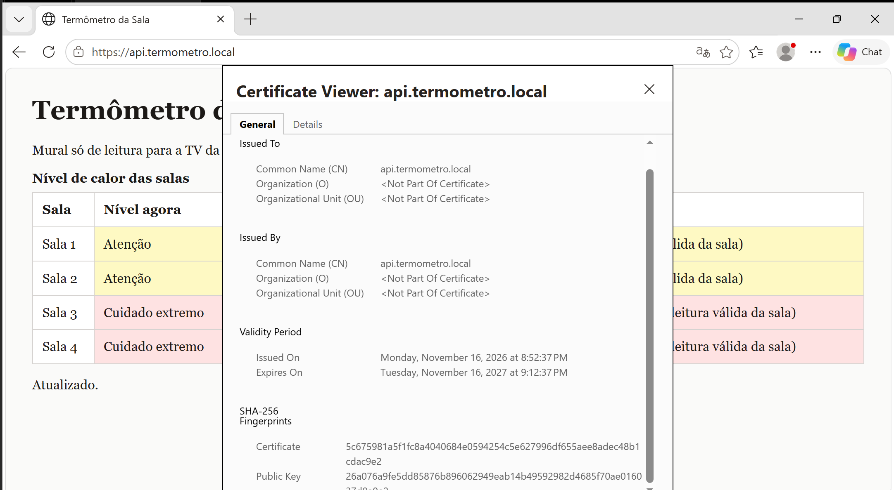

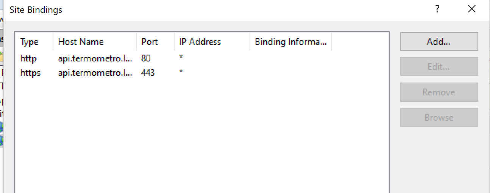

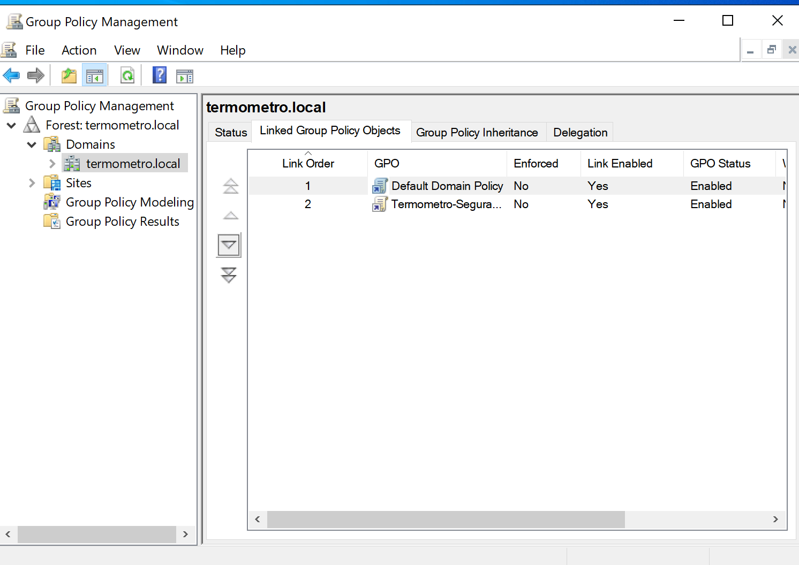

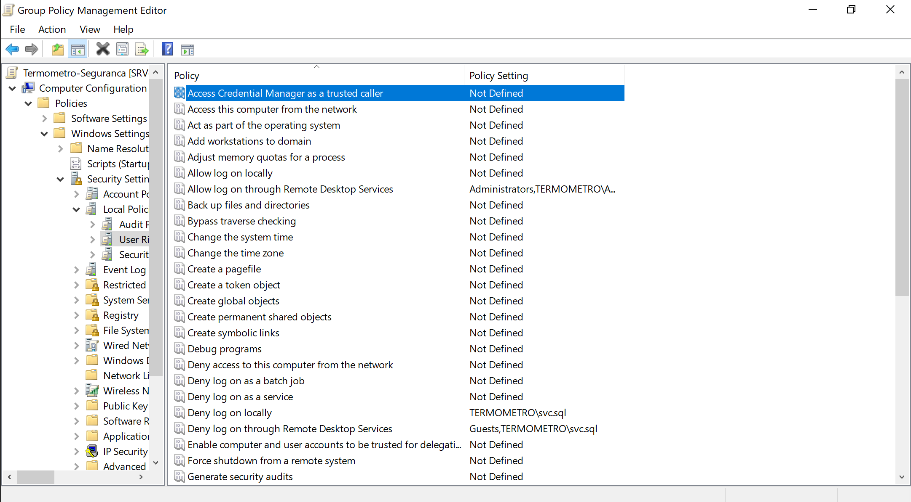

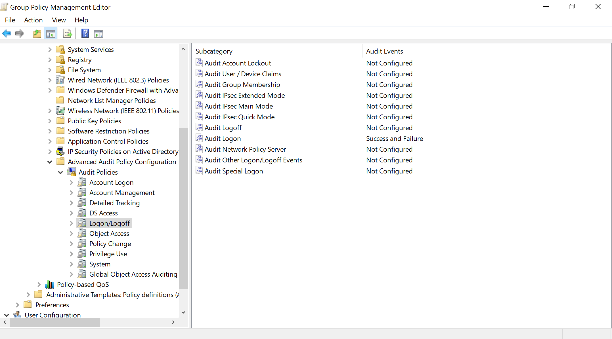

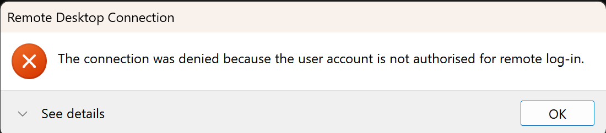

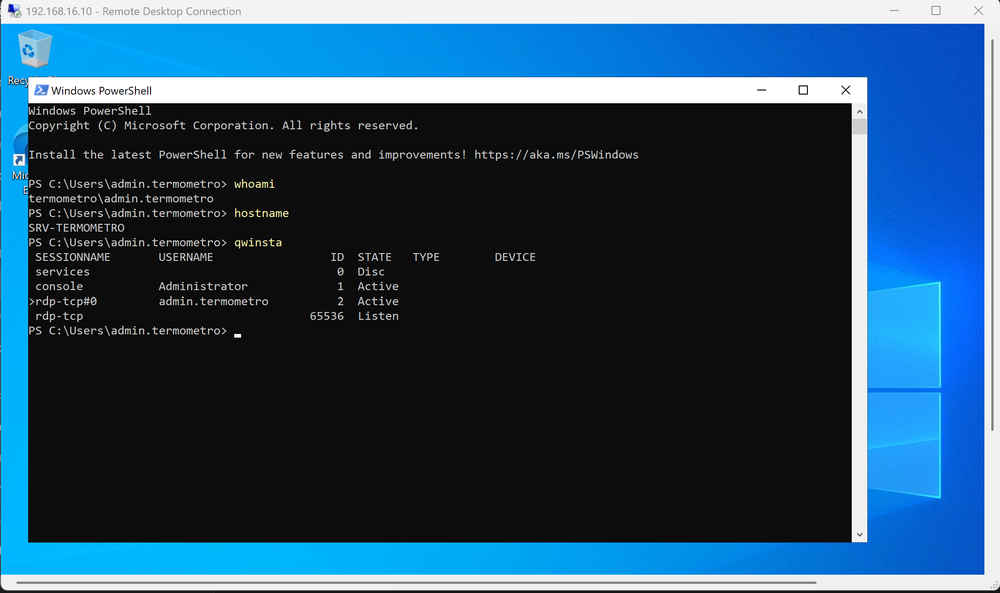

### Prints da coleta local

Prints da coleta local de 06/11/2026, 02h34 (API em Kestrel no Windows da equipe, HTTP em `localhost`, MQTT desligado). Cada print mostra o arquivo de saída correspondente em `evidencias/saidas/`, com a data e hora no topo; a chave e a conexão aparecem como `***`. O print E01 (listagem dos arquivos de código, 12.808 pixels de altura) fica só no repositório; no PDF ele é substituído pelos trechos de código acima.

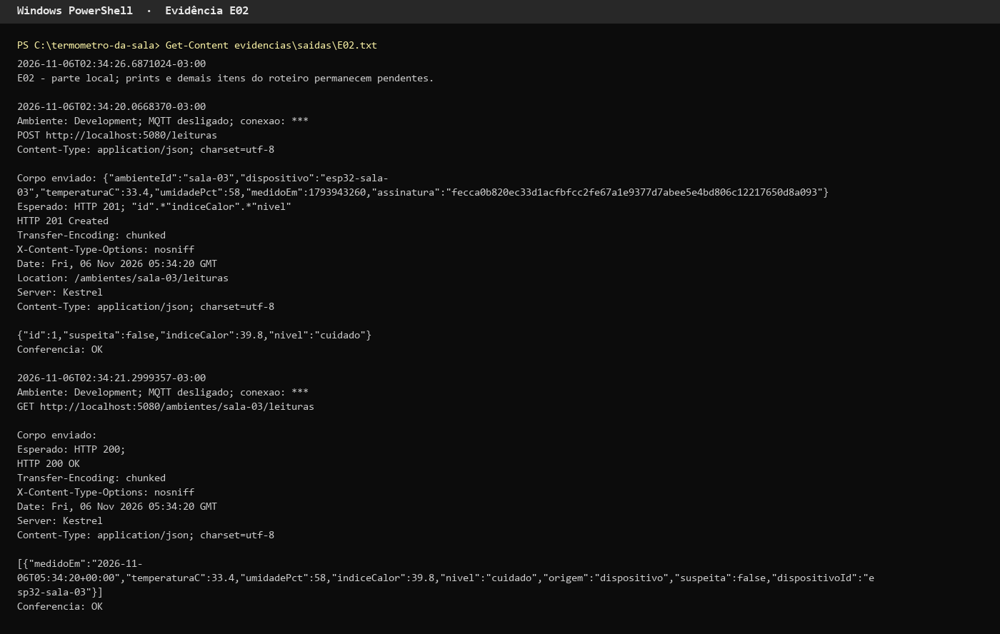

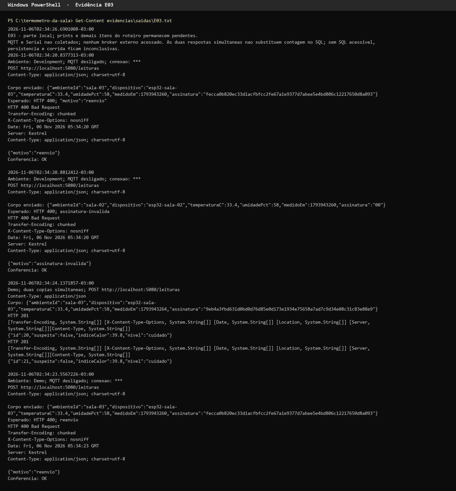


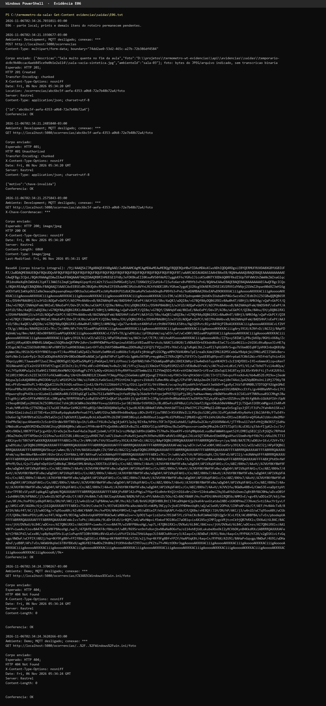


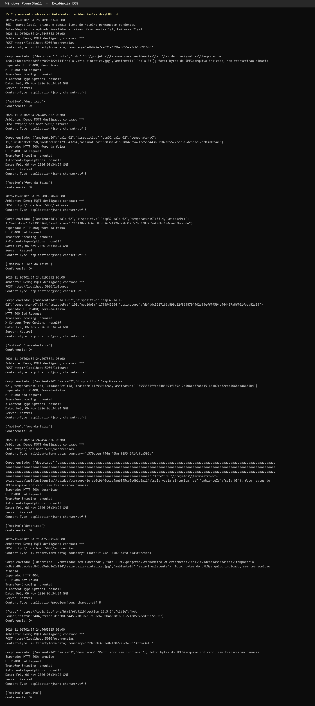


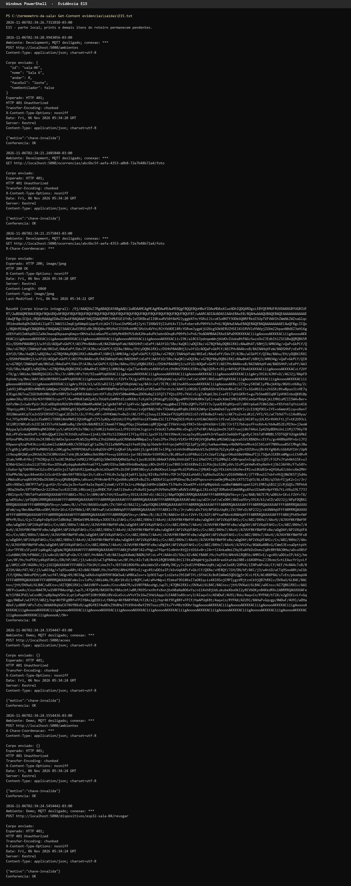
