# Termômetro da Sala — roteiro de evidências de Cybersecurity

Roteiro de coleta do [RELATORIO-RISCOS.md](RELATORIO-RISCOS.md); não entra no PDF. Os resultados (esperado x obtido e prints) vão para o [ANEXO-EVIDENCIAS.md](ANEXO-EVIDENCIAS.md). **Estado: parte local coletada em 05/11/2026; nmap, IIS, GPO e LED são coletados no laboratório Windows Server.** Não fazer varredura nem inundação do broker público. Não mostrar chaves, senhas, tokens, strings de conexão ou pessoas nos prints.

Rotas existentes: `POST /leituras`, `GET/POST /ambientes`, `GET/PUT/DELETE /ambientes/{id}`, `GET /ambientes/{id}/ocorrencias`, `GET /niveis`, `GET /ambientes/{id}/leituras`, `GET /ambientes/{id}/previsao`, `POST /ocorrencias`, `GET /ocorrencias/{id}/foto`, `GET/POST /acoes`, `POST /dispositivos/{id}/revogar`, `POST /demo/semear`. Não há `GET /ocorrencias?busca=`, rota de cadastro de dispositivo nem de reativação. O SQLi do roteiro usa `GET /ambientes/{id}/leituras`. Recusas de leitura: `assinatura-invalida`, `reenvio`, `dispositivo-revogado`, `atrasada`, `fora-da-faixa`. Saídas locais em [evidencias/](evidencias/). Cada arquivo traz só o trecho que prova cada controle, sem a semente de teste.

Cada print deve trazer ID da evidência, data/hora, ambiente, versão identificada pelo coordenador, comando e resultado; registrar também o arquivo/linha do controle. Anexar logs recortados e sem segredos. Os campos reservados abaixo são para prints, não para registrar aprovação antecipada.

## Preparação local

Abrir PowerShell na raiz do projeto. Os comandos de rede abaixo são executados pelo responsável no laboratório. `curl.exe` evita o alias de PowerShell. Não instalar ferramentas para este roteiro: usar as já disponíveis; se `nmap` não estiver disponível, a evidência E12 permanece pendente.

```powershell
Get-Date -Format o
$Api = (Read-Host 'URL HTTP/HTTPS da API do laboratorio, sem barra final').TrimEnd('/')
$IpServidor = Read-Host 'IP da VM Windows autorizada para os testes'
$AmbienteId = 'sala-03'
$Dispositivo = 'esp32-sala-03'
$Evidencias = Join-Path $env:TEMP ('termometro-evidencias-' + [guid]::NewGuid())
New-Item -ItemType Directory -Path $Evidencias | Out-Null
curl.exe -i "$Api/ambientes"
```

Esperado: API de negócio responde com salas reais de teste. Na execução do app, configurar `EXPO_PUBLIC_API_MOCK=0` antes de iniciá-lo; `app/app.config.ts:5` habilita simulação por padrão. Sem esse cuidado, protocolo gerado no cliente não prova persistência ou validação da API. Usar base descartável, conta de teste e imagem de equipamento sem pessoas. Se as rotas exigirem autenticação, fazer a coleta autenticada pelo cliente oficial/Insomnia e não copiar credenciais para os prints; E15 cobre as requisições anônimas.

## Coleta numerada

### 1. E01 — versão, escopo e localização dos controles

```powershell
Get-Date -Format o
Get-ChildItem api,app,esp32,infra -Recurse -File |
    Where-Object { $_.Extension -in '.cs','.csproj','.ts','.tsx','.ino','.md','.ps1' } |
    Select-Object FullName
$Fonte = Read-Host 'Caminho relativo do arquivo do controle a registrar'
$Linha = 0
Get-Content -LiteralPath $Fonte -Encoding UTF8 |
    ForEach-Object { $Linha++; '{0}: {1}' -f $Linha, $_ }
```

Esperado: arquivo e linha de C1–C12 estão na seção 6 do relatório. Abrir somente fonte que não contenha a chave da coordenação. Se uma linha mudar, atualizar o relatório. A suíte está em `evidencias/dotnet-test-seguranca.txt` (55/55 no total; 20 testes de segurança listados).

**Print E01:**  [saida local](evidencias/saidas/E01.txt)

### 2. E02 — vetor HMAC e leitura legítima

Pré-condição: dispositivo semeado `esp32-sala-03`, ativo e vinculado a sala-03. Usar chave **exclusivamente de demonstração**, provisionada pelo responsável; nunca usar chave de produção nem exibir seu valor. O teste abaixo faz uma autoverificação HMAC com vetor público antes de produzir a mensagem atual.

```powershell
$Utf8 = [System.Text.Encoding]::UTF8
$Hmac = [System.Security.Cryptography.HMACSHA256]::new()
$Hmac.Key = $Utf8.GetBytes('Jefe')
$Vetor = -join ($Hmac.ComputeHash($Utf8.GetBytes('what do ya want for nothing?')) |
    ForEach-Object { $_.ToString('x2') })
if ($Vetor -ne '5bdcc146bf60754e6a042426089575c75a003f089d2739839dec58b964ec3843') {
    throw 'Falha no vetor publico HMAC-SHA256'
}
$SegredoProtegido = Read-Host 'Chave exclusiva do dispositivo de demonstracao' -AsSecureString
$Ponteiro = [Runtime.InteropServices.Marshal]::SecureStringToBSTR($SegredoProtegido)
try {
    $Hmac.Key = $Utf8.GetBytes([Runtime.InteropServices.Marshal]::PtrToStringBSTR($Ponteiro))
} finally {
    [Runtime.InteropServices.Marshal]::ZeroFreeBSTR($Ponteiro)
}
$MedidoEm = [DateTimeOffset]::UtcNow.ToUnixTimeSeconds()
$Canonico = "$AmbienteId|$Dispositivo|33.4|58|$MedidoEm"
$Assinatura = -join ($Hmac.ComputeHash($Utf8.GetBytes($Canonico)) |
    ForEach-Object { $_.ToString('x2') })
$Leitura = [ordered]@{
    ambienteId = $AmbienteId; dispositivo = $Dispositivo
    temperaturaC = 33.4; umidadePct = 58; medidoEm = $MedidoEm
    assinatura = $Assinatura
}
$Valida = Join-Path $Evidencias 'leitura-valida.json'
$Json = $Leitura | ConvertTo-Json -Compress
[System.IO.File]::WriteAllText($Valida, $Json, $Utf8)
curl.exe -i -H 'Content-Type: application/json' --data-binary "@$Valida" "$Api/leituras"
curl.exe -i "$Api/ambientes/$AmbienteId/leituras"
```

Esperado: resposta 2xx e uma gravação identificável pelo dispositivo/timestamp. O vetor público está em `api/TermometroDaSala.Api.Tests/VetoresTestes.cs` (`HmacDoContrato`) e em `CONTRATO.md`. Cada sala usa `segredo-de-teste-sala-0N`; o vetor da sala 03 não assina a sala 01 (`ApiTestes.SegredoDeOutraSalaNaoAssina`). Nunca imprimir a chave.

**Print E02:** 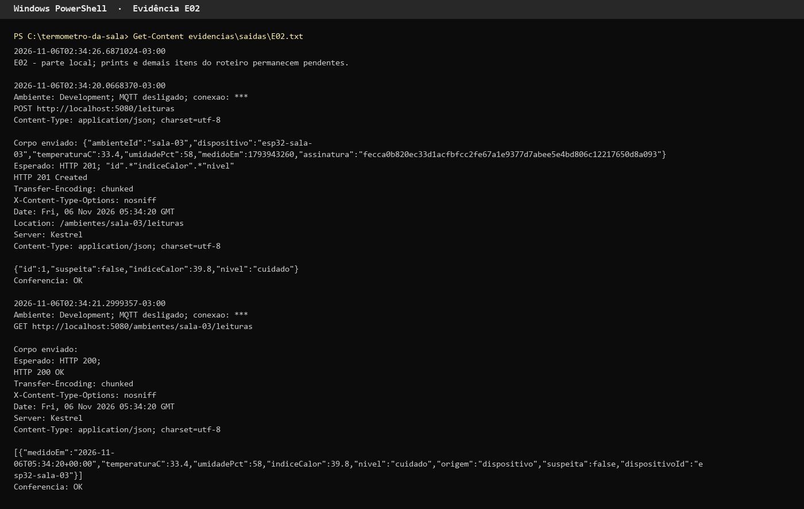 [saida local](evidencias/saidas/E02.txt)

### 3. E03 — assinatura inválida e reenvio

Executar logo após E02, dentro da janela de dez minutos. Alterar apenas a assinatura mantém campos e cadastro válidos e isola a causa da recusa.

```powershell
$Forjada = Join-Path $Evidencias 'leitura-forjada.json'
$Copia = $Json | ConvertFrom-Json
$Copia.assinatura = '0' * 64
[System.IO.File]::WriteAllText($Forjada, ($Copia | ConvertTo-Json -Compress), $Utf8)
curl.exe -i -H 'Content-Type: application/json' --data-binary "@$Forjada" "$Api/leituras"
curl.exe -i -H 'Content-Type: application/json' --data-binary "@$Valida" "$Api/leituras"
curl.exe -i "$Api/ambientes/$AmbienteId/leituras"
```

Esperado: 4xx nos dois POSTs, log `assinatura-invalida` no primeiro e `reenvio` no segundo, sem novas linhas no banco. Confirmar também ingestão MQTT com a mesma mensagem na coleção/ferramenta já usada pela equipe; confirmar no código que ambos chamam o mesmo validador. Para MQTT a prova é log e ausência de gravação, não status HTTP. Não publicar em tópico de terceiros.

Repetir o POST válido depois de reiniciar a API no laboratório. Esperado: o último `medidoEm` fica na coluna do dispositivo (`ServicoLeituras.cs:67`), então o reenvio continua recusado depois do reinício. O assinante MQTT está em `api/TermometroDaSala.Api/Servicos/AssinanteMqtt.cs:70` e chama o mesmo `Receber`.

Duas cópias simultâneas de uma leitura nova: o código lê o dispositivo e grava em dois passos, sem token de concorrência (`ServicoLeituras.cs:28` e `:67-68`; C1 parcial no relatório). Se as duas forem gravadas, registrar a contagem como a lacuna declarada, não como aprovação. Não há teste automatizado de concorrência.

**Print E03:** 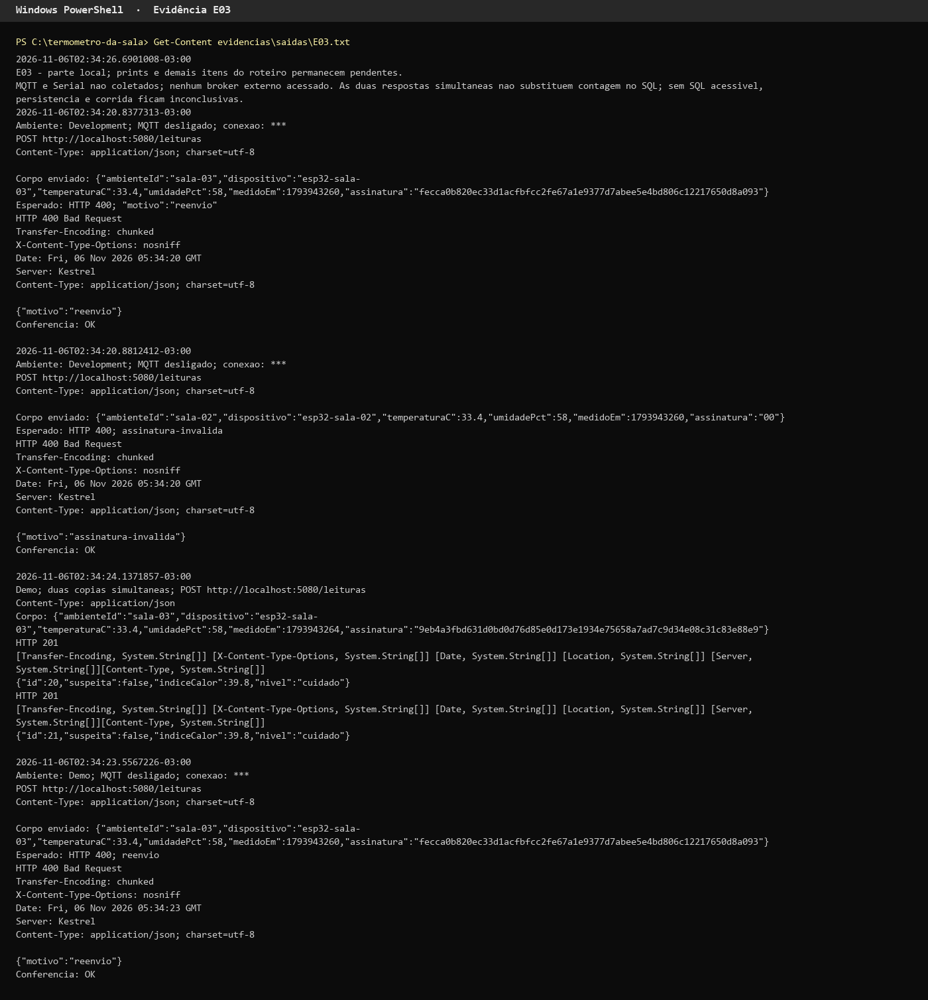 [saida local](evidencias/saidas/E03.txt)

### 4. E04 — revogação e janela temporal

A API não tem rota para reativar nem para cadastrar dispositivo: a revogação é definitiva no banco descartável. Por isso a revogação usa `esp32-sala-04`, que não é o dispositivo do Wokwi. No desktop, com a chave da coordenação, revogar apenas `esp32-sala-04`. Depois executar E02 a partir de `$SegredoProtegido = ...` com `$AmbienteId = 'sala-04'`, `$Dispositivo = 'esp32-sala-04'` e a chave de teste desse dispositivo, e enviar. Esperado: 4xx e `dispositivo-revogado`, sem inserção. Para voltar ao estado inicial, recriar o banco descartável do laboratório.

Para testar atraso sem confundir com reenvio, usar outro dispositivo semeado, ativo e **sem leitura anterior**: `esp32-sala-02` (conferir antes que `GET /ambientes/sala-02/leituras` volta vazio). Executar E02 a partir de `$SegredoProtegido = ...` com `$AmbienteId = 'sala-02'`, `$Dispositivo = 'esp32-sala-02'` e a chave de teste desse dispositivo, sem enviar o POST. Depois executar o trecho abaixo para atraso e repetir com a alternativa de futuro. Ambos precisam ser assinados corretamente.

```powershell
$MedidoEm = [DateTimeOffset]::UtcNow.AddMinutes(-11).ToUnixTimeSeconds()
# Para a segunda tentativa, substituir a linha anterior por:
# $MedidoEm = [DateTimeOffset]::UtcNow.AddMinutes(2).ToUnixTimeSeconds()
$Canonico = "$AmbienteId|$Dispositivo|33.4|58|$MedidoEm"
$Leitura.dispositivo = $Dispositivo
$Leitura.medidoEm = $MedidoEm
$Leitura.assinatura = -join ($Hmac.ComputeHash($Utf8.GetBytes($Canonico)) |
    ForEach-Object { $_.ToString('x2') })
$Temporal = Join-Path $Evidencias 'leitura-temporal.json'
[System.IO.File]::WriteAllText($Temporal, ($Leitura | ConvertTo-Json -Compress), $Utf8)
curl.exe -i -H 'Content-Type: application/json' --data-binary "@$Temporal" "$Api/leituras"
```

Esperado: 4xx e `atrasada` nos dois casos, sem gravação. A ordem está em `ValidadorLeitura.Motivo` (`api/TermometroDaSala.Api/Dominio/Contrato.cs:98`): assinatura, revogação, reenvio, janela de -10 min a +1 min, faixa. Teste: `VetoresTestes.LimitesDaJanelaEDaFaixa` e `ApiTestes.RecusasELeituraAceita`. O relógio do Wokwi por 15 minutos fica para o laboratório.

**Print E04:** 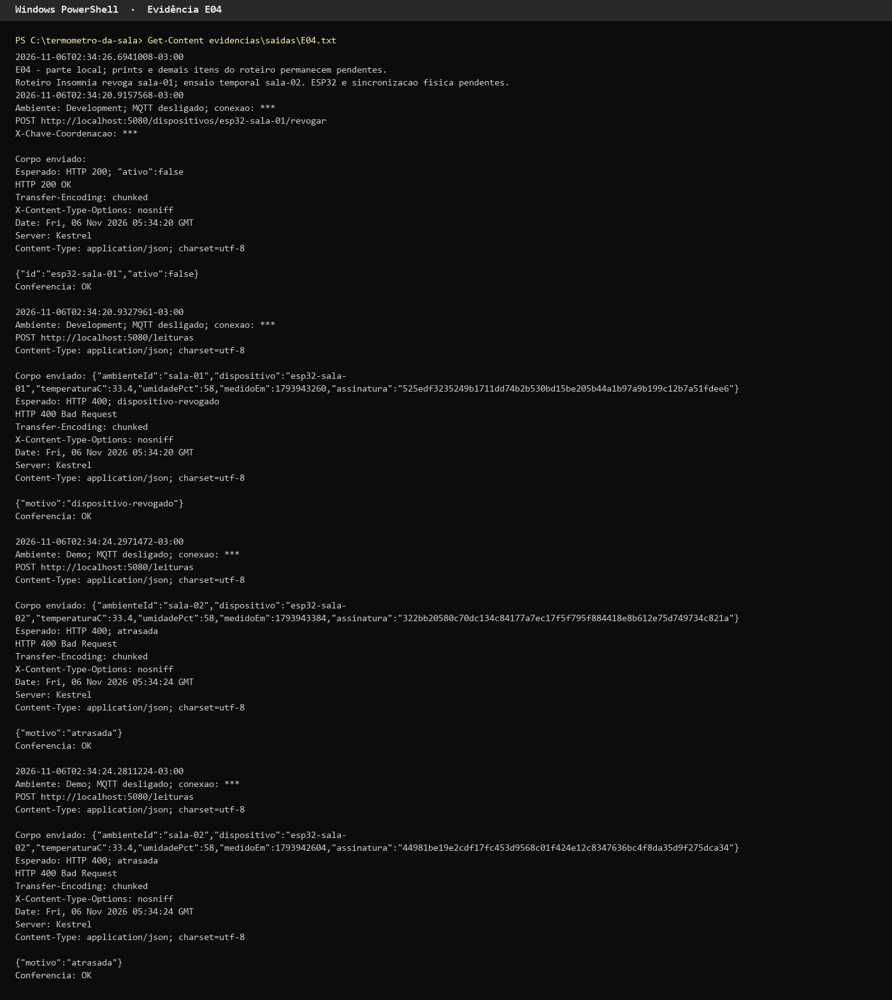 [saida local](evidencias/saidas/E04.txt)

### 5. E05 — SQLi na consulta de leituras

Não há busca `GET /ocorrencias?busca=`. A consulta que recebe texto do cliente é `GET /ambientes/{id}/leituras` (`LeiturasController.cs:18`).

```powershell
curl.exe -i "$Api/ambientes/sala-03/leituras"
curl.exe -i --path-as-is "$Api/ambientes/sala-03%27%20OR%201%3D1%20--/leituras"
```

Esperado: a sala conhecida devolve só as leituras dela; o id com apóstrofo responde 404 e não lista as outras salas. No teste `ApiTestes.ConsultaDeLeiturasParametrizada`, o comando gerado pelo EF compara o `Id` com o parâmetro `@__id_0` (tamanho 18); o texto `OR 1=1` não entra no SQL (`evidencias/consulta-parametrizada.txt`). Não habilitar log de dados sensíveis no servidor real.

**Print E05:** 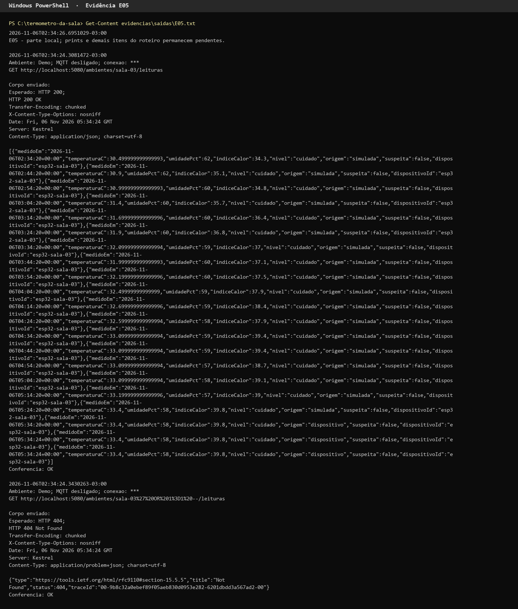 [saida local](evidencias/saidas/E05.txt)

### 6. E06 — foto legítima, GUID e LFI

Criar no app uma ocorrência artificial com foto de equipamento e guardar o id devolvido pela API; não aceitar id gerado em modo simulado. O download é `GET /ocorrencias/{id}/foto` (`OcorrenciasController.cs:44`).

```powershell
$OcorrenciaId = Read-Host 'Id da ocorrencia de teste persistida na API'
curl.exe -i -H "X-Chave-Coordenacao: $env:CHAVE_COORDENACAO" "$Api/ocorrencias/$OcorrenciaId/foto"
curl.exe -i --path-as-is "$Api/ocorrencias/..%2F..%2FWindows%2Fwin.ini/foto"
curl.exe -i --path-as-is "$Api/ocorrencias/C%3A%5CWindows%5Cwin.ini/foto"
$PastaFotos = Read-Host 'Caminho local da pasta de fotos na VM'
Get-ChildItem -LiteralPath $PastaFotos -File | Select-Object Name, Length
```

Esperado: foto legítima 200 com chave válida (definir `$env:CHAVE_COORDENACAO` sem exibir o valor); sem chave, 401. Nome GUID gerado no servidor; travessias 400/404, sem bytes de arquivo do Windows ou detalhe de caminho interno. Anexar resolução id → registro → arquivo, permissões e confirmação de armazenamento sem execução. Um GUID conhecido por terceiro não deve conceder acesso: E15 cobre autorização.

**Print E06:** 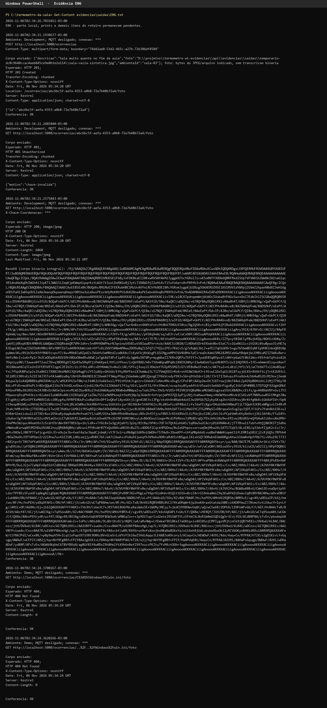 [saida local](evidencias/saidas/E06.txt)

### 7. E07 — upload malicioso e tamanho

O multipart usa `ambienteId`, `descricao` e `foto` (`OcorrenciaEntrada`). Criar conteúdo inofensivo que não é imagem; não enviar malware real.

```powershell
$Falsa = Join-Path $Evidencias 'falsa.jpg'
[System.IO.File]::WriteAllText($Falsa, 'isto nao e uma imagem', $Utf8)
curl.exe -i -F "ambienteId=$AmbienteId" -F 'descricao=Teste de arquivo invalido' -F "foto=@$Falsa;type=image/jpeg;filename=falsa.jpg" "$Api/ocorrencias"
curl.exe -i -F "ambienteId=$AmbienteId" -F 'descricao=Teste de nome invalido' -F "foto=@$Falsa;type=image/jpeg;filename=../../teste.jpg" "$Api/ocorrencias"
```

Esperado: falso JPEG recusado com 4xx, sem arquivo/ocorrência parcial. Para separar nome de conteúdo, repetir o segundo comando usando uma foto JPEG válida e conferir que o servidor descarta o nome externo e gera GUID, ou recusa o nome sem escrever fora da pasta.

O arquivo da foto é recusado acima de 5 MB (5242880 bytes) em `OcorrenciasController.cs:22`. A requisição inteira tem teto de 6 MB em `:16`. Gere um arquivo um byte acima de 5 MB:

```powershell
$LimiteBytes = 5MB
if ($LimiteBytes -ne 5242880) { throw 'O teto da foto em OcorrenciasController é 5 MB' }
$Grande = Join-Path $Evidencias 'grande.jpg'
$Arquivo = [System.IO.File]::Create($Grande)
try { $Arquivo.SetLength($LimiteBytes + 1) } finally { $Arquivo.Dispose() }
curl.exe -i -F "ambienteId=$AmbienteId" -F 'descricao=Teste de limite de tamanho' -F "foto=@$Grande;type=image/jpeg" "$Api/ocorrencias"
```

Esperado: 400 com corpo `{"motivo":"arquivo"}` (`OcorrenciasController.cs:22`), sem arquivo nem ocorrência gravados. A requisição fica abaixo do teto de 6 MB, então a resposta vem da regra de 5 MB da ação. O arquivo grande também não é imagem, mas a regra de tamanho roda antes da de conteúdo (`:25`): o motivo `arquivo`, e não `nao-jpeg`, mostra que a recusa foi por tamanho.

**Print E07:** 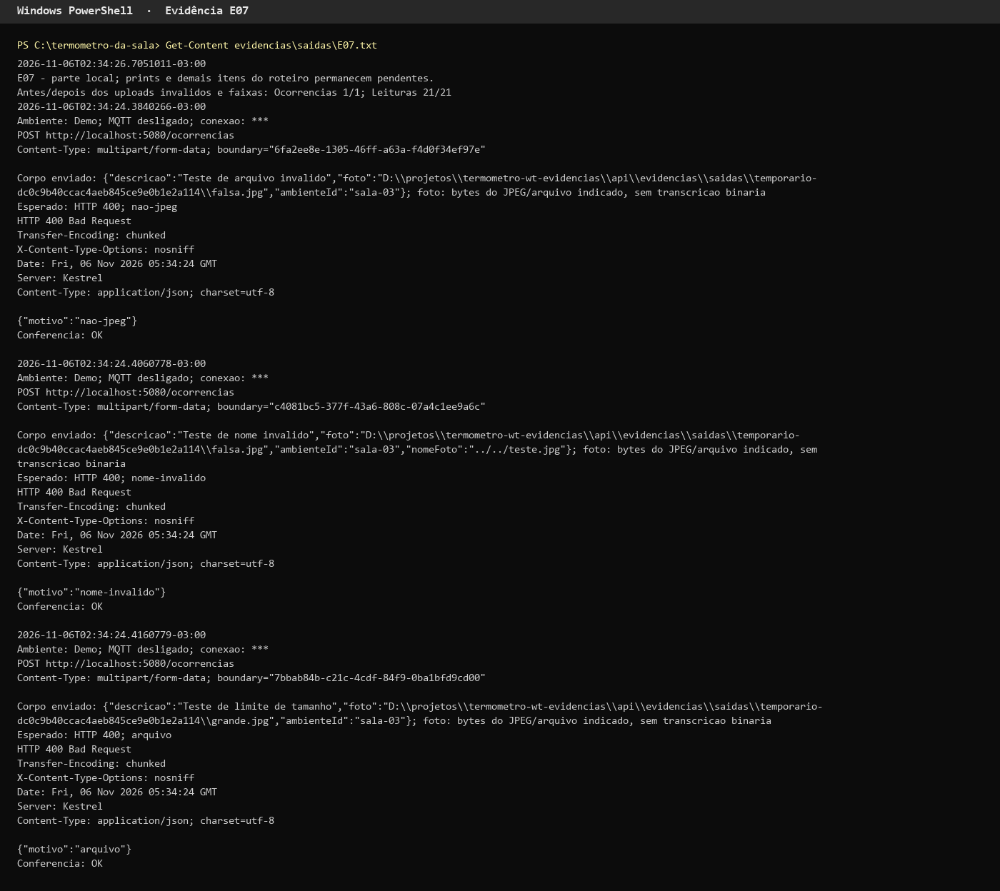 [saida local](evidencias/saidas/E07.txt)

### 8. E08 — validação na API e no app

Usar imagem válida de equipamento; enviar direto à API ignora as validações do formulário e comprova a fronteira de confiança.

```powershell
$FotoValida = Read-Host 'Caminho local do JPEG valido de equipamento sem pessoas'
curl.exe -i -F "ambienteId=$AmbienteId" -F 'descricao=curta' -F "foto=@$FotoValida;type=image/jpeg" "$Api/ocorrencias"
$DescricaoLonga = 'a' * 501
curl.exe -i -F "ambienteId=$AmbienteId" -F "descricao=$DescricaoLonga" -F "foto=@$FotoValida;type=image/jpeg" "$Api/ocorrencias"
curl.exe -i -F "ambienteId=$AmbienteId" -F 'descricao=Ventilador sem funcionar' "$Api/ocorrencias"
curl.exe -i -F 'ambienteId=sala-inexistente' -F 'descricao=Ventilador sem funcionar' -F "foto=@$FotoValida;type=image/jpeg" "$Api/ocorrencias"
```

Esperado: 4xx, sem registros parciais. Descrição após trim: 10 a 500 caracteres (`OcorrenciasController.cs:21`). No app, fotografar erro com descrição de 9 e 501 caracteres e falta de foto, e sucesso com 10 e 500 caracteres e foto. Para temperatura -11/61 e umidade -1/101, repetir E02 com cada valor alterado também no texto canônico e com nova assinatura válida; alterar só JSON provaria HMAC, não faixa física. Esperado: `fora-da-faixa` (`Contrato.cs:106`) e nenhuma inserção. Testes: `VetoresTestes.LimitesDaJanelaEDaFaixa` e `ApiTestes.RecusasELeituraAceita`.

**Print E08:** 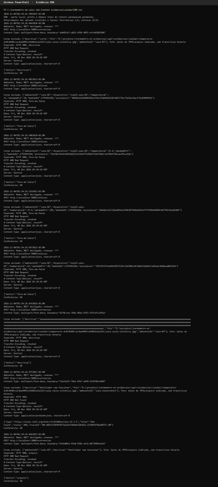 [saida local](evidencias/saidas/E08.txt)

### 9. E09 — /demo/semear recusado fora de Demo

A rota existe em todos os ambientes; fora de Demo a ação responde 404 sem gravar (`DemoController.cs:20`). Usar banco descartável; semear escreve dados. Em Demo, ligar sensor e confirmar leitura ao vivo antes de semear. Executar em terminais separados, encerrando a API antes de mudar ambiente:

```powershell
$env:ASPNETCORE_ENVIRONMENT = 'Demo'
dotnet run --no-launch-profile --project api/TermometroDaSala.Api --urls http://localhost:5080
```

```powershell
curl.exe -i -X POST 'http://localhost:5080/demo/semear?ambienteId=sala-03'
```

Esperado em Demo: sucesso e histórico simulado; sem leitura ao vivo, 409 com orientação para ligar sensor. Depois de encerrar o processo Demo, iniciar:

```powershell
$env:ASPNETCORE_ENVIRONMENT = 'Production'
dotnet run --no-launch-profile --project api/TermometroDaSala.Api --urls http://localhost:5080
```

```powershell
curl.exe -i -X POST 'http://localhost:5080/demo/semear?ambienteId=sala-03'
```

Esperado em Production: **404**, log `demo semear recusado: fora-do-ambiente` e banco inalterado. O log separa essa recusa de um 404 de rota inexistente; registrar também a linha do código que confere o ambiente. Se houver redirecionamento HTTPS, repetir na URL HTTPS efetiva com certificado válido; 307 não é prova de 404.

**Print E09:** 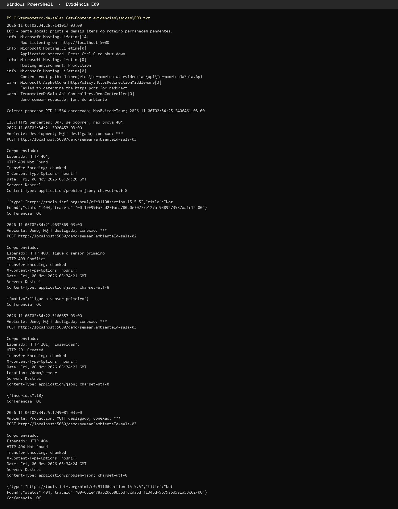 [saida local](evidencias/saidas/E09.txt)

### 10. E10 — segredo fora do repositório

Sem revelar conteúdo de arquivos de segredo:

```powershell
Select-String -Path .gitignore -Pattern 'secrets.h','env','appsettings'
Get-ChildItem api,app,esp32 -Recurse -File |
    Where-Object { $_.Name -match '^(secrets.*\.h|\.env.*|appsettings.*\.json)$' } |
    Select-Object FullName
```

Esperado: regra para secrets.h/configurações locais, exemplo sem chave real e configuração de execução protegida por ACL. Lista de arquivos e `.gitignore` **não provam** exclusão do versionamento nem ausência em histórico. A busca no histórico do git foi executada em 05/11/2026 e está em `evidencias/osint.txt`, item 8 (só os vetores de teste). O responsável pelo repositório repete a busca antes da entrega e confere a exportação pública pela interface que já utiliza, com print redigido sem valores. Não abrir variáveis de ambiente do pool em print que mostre valores.

No Wokwi, declarar que quem tem link consegue ver o segredo de demonstração. Não tentar comprovar sigilo inexistente. Anexar revogação e recusa posterior de E04, sem fotografar a chave.

**Print E10:** 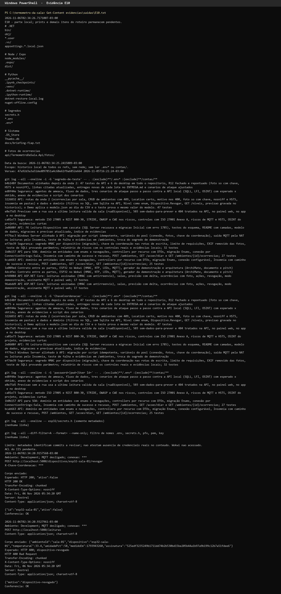 [saida local](evidencias/saidas/E10.txt)

### 11. E11 — GPO, RDP, NTFS e auditoria

Na VM, com conta administrativa do laboratório. O segundo comando consulta SACL e pode exigir privilégio de auditoria. Não registrar senha nem tentar força bruta.

```powershell
gpresult /h "$env:TEMP\termometro-gpo.html" /f
auditpol /get /category:*
$PastaFotos = Read-Host 'Caminho local da pasta de fotos na VM'
icacls "$PastaFotos"
(Get-Acl -LiteralPath $PastaFotos -Audit).Audit | Format-List
Get-WinEvent -FilterHashtable @{LogName='Security'; Id=4625,4663; StartTime=(Get-Date).AddHours(-1)} -MaxEvents 20 |
    Select-Object TimeCreated, Id, Message
```

Esperado: GPO aplicada restringe logon RDP a grupo autorizado; senha/bloqueio e firewall configurados; NTFS permite escrita ao pool/administradores; política de auditoria e SACL de fotos ativas. A SACL do roteiro usa o direito `Modify` (`infra/06-gpo.ps1:32`), que inclui leitura de dados (`ReadData`), gravação e exclusão: baixar uma foto pela API gera 4663 com a conta do pool, e gravar ou apagar também. Efetuar um logon RDP negado com conta de teste sem grupo, de uma estação que alcance a porta, e um download de teste de foto (E06) para gerar os eventos. Correlacionar conta/horário/evento; 4625 genérico não prova restrição RDP. Anexar também regra de firewall com escopo de origem. GPO e auditoria: a aplicar e coletar no laboratório Windows Server (`infra/06-gpo.ps1` é roteiro, não política aplicada).

**Print E11:** [inserir resultado de GPO, permissões, SACL e eventos correlacionados]

### 12. E12 — portas mínimas com nmap

De estação comum e, depois, da rede administrativa autorizada:

```powershell
nmap -sT -sV -Pn -p- --open $IpServidor
Test-NetConnection -ComputerName $IpServidor -Port 3389
Test-NetConnection -ComputerName $IpServidor -Port 1433
```

Esperado: HTTPS acessível a usuários; HTTP somente se usado para redirecionar; RDP inacessível da rede comum e acessível apenas na rede administrativa; SQL sem exposição a clientes comuns; nenhum listener MQTT no Windows apenas para assinar tópico externo. Se a VM também for controlador de domínio/DNS, portas necessárias a AD/DNS existem: justificar por função e origem, sem afirmar que só 443 pode estar aberta. A lista efetiva de portas é coletada no laboratório Windows Server (nmap e IIS). A API só redireciona para HTTPS em Production (`Program.cs:65`); o binding 443 e a regra de firewall `TermometroHTTPS` (só sub-rede local) estão no `infra/README.md`, seção "HTTPS no laboratório". Esperado no nmap: 443 com o certificado `api.termometro.local` e 80 só redirecionando. TCP não cobre UDP: anexar regras de firewall/DNS para completar a análise, sem alegar varredura UDP executada.

**Print E12:** [inserir saídas com origem identificada, portas justificadas e regras de firewall]

### 13. E13 — indisponibilidade do broker sem ataque

É a linha "Sem Wi-Fi" da tabela Ensaio de `esp32/README.md`. Não trocar o SSID no `WiFi.begin`.

Desconectar somente o Wi-Fi do ESP32 simulado ou a conexão MQTT do cliente de teste pela ferramenta já usada. Não desligar o broker público nem enviar volume de mensagens. Registrar medição e LED antes/depois e consultar:

```powershell
Get-Date -Format o
curl.exe -i "$Api/ambientes"
curl.exe -i "$Api/ambientes/$AmbienteId/previsao"
```

Esperado: LED continua reagindo à temperatura local sem internet; timestamp não avança com leitura inventada; após o limiar de desatualização confirmado no código, interface mostra falta de leitura recente. Reconectar e comprovar retomada; leituras velhas fora da janela não viram atuais. LED, limiar de desatualização na interface e recuperação do broker: a coletar no laboratório Windows Server. A API não fabrica leitura atual: sem pares, `semLeiturasRecentes` vem verdadeiro (`ApiTestes.DeltaSemTresParesENuloEComTresFechaOExemplo`).

**Print E13:** [inserir LED offline, timestamp, aviso e retomada]

### 14. E14 — prevenção de OSINT e dados de aluno

Fotografar o formulário com aviso de sala/equipamento sem pessoas e texto sem identificação de aluno. Usar apenas cenário artificial: quadro sem nomes, equipamento, sala vazia. Conferir foto original e salva, painel público, exportação e logs; não colocar rosto real na demonstração.

```powershell
Select-String -LiteralPath 'app/app/salas/[id]/ocorrencia.tsx' -Pattern 'exif: false','sem pessoas','sem identificar aluno'
Start-Process -FilePath $FotoValida
```

Esperado: orientação visível, nenhuma identificação nos arquivos e fotos ausentes do painel público. No Windows, abrir Propriedades → Detalhes tanto do original quanto da foto baixada e conferir GPS/autor/câmera; essa inspeção básica não é prova forense de remoção de todo metadado. `exif: false` evita pedir EXIF no retorno do seletor, sem garantir limpeza do arquivo transmitido. No servidor, `SemApp1` (`OcorrenciasController.cs:74`) regrava o JPEG sem APP1. Teste: `ApiTestes.UploadRemoveSegmentoApp1`. A revisão de rosto continua humana: tirar o EXIF não vê o conteúdo da foto.

**Print E14:** 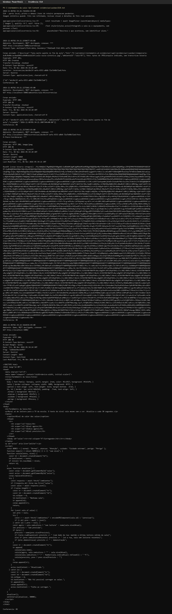 [saida local](evidencias/saidas/E14.txt)

### 15. E15 — acesso indevido e encerramento da coleta

O controle da API é a chave `X-Chave-Coordenacao` (`ExigeChaveCoordenacaoAttribute.cs:20`), não uma conta. Ela protege `POST /ambientes`, `PUT/DELETE /ambientes/{id}`, `POST /acoes`, `POST /dispositivos/{id}/revogar` e `GET /ocorrencias/{id}/foto`. Registrar pelo desktop uma revogação com a chave correta (a de E04) e outra tentativa sem a chave ou com chave errada, sem imprimir o valor. Para acesso anônimo às operações e imagens:

```powershell
curl.exe -i "$Api/ocorrencias/$OcorrenciaId/foto"
curl.exe -i -X POST "$Api/acoes" -H 'Content-Type: application/json' --data-binary '{}'
curl.exe -i -X POST "$Api/dispositivos/esp32-sala-01/revogar"
```

Esperado: `POST /acoes` e a revogação sem chave respondem 401 `chave-invalida` antes de validar o corpo (o filtro é de autorização) e nada é gravado; `esp32-sala-01` continua ativo. A foto sem chave responde **401** `chave-invalida`; com chave válida e id existente responde 200. R12 corrigido e coberto por `OcorrenciaCriadaVoltaNaListaDaSalaEFotoSoComChave`.

Ao concluir, restaurar estado dos dispositivos de laboratório, revogar a chave de demonstração ao final da avaliação, fechar o processo de coleta e descartar seu estado criptográfico:

```powershell
$Hmac.Dispose()
Remove-Variable Hmac,SegredoProtegido -ErrorAction SilentlyContinue
Get-Date -Format o
```

Os arquivos temporários de leitura têm assinatura, não chave. Guardar somente evidências revisadas, eliminar cópias locais de fotos após a entrega conforme decisão da equipe e não publicar diretório temporário. Revogação é necessária mesmo após remover variáveis de memória.

**Print E15:** 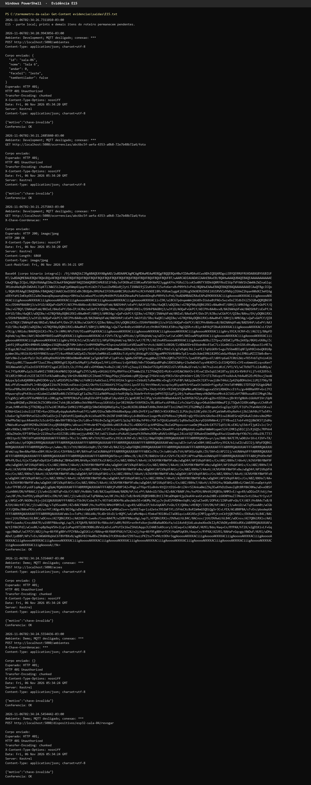 [saida local](evidencias/saidas/E15.txt)

## Montagem do PDF único

Antes do E04, rodar `seguranca/cenarios-ataque.ps1 -Api https://api.termometro.local` (cenários S1 a S3 do relatório; em Production o HTTP só redireciona). Inserir os prints na coluna do laboratório do [ANEXO-EVIDENCIAS.md](ANEXO-EVIDENCIAS.md), com legenda que distingue resultado obtido do esperado, data, ambiente e arquivo/linha. Se um teste falhar ou não puder ser executado, declarar o fato e manter o risco aberto. Revisar legibilidade, ausência de dados pessoais/segredos e RM da capa. Juntar relatório e o ANEXO-EVIDENCIAS.md em um único PDF; este roteiro fica fora, conferir a versão exportada e entregar no Teams até 19/11/2026. A ferramenta de exportação fica a critério da equipe; não é necessário alterar o projeto para gerar o documento.
