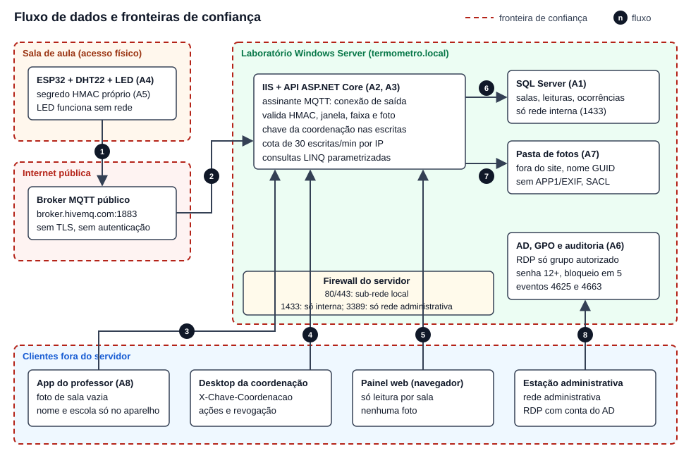

# Termômetro da Sala

## Relatório de Gestão de Riscos

**Equipe:** Termômetro da Sala  
**Integrantes:** Samuel David Baecker - RM 559269; Lucas de Almeida Villar - RM 560005; Guilherme Augusto Caseiro - RM 559765  
**Disciplina:** Cybersecurity  
**Instituição:** FIAP — Engenharia de Software, Global Solution 2026.2  
**Data da análise:** 05/11/2026, revisada em 18/11/2026  
**Laboratório Windows Server:** 17 e 18/11/2026, `SRV-TERMOMETRO` em VM isolada (VMware, rede NAT)

## Resumo executivo

O Termômetro da Sala mede o calor de salas de aula sem climatização (ESP32), envia as leituras assinadas por MQTT a uma API ASP.NET Core com SQL Server e apoia a coordenação na decisão de agir. O professor registra ocorrências com foto pelo app. Os ativos mais sensíveis são as **fotos de ocorrência** (podem expor menores, LGPD art. 14), os **segredos dos dispositivos** e o **servidor Windows**.

A análise seguiu a ISO/IEC 27005:2022 e a NIST SP 800-30 Rev. 1, com ameaças classificadas por STRIDE e vulnerabilidades ligadas ao OWASP Top 10 2021 e ao CWE. Foram identificados **14 riscos**. Sem controles, 6 eram críticos e 8 altos. Com os controles que o código executa e que a suíte de testes comprova (134 de 134 testes da API aprovados em 18/11/2026, `dotnet test api\TermometroDaSala.sln`; seleção de segurança com 30 de 30 em `evidencias/dotnet-test-seguranca.txt`), somados ao que o laboratório Windows Server de 17 e 18/11/2026 comprovou, ficam **0 críticos, 4 altos, 7 moderados e 3 baixos**. A matriz só desconta o que foi executado e comprovado (seção 5).

| Prioridade | Risco | Classe depois | O que segue aberto |
|---|---|---|---|
| 1 | R8 — negação de serviço no MQTT | Alto (12) | A cota de 30/min vale só para HTTP; o assinante MQTT descarta mensagem acima de 1024 bytes, mas não limita volume |
| 2 | R9 — acesso indevido por RDP ao servidor | Alto (10) | GPO aplicada no laboratório em 17/11: logon remoto só para `AdminsTermometro` e administradores, `svc.sql` negado, auditoria de logon e de arquivos ligada; prints da GPO, dos direitos de logon, do RDP permitido e negado e o evento 4624 tipo 10 no repositório (E11). Faltam a varredura de portas de duas origens (E12) e a correlação dos eventos 4663 da pasta de fotos |
| 3 | R6 — foto que identifica aluno (OSINT/LGPD) | Alto (10) | O upload remove EXIF, também comprovado no laboratório (S3.3), mas um rosto na imagem só é barrado pela revisão humana |
| 4 | R13 — MQTT na porta 1883 sem TLS | Alto (10) | Leituras trafegam em claro no broker público; aceito só no laboratório com dados simulados (C12 pendente) |
| 5 | R14 — HTTPS no IIS | Moderado (8) | HSTS em Production e `nosniff` no código (C11); API publicada em HTTPS com certificado autoassinado do laboratório (binding 443 e certificado em prints da VM), usada pelos cenários de 18/11. Falta a varredura que mostra a porta 80 só redirecionando (E12) |
| 6 | R12 — autorização da foto | Baixo (4) | Corrigido: `GET /ocorrencias/{id}/foto` exige a chave da coordenação; 401 sem chave no teste automatizado e no IIS (S2.10, 18/11) |
| 7 | R2 — reenvio e duplicata concorrente | Baixo (4) | Corrigido: reserva atômica de `UltimoMedidoEm` na mesma transação da leitura (C1), com 5 testes de concorrência; reenvio recusado no IIS com SQL Server (E03). Não exercido no laboratório: o reenvio pela ingestão MQTT |

Nos arquivos da versão atual do repositório público e no histórico do git não há credencial de produção nem dado de aluno (exercício de OSINT na seção 4.1 e `evidencias/osint.txt`, item 8). Os três cenários de ataque (SQLi, LFI e OSINT) foram executados passo a passo duas vezes: em 05/11/2026 contra a API local com banco de teste, e em 18/11/2026 às 00h26 contra a API publicada no IIS do laboratório, em Production e com SQL Server. Na execução do laboratório os **23 passos conferem** com o esperado: 17 ataques barrados (incluindo a foto sem chave, S2.10, que confirma R12 corrigido), 1 lacuna aceita e declarada (S3.1, R7: o vetor público assina até a revogação) e 5 passos de referência ou da coordenação (seção 4.2). Os segredos `segredo-de-teste-sala-01` a `-04` são **valores de teste, públicos de propósito e revogáveis**, e serão revogados após a avaliação de 19/11/2026.

## 1. Escopo e ficha resumida

| Campo | Descrição |
|---|---|
| Projeto | Termômetro da Sala |
| Local de referência | São Paulo; recorte de uma sala de escola pública sem climatização |
| Beneficiários e operadores | Professor e turma; coordenação pedagógica decide e registra as ações |
| Problema | Calor dentro da sala sem medição e sem informação antecipada para a coordenação |
| Funcionamento previsto | ESP32 mede temperatura e umidade, sinaliza localmente e publica por MQTT; API valida, armazena e fornece nível atual e previsão de duas horas; app registra ocorrências com foto; desktop registra ações e revoga sensores |
| Tecnologia prevista | ESP32/DHT22 no Wokwi, MQTT público, ASP.NET Core, EF Core/SQL Server, Expo/React Native, Windows Forms e IIS/Windows Server no domínio termometro.local |
| Indicadores | Aulas em nível Perigo sem ação registrada e tempo entre alerta e ação |
| ODS | 3, 4, 11 e 13: saúde, ambiente escolar seguro, adaptação urbana e resiliência climática |
| Dados | Medições por ambiente, ocorrências simuladas e meteorologia pública do INMET; nenhum dado de aluno deve ser coletado |

O escopo inclui banco, API REST, assinante MQTT, servidor Windows, dispositivo, configuração de segredos, contas administrativas e imagens. Abrange SQL Injection (SQLi), inclusão/leitura indevida de arquivo local (LFI), exposição por fontes abertas (OSINT), acesso remoto e disponibilidade. Não é certificação de segurança nem validação clínica dos limites de calor.

**Estado observado (análise em 05/11/2026, revisão em 18/11/2026):** a API tem salas, leituras assinadas, ocorrências, ações, revogação e previsão. O HMAC usa segredo distinto por dispositivo, e a reserva do último instante aceito é atômica. A coordenação escreve e lê fotos com `X-Chave-Coordenacao`. As rotas HTTP de escrita têm cota de 30 pedidos por minuto por IP; a ingestão MQTT não passa por ela. O upload regrava o JPEG sem APP1. O app do professor continua com simulação por padrão (`app/app.config.ts:5`).

**Laboratório Windows Server (17 e 18/11/2026):** domínio `termometro.local` em `SRV-TERMOMETRO` (192.168.16.10), API publicada no IIS em Production com HTTPS e certificado do laboratório, SQL Server Express com as cinco migrações e GPO `Termometro-Seguranca` aplicada (RDP só para `AdminsTermometro` e administradores, auditoria de logon e de arquivos). Os cenários S1 a S3 rodaram contra essa API em 18/11/2026 com os 23 passos conferindo, e sondagens avulsas fecharam em parte E03 e E09. Os prints da VM, em [infra/evidencias/vm-2026-11/](../infra/evidencias/vm-2026-11/), mostram a GPO ligada ao domínio, os direitos de logon, a auditoria de logon, o RDP permitido e negado, o evento 4624 tipo 10 e o certificado HTTPS. Ficaram sem execução a varredura de portas com nmap (E12), os prints do app (E08) e a correlação dos eventos 4663 (E11); o E13 tem só o ensaio sem Wi-Fi no Wokwi (o alerta local seguiu), sem a consulta da API durante a queda. Saídas em [evidencias/](evidencias/) e situação por evidência no anexo.

## 2. Método

A análise segue o processo de gestão de riscos da **ISO/IEC 27005:2022** e as etapas de avaliação da **NIST SP 800-30 Rev. 1**:

| Etapa (ISO/IEC 27005) | O que foi feito (NIST SP 800-30, etapa 2, tarefas 2-1 a 2-6) | Seção |
|---|---|---|
| Estabelecimento do contexto | Escopo, partes interessadas e critérios de aceitação do risco | 1 e 5 |
| Identificação | Inventário dos ativos; agentes (fontes) de ameaça; fluxo de dados e fronteiras de confiança; eventos de ameaça; vulnerabilidades e condições predisponentes | 3 e 4 |
| Análise | Cenários de ataque passo a passo; probabilidade (1 a 5) e impacto (1 a 5) de cada evento, antes e depois dos controles | 4.2 e 5 |
| Avaliação | Pontuação P × I comparada com o critério de aceitação | 5 |
| Tratamento | Controles com critério de aceitação, tipo, controle da ISO/IEC 27001:2022 Anexo A, custo e responsável | 6 |
| Monitoramento e comunicação | Riscos residuais, gatilhos de reavaliação e evidências | 7 e 8 |

Classificações usadas:

- **STRIDE** para a natureza da ameaça: S falsificação de identidade, T adulteração, R repúdio, I divulgação de informação, D negação de serviço, E elevação de privilégio.
- **OWASP Top 10 2021** (e OWASP API Security Top 10 2023 quando o Top 10 não tem categoria) e **CWE** para a vulnerabilidade.
- **ISO/IEC 27001:2022, Anexo A** para os controles.

A escala é semiquantitativa, como a da NIST SP 800-30 (cinco níveis). Os valores são julgamento da equipe a partir do código e da arquitetura, sem frequência de incidentes medida. O impacto pode continuar elevado mesmo quando a probabilidade cai. Opções de tratamento da ISO/IEC 27005: modificar (mitigar com controle), reter (aceitar), evitar ou compartilhar.

## 3. Inventário e classificação dos ativos

Escala de criticidade de confidencialidade (C), integridade (I) e disponibilidade (D): **baixa**, **média** ou **alta**, conforme o dano da exposição, alteração ou indisponibilidade. Criticidade não é probabilidade de ataque.

| ID | Ativo e conteúdo | C | I | D | Responsável funcional e justificativa | Cidadão afetado |
|---|---|---|---|---|---|---|
| A1 | Banco SQL Server: ambientes, dispositivos, leituras, previsões, ocorrências e ações | Alta | Alta | Alta | Backend/coordenação; alteração muda alertas e histórico; segredos e fotos exigem restrição | Aluno (alerta errado ou histórico falso); coordenação (decisão) |
| A2 | API REST e assinante MQTT | Média | Alta | Alta | Backend; é a fronteira de validação entre internet, dispositivo e banco | Aluno e professor (alerta ausente ou errado) |
| A3 | Windows Server, IIS, AD, disco de fotos e logs | Alta | Alta | Alta | Infraestrutura; comprometimento dá acesso a serviços, arquivos e contas | Todos: aluno, professor e coordenação |
| A4 | ESP32, sensor e LED local | Baixa | Alta | Alta | Dispositivo/coordenação; leitura ou sinal incorreto prejudica a decisão; LED deve continuar sem rede | Aluno e professor na sala (sinal local) |
| A5 | Segredos HMAC por dispositivo, conexão do banco e credenciais administrativas | Alta | Alta | Alta | Backend/infraestrutura; permitem forja ou tomada de controle; indisponibilidade impede operação | Aluno (leitura forjada esconde calor real) |
| A6 | Contas da coordenação e grupos administrativos/RDP | Alta | Alta | Alta | Coordenação/infraestrutura; habilitam decisões, revogação e administração | Coordenação; aluno indiretamente |
| A7 | Fotos de ocorrências e metadados | Alta | Alta | Média | Aplicativo/backend; podem identificar pessoas e local, embora isso seja proibido pelo projeto | Aluno menor de idade (identificação); professor |
| A8 | App, desktop e painel público | Média | Alta | Média | Interfaces; painel mostra somente informação por sala, sem fotos; dados do professor ficam no aparelho | Professor (nome e escola no aparelho); coordenação |

O app armazena nome e escola do professor localmente (`app/services/professor.ts:6` e `:19`); isso continua sendo dado pessoal de adulto, sem equivaler a autenticação. O objetivo de não coletar dados de aluno não significa ausência de qualquer dado pessoal.

### 3.1 Agentes de ameaça

Quem pode atacar o Termômetro da Sala, por que, com que meios e qual cidadão sofre o dano. A capacidade segue a escala da NIST SP 800-30 (baixa, média, alta).

| ID | Agente | Motivação | Capacidade | Ativos-alvo | Dano ao cidadão | Riscos |
|---|---|---|---|---|---|---|
| AG1 | Aluno curioso ou que quer liberar a turma | Sair mais cedo, brincadeira, testar o sistema | Baixa a média: celular, cliente MQTT gratuito, leitura do repositório público | A4, A5, broker | Alerta falso interrompe a aula, ou calor real fica escondido e colegas passam mal | R1, R2, R7, R13 |
| AG2 | Pessoa de dentro da escola (funcionário ou terceirizado com acesso à rede ou ao servidor) | Esconder falha, evitar trabalho, curiosidade sobre fotos | Média: rede interna, conta do AD, acesso físico ao servidor | A1, A3, A6, A7 | Fotos de menores expostas; ações e revogações falsificadas | R6, R9, R11, R12 |
| AG3 | Atacante oportunista na internet (robôs de varredura) | Ganho genérico: sequestro de dados, servidor para botnet | Média a alta, automatizada: varredura de portas, cargas prontas de SQLi e LFI | A1, A2, A3 | Sistema fora do ar no dia quente; banco vazado ou apagado | R3, R4, R5, R9, R14 |
| AG4 | Coletor OSINT (golpista ou pessoa que monta perfil de crianças) | Identificar e localizar alunos, escola e rotina | Baixa técnica, muita paciência: busca no GitHub, no Wokwi, em fotos e metadados | A7, A8, repositório público | Menor identificado e localizado (LGPD art. 14) | R6, R7, R10 |
| AG5 | Robô ou anônimo no tópico MQTT público | Spam, teste de brokers abertos, sem alvo específico | Publica e assina qualquer tópico sem autenticação | Broker, A2 | Leituras falsas ou ausentes na tela da coordenação | R1, R8, R13 |

A banca e a equipe usam os vetores de teste públicos de propósito (seção 4.1). Elas não são agentes de ameaça, mas o mesmo valor serve ao AG1 e ao AG4 até a revogação.

### 3.2 Fluxo de dados e fronteiras de confiança

Cada linha tracejada é uma fronteira de confiança: tudo que a atravessa é tratado como não confiável até a API validar.

| Fluxo | De → para | Dado | Fronteira atravessada | Controle na travessia | Riscos |
|---|---|---|---|---|---|
| 1 | ESP32 → broker público | Leitura com sala, dispositivo, temperatura, umidade, horário e HMAC; o segredo não trafega | Sala de aula → internet | C1 (assinatura por dispositivo) | R1, R2, R7, R13 |
| 2 | Broker → assinante da API (conexão de saída) | A mesma mensagem, até 1024 bytes | Internet → laboratório | C1 e C4 (1024 bytes); nenhuma porta aberta no servidor para MQTT (C8) | R1, R2, R8, R13 |
| 3 | App do professor → API | `POST /ocorrencias` (texto e foto) e `GET /ambientes` | Cliente → servidor | C3, C4, C9 e cota de escrita | R4, R5, R6, R12 |
| 4 | Desktop da coordenação → API | `POST /acoes`, `POST /ambientes` e `POST /dispositivos/{id}/revogar` com `X-Chave-Coordenacao` | Cliente → servidor | C10, cota de escrita, HTTPS do C8 (publicado no laboratório) | R12, R14 |
| 5 | Painel web → API | `GET /ambientes`, leituras e previsão, sem fotos | Navegador → servidor | C2 | R3, R14 |
| 6 | API → SQL Server | Comandos do EF Core com parâmetros | Nenhuma: mesmo servidor; controle pela conta do pool e ACL | C2; porta 1433 só interna (C8) | R3 |
| 7 | API → pasta de fotos | JPEG sem APP1, nome GUID gerado no servidor | Nenhuma: mesmo servidor; controle pela conta do pool e ACL | C3, C9; NTFS e SACL (C7) | R4, R5, R6 |
| 8 | Estação administrativa → Windows Server | RDP 3389 com conta do AD | Rede administrativa → servidor | C7; firewall do C8 | R9 |

`POST /leituras` por HTTP é o caminho alternativo dos fluxos 1 e 2 e passa pelo mesmo `ServicoLeituras.Receber` (C1).

## 4. Ameaças, vulnerabilidades e consequências

| Risco | Ativos | Agente e cenário concreto | Vulnerabilidade a impedir | Consequência | STRIDE | OWASP 2021 | CWE |
|---|---|---|---|---|---|---|---|
| R1 — leitura forjada | A1, A2, A4 | Pessoa no tópico público publica calor falso para liberar a turma ou ocultar calor real | Ingestão sem assinatura por dispositivo ou sem associação dispositivo/ambiente | Alerta e previsão incorretos; decisão operacional prejudicada | S, T | A08 | CWE-345 |
| R2 — reenvio | A1, A2 | Ouvinte copia uma mensagem válida e a publica novamente, inclusive após reinício da API | Aceitar timestamp igual/anterior; estado antirreenvio só em memória; corrida entre MQTT e HTTP | Histórico duplicado ou leitura antiga tratada como atual | S, T | A07 | CWE-294 |
| R3 — SQLi na consulta de leituras | A1, A2 | Cliente manda apóstrofo e `OR 1=1` no id de `GET /ambientes/{id}/leituras` | Concatenar o id em SQL | Leitura ou alteração indevida de registros | T, I | A03 | CWE-89 |
| R4 — LFI no download | A3, A7 | Cliente tenta `../`, caminho absoluto ou nome de arquivo do Windows no identificador da foto | Usar caminho fornecido pelo cliente em leitura de disco | Exposição de configuração, credenciais ou arquivos do servidor | I | A01 | CWE-22 |
| R5 — upload malicioso | A2, A3, A7 | Cliente envia script como JPEG, nome com travessia ou arquivo grande | Confiar em extensão/MIME, permitir execução no diretório de imagens ou não limitar tamanho | Execução, sobrescrita de arquivos ou disco cheio | T, E, D | A04 | CWE-434 |
| R6 — OSINT e LGPD | A7, A8 | Terceiro reconhece aluno, uniforme, placa, documento ou localização em foto pública | Fotografar pessoas, enviar EXIF/localização ou publicar fotos no mural/repositório | Identificação e exposição de menor de idade | I | A01 | CWE-359, CWE-212 |
| R7 — segredo do Wokwi | A4, A5 | Visitante do projeto copia o segredo e assina novas mensagens daquele dispositivo | Link do simulador permite ver todos os arquivos, inclusive secrets.h | HMAC válido produzido por terceiro até revogação | I, S | A07 | CWE-798 |
| R8 — negação de serviço | A2, A4 | Terceiro ocupa o tópico com lixo; broker público cai ou limita conexões | Dependência de serviço público sem garantia de capacidade; mensagens MQTT sem limite de volume (o tamanho já é limitado a 1024 bytes em `AssinanteMqtt.cs:12`) | Falta de medições recentes e atraso na resposta da coordenação | D | API4:2023 | CWE-770 |
| R9 — acesso indevido/RDP | A1, A3, A6 | Conta comum ou atacante tenta logon remoto no servidor | RDP exposto, permissões amplas, senha fraca e auditoria desativada | Tomada do servidor e dos dados | S, E | A07 | CWE-307, CWE-269 |
| R10 — credenciais versionadas | A1, A3, A5 | Leitor de repositório, histórico, print ou log recupera segredo | Segredo em configuração rastreada; acreditar que ignorar arquivo remove histórico | Forja de leituras, acesso ao banco ou servidor | I | A07 | CWE-798 |
| R11 — semeadura indevida | A1, A2 | Cliente chama POST /demo/semear no ambiente de produção | Rota de carga simulada sem HMAC, presente em todos os ambientes, que grava também fora de Demo | Histórico artificial influencia previsão real | T | A05 | CWE-489 |
| R12 — operações administrativas sem controle | A2, A6, A7 | Cliente direto tenta registrar ação, revogar sensor ou ler foto sem autorização | Confundir identificação local do professor e middleware com autenticação/autorização | Decisões falsas, revogação indevida e acesso a imagens | E, S, I | A01 | CWE-862, CWE-639 |
| R13 — MQTT sem TLS | A2, A4 | Qualquer pessoa assina o tópico `fiap-gs/termometro-da-sala/leituras` em `broker.hivemq.com:1883` e lê ou altera mensagens em trânsito | Porta 1883 sem TLS e sem autenticação no broker (`api/TermometroDaSala.Api/appsettings.json:6-7`, `esp32/sketch.ino:260`; tópico em `esp32/sketch.ino:16`) | Leituras e identificadores de dispositivo expostos; base para R1, R2 e R8 | I, T | A02 | CWE-319 |
| R14 — rebaixamento de HTTPS e interpretação de conteúdo | A2, A6, A8 | Interceptar o primeiro acesso HTTP antes de o navegador conhecer o HSTS | HSTS em Production (`Program.cs:64`) e `nosniff` (`Program.cs:70`) implementados; binding HTTPS com certificado do laboratório publicado no IIS. O primeiro acesso HTTP ainda pode ser interceptado, e a porta 80 só redirecionando ainda não foi comprovada por varredura (C8, E12) | Captura da chave da coordenação; ações e revogações falsas | I, T | A05 | CWE-319, CWE-693 |

`UseAuthorization()` em `api/TermometroDaSala.Api/Program.cs:77` sozinho não protege as rotas. A escrita da coordenação e a leitura de foto passam pelo filtro `ExigeChaveCoordenacaoAttribute`; `POST /ocorrencias` segue sem essa chave.

### 4.1 Exercício de OSINT sobre o próprio projeto

Em 05/11/2026 a equipe procurou, na cópia local do repositório público, o que um terceiro descobre sem acesso privilegiado. Comandos e saídas estão em [evidencias/osint.txt](evidencias/osint.txt).

| Achado | Onde | Decisão |
|---|---|---|
| Segredos `segredo-de-teste-sala-01` a `-04` (35 arquivos versionados em 18/11/2026, contando os roteiros e as saídas de teste que os citam) | `api/TermometroDaSala.Api/Dados/SalaDb.cs:72-75`, migrações, testes, `esp32/sketch.ino:138` (só o vetor da sala-03, no autoteste do HMAC), `CONTRATO.md` | **Valores de teste**, publicados de propósito como vetor do contrato HMAC para a banca reproduzir a assinatura. Valem só para os quatro dispositivos semeados do laboratório e nunca são chave de produção. A coordenação revoga os quatro com `POST /dispositivos/{id}/revogar` após a avaliação; um uso real cadastra dispositivos novos com segredo gerado fora do repositório |
| Segredo de demonstração `somente-demonstracao-sala-07` | `esp32/secrets.exemplo.h:7` (copiado para o `secrets.h` do projeto no Wokwi, `esp32/README.md`, passo 2) e `DemoController.cs:37` | **Valor de demonstração** do mapa térmico. Os quatro dispositivos `demo-sala-07-*` só existem depois de `POST /demo/mapa`, que responde 404 fora do ambiente Demo (`DemoController.cs:20`): na API em Production, como a do IIS, esse segredo não assina nada |
| Broker e tópico MQTT públicos | `appsettings.json:6-8`, `esp32/sketch.ino:16` (tópico) e `:260` (broker) | Aceito só no laboratório (R13); leitura assinada (C1) e sem dado pessoal |
| Chave da coordenação e senha de banco | Só o valor de teste `chave-teste` em `api/TermometroDaSala.Api.Tests/ApiTestes.cs:827` e `:844`, usado pela suíte automatizada; `api/insomnia.json` traz o campo vazio e `api/README.md` (configuração por variável de ambiente) usa variável de ambiente | **Valor de teste**, público como os vetores, nunca configurado no IIS (a chave do laboratório fica só no pool, `infra/04-iis.ps1:75-89`). Histórico conferido no item 8 |
| Nomes de pessoas | Nome e RM dos integrantes, exigidos nas entregas, e o nome da pessoa entrevistada, adulta e coordenadora de um equipamento público, citada com autorização escrita de 07/11/2026 (`desktop/README.md:7`). Nenhum e-mail, telefone ou nome de aluno (busca refeita em 18/11/2026) | Manter só integrantes e a entrevistada autorizada; nunca citar aluno, turma ou contato pessoal |
| Escola e bairro | Só a cidade (São Paulo) e o bairro do equipamento da entrevista (CRAS Santo Amaro, `seguranca/README.md`); a escola do piloto não está definida e não é citada | Ao definir a escola, nunca citar turma, sala real ou horário de aula |
| Fotos | Nenhuma foto de sala ou ocorrência; `api/TermometroDaSala.Api/fotos/` está no `.gitignore` | Prints só de sala vazia ou equipamento |

A busca no histórico do git foi executada em 05/11/2026 e repetida em 18/11/2026 (`evidencias/osint.txt`, itens 8 e 8b): só aparecem os vetores de teste do item 1 e o valor de teste `chave-teste` da suíte automatizada (`ApiTestes.cs:827` e `:844`); `esp32/secrets.h` nunca foi commitado e nenhuma chave da coordenação de uso real, senha, `.env` ou certificado entrou em commit algum. O projeto foi publicado no Wokwi em 18/11/2026 (link em `esp32/README.md`). Pelos arquivos publicados, o link expõe dois valores: o vetor público da sala-03 usado no autoteste do HMAC (`esp32/sketch.ino:137-138`) e o segredo de demonstração da sala-07 do `secrets.h`. A conferência em janela anônima (item 9) não foi registrada até o fechamento deste relatório.

### 4.2 Cenários de ataque passo a passo

Os três cenários pedidos no enunciado foram modelados e executados só contra a própria API, com o script [cenarios-ataque.ps1](cenarios-ataque.ps1), que sai com o número de passos que divergem do esperado. Houve duas execuções:

- **05/11/2026, local:** API com o pipeline dos testes automatizados, banco SQLite em memória com a semente das quatro salas e MQTT desligado ([evidencias/cenarios-ataque.txt](evidencias/cenarios-ataque.txt)). Os 23 passos conferiram; nessa data a foto ainda era lida sem chave (S2.10 em 200), lacuna R12 corrigida depois.
- **18/11/2026, 00h26, laboratório:** `.\seguranca\cenarios-ataque.ps1 -Api https://api.termometro.local` contra a API publicada no IIS do `SRV-TERMOMETRO`, em Production, com SQL Server Express ([evidencias/cenarios-ataque-laboratorio.txt](evidencias/cenarios-ataque-laboratorio.txt)). **Os 23 passos conferem, 0 divergências:** 17 ataques barrados (S1.3 a S1.7, S2.1 a S2.8, S2.10, S3.3, S3.4 e S3.6), 1 lacuna aceita e declarada (S3.1, R7) e 5 passos de referência ou da coordenação (S1.1, S1.2, S2.9, S3.2 e S3.5).

A coluna "Obtido" das tabelas abaixo traz o resultado do laboratório de 18/11/2026.

**Cenário 1: SQL Injection na consulta de leituras (AG3; R3)**

O atacante procura um parâmetro que vá para o banco. `GET /ambientes` é público e mostra os ids das salas; o id entra na rota `GET /ambientes/{id}/leituras`.

| Passo | Ação do atacante | Onde é barrado | Esperado | Obtido |
|---|---|---|---|---|
| S1.1 | Grava uma leitura legítima na sala-01, para ter o que roubar, e outra na sala-04, para a linha de base | Não é ataque: leituras assinadas | 201 e 201 | 201 e 201 |
| S1.2 | Linha de base: lê as leituras da sala-04 | Não é ataque | 200, só a sala-04, ao menos 1 leitura | 200, 8 leituras |
| S1.3 | Id `sala-04' OR 1=1 --` para listar todas as salas | C2: `AnyAsync(a => a.Id == id)` em `LeiturasController.cs:18`; o id vai inteiro como parâmetro `@__id_0` | 404, nada de outra sala | 404, 162 bytes (na execução local, log com `@__id_0` de 18 caracteres) |
| S1.4 | Id `x' UNION SELECT Id, Segredo FROM Dispositivos --` para roubar os segredos | C2, mesma linha | 404, nenhum segredo | 404, 162 bytes (local: `@__id_0` de 48 caracteres) |
| S1.5 | Id `sala-04'; DROP TABLE Leituras; --` para apagar o histórico | C2, mesma linha | 404 | 404, 162 bytes (local: `@__id_0` de 33 caracteres) |
| S1.6 | Injeção no parâmetro `formato=csv' OR '1'='1` | O parâmetro só escolhe JSON ou CSV (`LeiturasController.cs:20`) e nunca chega ao SQL | 200, as mesmas leituras da sala-04 | 200, as mesmas 8 leituras do S1.2 |
| S1.7 | Confere se o `DROP` funcionou | — | 200 com a leitura do S1.1 | 200, 6 leituras na sala-01: tabela intacta |

Onde o ataque para: no primeiro comando SQL. O texto do atacante nunca vira SQL, só valor de parâmetro (CWE-89 tratada). O teste `ApiTestes.ConsultaDeLeiturasParametrizada` repete a prova com o provedor do SQL Server (`evidencias/consulta-parametrizada.txt`). O trecho de código está no anexo (consulta parametrizada).

**Cenário 2: LFI e upload malicioso nas fotos (AG3 e AG2; R4 e R5)**

O atacante quer ler arquivos do servidor (`appsettings.json`, `web.config`, `win.ini`) pela rota de foto ou gravar um arquivo executável no site.

| Passo | Ação do atacante | Onde é barrado | Esperado | Obtido |
|---|---|---|---|---|
| S2.1 | `GET /appsettings.json` | Só `wwwroot` é servido (`Program.cs:74-75`) | 404 | 404 |
| S2.2 | `GET /../appsettings.json` sem normalizar a URL | O próprio IIS recusa a travessia antes da aplicação; sem ele, o Kestrel normaliza para `/appsettings.json` (404, como no S2.1) | 4xx, sem o arquivo | 403, 312 bytes, sem `ConnectionStrings` |
| S2.3 | `GET /ocorrencias/..%2F..%2Fappsettings.json/foto` | IIS recusa a barra codificada; sem ele, a rota `{id:guid}` recusa com 404 (`OcorrenciasController.cs:44`) | 4xx, sem o arquivo | 403, 312 bytes |
| S2.4 | `GET /ocorrencias/C%3A%5CWindows%5Cwin.ini/foto` | Rota `{id:guid}` (`OcorrenciasController.cs:44`) | 404 | 404, 0 bytes |
| S2.5 | GUID inventado, com a chave da coordenação | Id resolvido no banco (`OcorrenciasController.cs:48-49`); o caminho do disco nunca vem do cliente (`:50`) | 404 | 404, 162 bytes |
| S2.6 | Upload de JPEG válido com nome `../../wwwroot/index.html` | Nome com `..`, `/` ou `\` recusado (`OcorrenciasController.cs:23-24`) | 400 `nome-invalido` | 400 `nome-invalido` |
| S2.7 | Upload com nome `..\..\web.config` | Mesma regra | 400 `nome-invalido` | 400 `nome-invalido` |
| S2.8 | Página ASPX enviada como `image/jpeg` | Bytes `FF D8 FF` conferidos (`OcorrenciasController.cs:25` e `:63-69`) | 400 `nao-jpeg` | 400 `nao-jpeg` |
| S2.9 | Upload legítimo | Nome GUID gerado no servidor (`OcorrenciasController.cs:32`), fora do site no IIS (`infra/04-iis.ps1:88`) | 201 com GUID | 201 com GUID gerado no servidor |
| S2.10 | Lê a foto do S2.9 sem chave | C10: `[ExigeChaveCoordenacao]` em `OcorrenciasController.cs:45` | 401 `chave-invalida` | 401, 27 bytes; também no teste `OcorrenciaCriadaVoltaNaListaDaSalaEFotoSoComChave` |

Onde o ataque para: no IIS (travessia na URL), na rota (só GUID), na autorização C10, no banco (nome gerado pelo servidor) e na validação do upload. R12 está corrigido e confirmado no laboratório: a foto sem chave responde 401 (na execução local de 05/11, anterior à correção, respondia 200).

**Cenário 3: OSINT sobre o projeto (AG4 e AG1; R6, R7 e R10)**

O atacante só usa o que está publicado: o repositório no GitHub, o link do Wokwi e as fotos.

| Passo | Ação do atacante | Onde é barrado | Esperado | Obtido |
|---|---|---|---|---|
| S3.0a | Lê o repositório e acha `segredo-de-teste-sala-0N` (`SalaDb.cs:72-75`) | **Não barrado:** vetores de teste públicos de propósito | Encontrado | Encontrado (`evidencias/osint.txt`, item 1) |
| S3.0b | Procura no histórico do git um segredo real, `secrets.h`, `.env` ou a chave da coordenação | C6: segredos fora do repositório desde o primeiro commit | Nada além dos valores de teste | Só os vetores e o valor de teste `chave-teste` dos testes automatizados (`osint.txt`, item 8) |
| S3.1 | Forja uma leitura da sala-04 com o vetor copiado | **Não barrado até a revogação:** risco R7 aceito no laboratório | 201 | 201 |
| S3.2 e S3.3 | Envia foto com EXIF de localização (`GPS-TESTE`) e baixa com a chave da coordenação para ver se a localização sobrou | C9: `SemApp1` regrava o JPEG sem APP1 (`OcorrenciasController.cs:29` e `:74`) | 201; depois 200 sem `GPS-TESTE` | 201; 200, `GPS-TESTE` ausente |
| S3.4 | Tenta revogar o sensor da sala para esconder o calor | C10: `ExigeChaveCoordenacaoAttribute.cs:20`, antes de qualquer acesso ao banco | 401 `chave-invalida` | 401 `chave-invalida` |
| S3.5 | A coordenação responde ao vazamento e revoga `esp32-sala-04` | C6: `DispositivosController.cs:20` | 200, `ativo: false` | 200, `ativo: false` |
| S3.6 | Repete a forja | C1: `dispositivo-revogado` (`Contrato.cs:103`; também na reserva atômica, `ServicoLeituras.cs:59`) | 400 `dispositivo-revogado` | 400 `dispositivo-revogado` |
| S3.7 | Abre o link do Wokwi e lê o `sketch.ino` e o `secrets.h` | **Não barrado:** ficam visíveis o vetor público da sala-03 (autoteste, `sketch.ino:137-138`) e o segredo de demonstração da sala-07, que só assina com a API em Demo (`DemoController.cs:20`) | Só esses dois valores, nenhum segredo de Production | Não registrado: projeto publicado em 18/11/2026, conferência do link não executada (`osint.txt`, item 9) |
| S3.8 | Procura rosto, uniforme ou nome de aluno numa foto | **Não barrado por código:** revisão humana (C9) | Nenhuma pessoa nas fotos entregues | Fotos dos testes são sintéticas, de sala vazia; a revisão humana é feita a cada entrega (E14) |

Onde o ataque para: o repositório não entrega nada além dos vetores de teste, e cada vetor é desligado pela revogação. O vazamento por imagem só é barrado em parte: a localização sai no upload, o rosto depende de revisão humana (R6 continua alto).

## 5. Matriz de risco: probabilidade × impacto

Probabilidade (P): 1 rara, 2 improvável, 3 possível, 4 provável, 5 quase certa. Impacto (I): 1 desprezível, 2 pequeno/reversível, 3 interrupção localizada, 4 perda relevante ou decisão operacional incorreta, 5 comprometimento amplo ou exposição de menores. Pontuação **P × I**: 1–4 baixo; 5–9 moderado; 10–16 alto; 17–25 crítico.

“Antes” estima o cenário sem o conjunto de controles. “Depois” usa só o que foi executado e comprovado: os controles que o código executa e que a suíte de testes comprova (HMAC por dispositivo com reserva atômica, consulta LINQ, nome GUID, validação, 404 fora do Demo, chave da coordenação, cota das rotas HTTP de escrita e remoção de APP1; 134 de 134 testes em 18/11/2026) e o que o laboratório Windows Server comprovou em 17 e 18/11/2026 (cenários S1 a S3 contra o IIS, GPO e restrição de RDP do E11, HTTPS publicado). Não entram na conta a decodificação dos pixels (C4), a varredura de portas e a parte de rede de C8 (E12), a correlação 4663 de C7 e o C12. Por isso R8 e R13 continuam altos; R9 cai de crítico para alto, mas não abaixo, enquanto o E12 não mostrar a porta 3389 fechada para a rede comum; R2 e R12 caem a baixo.

| ID | Antes P | Antes I | Antes P×I / classe | Controles | Depois P | Depois I | Depois P×I / classe |
|---|---:|---:|---|---|---:|---:|---|
| R1 | 4 | 4 | 16 alto | C1 | 2 | 4 | 8 moderado |
| R2 | 4 | 4 | 16 alto | C1: reserva atômica de `UltimoMedidoEm` na transação da leitura, 5 testes de concorrência aprovados; reenvio recusado no IIS com SQL Server (E03) | 1 | 4 | 4 baixo |
| R3 | 3 | 5 | 15 alto | C2 | 1 | 5 | 5 moderado |
| R4 | 3 | 5 | 15 alto | C3 | 1 | 5 | 5 moderado |
| R5 | 4 | 5 | 20 crítico | C3, C4 (parcial: estrutura JPEG e 5 MB, sem decodificar pixels) e cota de escrita | 2 | 4 | 8 moderado |
| R6 | 4 | 5 | 20 crítico | C9 | 2 | 5 | 10 alto |
| R7 | 5 | 4 | 20 crítico | C1, C6 | 3 | 3 | 9 moderado |
| R8 | 4 | 4 | 16 alto | C1 recusa mensagem sem assinatura válida sem gravar; C4 descarta mensagem MQTT acima de 1024 bytes; a cota de 30/min não cobre MQTT, não há limite de volume e o broker público permanece | 4 | 3 | 12 alto |
| R9 | 4 | 5 | 20 crítico | C7: GPO aplicada, RDP só para `AdminsTermometro` e administradores, conta sem o grupo recusada, auditoria ligada (E11, 17/11); firewall da 3389 sem varredura (E12) | 2 | 5 | 10 alto |
| R10 | 3 | 5 | 15 alto | C6 | 2 | 4 | 8 moderado |
| R11 | 3 | 4 | 12 alto | C5 | 1 | 4 | 4 baixo |
| R12 | 4 | 5 | 20 crítico | C10, incluindo autorização da foto; 401 sem chave no IIS (S2.10 e S3.4) | 1 | 4 | 4 baixo |
| R13 | 5 | 4 | 20 crítico | C1 (assinatura); C12 pendente | 5 | 2 | 10 alto |
| R14 | 3 | 4 | 12 alto | C11 implementado; HTTPS com certificado publicado no IIS; porta 80 só redirecionando sem varredura (E12) | 2 | 4 | 8 moderado |

Critério de aceitação: não se aceita exposição real de menores nem produção aberta com risco alto ou crítico. O recorte demonstrativo reduz o impacto de R7, R8 e R13 por usar dados simulados, decisão humana e sinalização local; fora desse recorte a matriz precisa ser refeita.

## 6. Controles e comprovação

| ID | Controle e critério de aceitação | Onde está implementado / estado observado | Evidência |
|---|---|---|---|
| C1 | HMAC-SHA256 por dispositivo; bytes UTF-8 `ambienteId\|dispositivo\|temperaturaC\|umidadePct\|medidoEm`, temperatura com uma casa e cultura invariável, comparação em tempo constante. Validar vínculo com ambiente, dispositivo ativo, timestamp estritamente crescente e persistido; rejeitar mais de 10 min atrás ou 1 min à frente. HTTP e MQTT devem usar a mesma regra; atualização atômica deve impedir duplicata concorrente | `Assinatura.Confere` e `FixedTimeEquals` em `api/TermometroDaSala.Api/Dominio/Contrato.cs:72` e `:80`. Motivos em `ValidadorLeitura.Motivo` (`Contrato.cs:86`). HTTP em `LeiturasController.cs:43`; MQTT em `AssinanteMqtt.cs:70`; os dois chamam `ServicoLeituras.Receber` (`ServicoLeituras.cs:26`). Segredo distinto em `SalaDb.cs:72-75` e na migração `Dados/Migrations/20261105050515_SegredosPorDispositivo.cs:13`. **Reserva atômica:** depois da validação, a API abre uma transação (`ServicoLeituras.cs:50`) e grava `UltimoMedidoEm` com um `UPDATE` condicional que só acerta a linha se o dispositivo estiver ativo e o instante for mais novo que o último aceito (`:51-54`). Se nenhuma linha for reservada, a leitura é recusada com `reenvio` ou `dispositivo-revogado` (`:55-61`); a leitura só é inserida e confirmada na mesma transação (`:82-84`). Duas gravações concorrentes, por HTTP e por MQTT, não aceitam o mesmo instante. Testes: `VetoresTestes.HmacDoContrato`, `ApiTestes.RecusasELeituraAceita`, `ApiTestes.SegredoDeOutraSalaNaoAssina` e os 5 casos de `ServicoLeiturasConcorrenciaTestes` (leitura concorrente igual, mais nova e mais antiga, revogação intermediária e rollback da reserva), todos aprovados em 18/11/2026. No IIS com SQL Server, assinatura inválida e reenvio recusados (E03). Não exercido no laboratório: o reenvio pela ingestão MQTT | E02–E04; `evidencias/dotnet-test-seguranca.txt`; `evidencias/probes-laboratorio.txt`; histórico em `evidencias/recusas-log.txt` |
| C2 | Consultas LINQ/EF; nunca concatenar o id em SQL. O texto do cliente vai como parâmetro, nunca dentro do SQL | `GET /ambientes/{id}/leituras` em `LeiturasController.cs:18-19`: `Where(l => l.AmbienteId == id)`. Não há SQL montado no controlador. `ToQueryString()` (SQLite do teste e provedor SQL Server, sem abrir conexão) mostra o `WHERE` comparando com um parâmetro `@...`; o texto `OR 1=1` não aparece no comando. O GET com esse id responde 404 e não lista as outras salas. Teste: `ApiTestes.ConsultaDeLeiturasParametrizada` | E05, `evidencias/consulta-parametrizada.txt` |
| C3 | Gerar nome GUID no servidor; guardar imagem fora de diretório executável e servir por id de ocorrência, resolvido no banco; nunca aceitar caminho do cliente. GUID evita colisão, não substitui autorização | Nome em `OcorrenciasController.cs:32`. A rota de leitura só aceita GUID (`{id:guid}`, `:44`) e usa `Path.GetFileName` em `:50`. Nome com `..`, `/` ou `\` recusado em `:23-24` (`nome-invalido`). O `foto.jpg` de `app/app/salas/[id]/ocorrencia.tsx:39` é só o nome enviado pelo cliente. Pasta de fotos fora do site no IIS: `infra/04-iis.ps1:88`. Teste: `ApiTestes.UploadRecusaOQueNaoEJpegENomeComDoisPontos` (`../x.jpg`) | E06–E07, `evidencias/upload-travessia.txt` |
| C4 | Validar na API ambiente existente, campos/tipos, temperatura -10 a 60 °C e umidade 0 a 100%; descrição 10–500 caracteres após trim; foto obrigatória, tamanho limitado, tipo permitido e estrutura de JPEG conferida (decodificação completa dos pixels planejada). Limite de bytes também na ingestão MQTT | Cliente: `app/domain/ocorrencia.ts:9`, `ocorrencia.tsx:54`, `ocorrencia.test.ts:5`. Servidor: descrição 10–500 em `OcorrenciasController.cs:21`; foto vazia ou acima de 5 MB recusada com 400 `arquivo` em `:22`; teto da requisição de 6 MB em `:16`. Faixa da leitura em `ValidadorLeitura` (`Contrato.cs:107`). Testes: `ApiTestes.RecusasELeituraAceita` (`fora-da-faixa`), `VetoresTestes.LimitesDaJanelaEDaFaixa`, `ApiTestes.CadastroRecusaEntradaInvalida`, `ApiTestes.UploadRecusaOQueNaoEJpegENomeComDoisPontos`. Tipo: `Content-Type` e três primeiros bytes `FF D8 FF` (`OcorrenciasController.cs:63-69`); estrutura: `SemApp1` (`:74`) devolve vazio, e a ação responde 400 `nao-jpeg` (`:30`), se faltar quadro SOF com altura e largura maiores que zero ou varredura SOS. Teste: `ApiTestes.UploadRecusaJpegSemQuadroOuSemVarredura`. MQTT: mensagem acima de 1024 bytes (`AssinanteMqtt.cs:12`) é descartada antes de desserializar (`:60`), com log `acima-do-limite`. Teste: `ApiTestes.MqttDescartaMensagemAcimaDoLimite`. **Parcial:** os pixels não são decodificados, então um arquivo com cabeçalhos JPEG válidos e dados de imagem corrompidos passa; `POST /leituras` só tem o limite padrão do servidor web. Planejado: decodificar a imagem no servidor | E07–E08 |
| C5 | `/demo/semear` só grava em Demo; em qualquer outro ambiente responde 404 sem tocar no banco. Demonstrar que a mesma rota funciona em Demo para evitar falso positivo de rota inexistente | A rota existe em todos os ambientes; a primeira linha da ação, `DemoController.cs:78`, confere o ambiente e, fora de Demo, registra `demo semear recusado: fora-do-ambiente` e retorna 404. Esse log separa a recusa de uma rota inexistente. No ambiente Demo o mesmo caminho grava, se houver leitura ao vivo. Testes: `ApiTestes.DemoSemearForaDoAmbienteDemoResponde404` e `ApiTestes.DemoSemearExigeLeituraAoVivoEAncoraNela`. No IIS em Production, `POST /demo/semear?ambienteId=sala-01` respondeu 404 em 18/11/2026 | E09, `evidencias/demo-semear-404.txt`, `evidencias/probes-laboratorio.txt` |
| C6 | Segredos fora dos arquivos versionados e dos logs; chave distinta por dispositivo, revogável; configuração protegida no IIS e ACL mínima. Valores de teste declarados como tais e revogados após a avaliação | Os segredos `segredo-de-teste-sala-01` a `-04` em `SalaDb.cs:72-75` são **valores de teste revogáveis**, públicos como vetor do contrato, nunca de produção (seção 4.1). Revogação por `POST /dispositivos/{id}/revogar` (`DispositivosController.cs:13`). `esp32/secrets.h` ignorado em `.gitignore:23`. `ChaveCoordenacao` não está no appsettings; o filtro lê a configuração em `ExigeChaveCoordenacaoAttribute.cs:16`, e o roteiro do IIS grava a chave só no pool (`infra/04-iis.ps1:75-89`). Teste do segredo alheio: `ApiTestes.SegredoDeOutraSalaNaoAssina`. Busca no histórico do git executada em 05/11/2026: só os vetores de teste e o `chave-teste` da suíte (`evidencias/osint.txt`, item 8) | E10, `evidencias/git-check-ignore.txt`, `evidencias/osint.txt` |
| C7 | GPO: RDP apenas grupo autorizado do AD, política de senha/bloqueio e firewall restrito à administração; auditoria de logon e da pasta de fotos (política + SACL), NTFS só permite escrita ao pool e administradores; logs protegidos | Roteiro pronto: política de senha (mínimo 12, histórico 24) e bloqueio após 5 tentativas por 15 min em `infra/06-gpo.ps1:11`; auditoria de logon e de sistema de arquivos em `:30-33`; SACL da pasta de fotos em `:35-38`; ACL NTFS só para SYSTEM, Administradores e pool em `infra/04-iis.ps1:40-49`. **Aplicado no laboratório em 17/11/2026:** GPO `Termometro-Seguranca` ligada na raiz do domínio (print `E07-gpo-link.png`) e, segundo a sessão e o vídeo, na OU Domain Controllers (sem print); `SeRemoteInteractiveLogonRight` só para `AdminsTermometro` e administradores; logon local e remoto negados a `svc.sql`; `auditpol` com Logon e File System em sucesso e falha; `admin.termometro` entrou por RDP e `coordenador` foi recusado por falta de autorização. Prints da GPO, dos direitos, da auditoria de logon e do RDP permitido e negado, e o evento 4624 tipo 10 de 17/11/2026 21:09:48, em `infra/evidencias/vm-2026-11/`. Não executada: a correlação dos eventos 4663 da pasta de fotos | E11 |
| C8 | Reduzir superfície de rede: HTTPS para usuários, SQL somente interno, RDP somente rede administrativa, MQTT de saída sem abrir listener no servidor. LED local sem internet e aviso de leitura desatualizada; não fabricar dados atuais | Cota das rotas HTTP de escrita: `Program.cs:12` (30 por minuto por IP, 429 em `:14`); teste `ApiTestes.EscritaAcimaDeTrintaPorMinutoResponde429`. A ingestão MQTT não passa por essa cota. Roteiro de rede: firewall HTTP 80 só para a sub-rede local, perfis Domínio e Privado (`infra/04-iis.ps1:52`); binding HTTPS 443 com certificado do laboratório e regra de firewall `TermometroHTTPS` na porta 443, também só para a sub-rede local (`infra/README.md`, seção "HTTPS no laboratório"); porta 443 informada à API pelo pool (`infra/04-iis.ps1:91`) e redirecionamento HTTPS só em Production (`Program.cs:65`). HTTP 80 continua aberto para a inicialização do IIS e só redireciona; HSTS e `nosniff` ficam em C11. No laboratório, a API foi publicada em HTTPS com certificado do laboratório e os cenários de 18/11 rodaram por `https://api.termometro.local`; os bindings 80 e 443 e o certificado autoassinado aparecem nos prints da VM (`E04-iis-binding.png` e `E06-certificado.png`). LED sem rede ensaiado no Wokwi em 18/11 (E13, parcial: o alerta local seguiu e nada foi publicado). Não executados: a varredura nmap de duas origens (portas 80, 443, 1433 e 3389), a ausência de listener MQTT e a consulta da API durante a queda | E12 e E13; a cota está na suíte |
| C9 | Nenhum dado de aluno: foto de sala/equipamento vazio, texto sem nomes, painel sem imagens e revisão antes de publicar. Minimizar metadados, excluir cópias locais de teste ao encerrar e revisar retenção antes de uso real | O upload regrava o JPEG sem APP1 em `OcorrenciasController.cs:29` (`SemApp1` em `:74`). Teste: `ApiTestes.UploadRemoveSegmentoApp1` (o arquivo devolvido conserva `JFIF` e não contém `GPS-TESTE` nem o marcador APP1). O app pede `exif: false` em `ocorrencia.tsx:37` e orienta em `:102` e `:110`. No IIS, a foto baixada com a chave voltou sem `GPS-TESTE` (S3.3, 18/11/2026). Isso não impede um rosto na imagem: a revisão humana continua obrigatória | E14 |
| C10 | Autenticar e autorizar ações, revogação, cadastro de sala e leitura de foto na API; menor privilégio nas contas/pool/SQL. Upload de ocorrência continua sem a chave | Filtro `ExigeChaveCoordenacaoAttribute.cs:20`: cabeçalho `X-Chave-Coordenacao`, comparação em tempo constante e 401 se faltar, divergir ou a configuração estiver vazia. Aplicado em `AmbientesController.cs:17`, `AcoesController.cs:33`, `DispositivosController.cs:15` e `OcorrenciasController.cs:45`. Testes `CoordenacaoSemChaveNaoGravaELeituraContinuaComHmac` e `OcorrenciaCriadaVoltaNaListaDaSalaEFotoSoComChave`. No IIS, revogação sem chave e foto sem chave em 401 (S3.4 e S2.10, 18/11/2026). Não exercido no laboratório: o caminho pelo aplicativo desktop | E15 |
| C11 | HSTS em Production e `X-Content-Type-Options: nosniff` | Implementado em `Program.cs:64` e `Program.cs:70`; teste `RespostasLevamNosniffEProducaoLevaHsts` aprovado. HTTPS publicado no IIS; a varredura da porta 80 e da 443 é o E12. HSTS não protege o primeiro acesso HTTP | Teste automatizado e E12 |
| C12 | MQTT com TLS (porta 8883) e autenticação no broker; o ESP32 confere o certificado do broker | Pendente; obrigatório antes de qualquer piloto com decisão real. No laboratório vale a exceção da seção 7 | Configuração do broker e captura sem texto em claro |

### 6.1 Classificação dos controles

Tipo: **P** preventivo, **D** detectivo, **C** corretivo. Controles do Anexo A da ABNT NBR ISO/IEC 27001:2022. Estado: **implementado** (no código e com teste, ou aplicado e comprovado no laboratório), **parcial** (parte implementada e comprovada, parte planejada ou sem coleta) ou **pendente**.

| ID | Tipo | ISO/IEC 27001:2022, Anexo A | Custo e viabilidade | Responsável funcional | Estado |
|---|---|---|---|---|---|
| C1 | P, D | 8.24 Uso de criptografia; 8.5 Autenticação segura; 8.15 Registros (logs) | Baixo; HMAC e atualização condicional na coluna existente, sem dependência paga | Backend | Implementado: HMAC, vínculo, revogação, janela e reserva atômica contra reenvio e duplicata concorrente, com testes; recusas confirmadas no IIS com SQL Server (E03) |
| C2 | P | 8.28 Codificação segura | Nenhum; padrão do EF Core | Backend | Implementado |
| C3 | P | 8.28 Codificação segura; 8.3 Restrição de acesso à informação | Baixo; já no código | Backend e infraestrutura | Implementado |
| C4 | P | 8.26 Requisitos de segurança da aplicação; 8.28 Codificação segura | Baixo; validação e limite MQTT já no código; decodificação sem dependência paga | Backend e app | Parcial: descrição, tamanho da foto, tipo, estrutura JPEG, faixa e limite de 1024 bytes no MQTT implementados e testados; decodificação dos pixels planejada |
| C5 | P | 8.31 Separação dos ambientes de desenvolvimento, teste e produção; 8.33 Informações de teste | Nenhum | Backend | Implementado |
| C6 | P, C | 5.17 Informações de autenticação; 8.4 Acesso ao código-fonte; 8.33 Informações de teste | Baixo; revogação já existe na API | Responsável pelo repositório e coordenação | Implementado; revogação dos valores de teste após 19/11/2026 |
| C7 | P, D | 5.15 Controle de acesso; 8.2 Direitos de acesso privilegiado; 8.5 Autenticação segura; 8.15 Registros (logs); 8.16 Atividades de monitoramento | Baixo; recursos nativos do Windows Server, sem licença extra | Infraestrutura | Parcial: GPO, restrição de RDP e auditoria aplicadas no laboratório, com prints e evento 4624 (E11); correlação 4663 sem coleta |
| C8 | P | 8.20 Segurança de redes; 8.22 Segregação de redes; 8.6 Gestão de capacidade | Baixo; certificado autoassinado no laboratório, certificado público gratuito para uso real | Infraestrutura e backend | Parcial: cota HTTP implementada e testada; HTTPS publicado no IIS; varredura de portas (E12) sem coleta; E13 só com o ensaio sem Wi-Fi no Wokwi |
| C9 | P, C | 5.34 Privacidade e proteção de dados pessoais; 8.10 Exclusão de informações; 8.11 Mascaramento de dados | Baixo; remoção de EXIF já no código, revisão humana custa tempo da equipe | App, backend e coordenação | Implementado (técnico); revisão humana a cada entrega |
| C10 | P | 5.15 Controle de acesso; 8.5 Autenticação segura; 8.3 Restrição de acesso à informação | Baixo para a chave; foto protegida pelo mesmo filtro | Backend | Implementado, incluindo a foto; 401 sem chave confirmado no IIS |
| C11 | P | 8.9 Gestão de configuração; 8.26 Requisitos de segurança da aplicação | Baixo; duas linhas no `Program.cs` e um teste | Backend e infraestrutura | Implementado no código e testado; HTTPS publicado no IIS |
| C12 | P | 8.24 Uso de criptografia; 8.21 Segurança dos serviços de rede | Médio; broker gerenciado ou próprio com TLS e certificado gravado no ESP32 | Dispositivo e backend | Pendente |

A autenticação do professor pelo AD no app não faz parte desta entrega: a limitação está declarada, e o upload de ocorrência segue sem a chave, protegido pela validação (C3, C4) e pela cota de escrita. Qualquer mudança de rota ou DTO requer ajustar os comandos do roteiro, os consumidores e o contrato na integração.

## 7. Riscos residuais e plano de tratamento

| Risco residual | Tratamento (ISO/IEC 27005) e responsável funcional | Prazo/gatilho | Condição de encerramento |
|---|---|---|---|
| Chave de demonstração visível no Wokwi e no repositório (R7, R10) | Reter no laboratório; coordenação/backend: chave única por dispositivo, revogação após avaliação. Para instalação física, provisionar chave fora do fonte em NVS e proteger acesso físico | Revogar imediatamente após a avaliação de 19/11/2026 ou antes se houver abuso | Mensagem assinada com a chave antiga é recusada; nenhuma chave de produção usada no Wokwi |
| Broker público sem SLA, sem TLS e sem controle de publicação (R8, R13) | Reter no laboratório; dispositivo/backend: LED autônomo, aviso de desatualização e POST /leituras como alternativa de demonstração. Modificar antes de uso real com C12 | Antes de qualquer piloto com decisões reais | Broker autenticado com TLS; queda ensaiada sem dado antigo parecer atual |
| Primeiro acesso HTTP no IIS (R14) | C11 feito no backend e HTTPS publicado no laboratório; infraestrutura comprova por varredura que a porta 80 só redireciona (E12). Usar URL HTTPS desde o primeiro acesso | Antes de expor a API fora da sub-rede do laboratório | Teste dos cabeçalhos aprovado; E12 com certificado e redirecionamento |
| Volume MQTT sem limite (R8) | Limitar volume por dispositivo no assinante ou usar broker próprio (C12); backend. A duplicata concorrente (R2) já está tratada pela reserva atômica de C1 | Antes de qualquer piloto com decisões reais | Inundação ensaiada no broker próprio sem perda de leituras legítimas |
| Foto pode conter pessoa apesar do aviso (R6) | Modificar e evitar: revisar cada imagem e texto antes da entrega; remover ocorrência indevida e cópias, registrar incidente sem reproduzir dado. Não usar rosto real para testar | Antes de qualquer envio, print ou publicação | Conjunto entregue sem identificação de aluno e sem metadados desnecessários |
| Upload e RDP (R5, R9) | Backend protege o GET da foto com C10 (401 sem chave, confirmado no IIS). C7 aplicado no laboratório; falta comprovar por varredura que a 3389 só atende à rede administrativa (E12) e correlacionar os eventos 4663. Validação dos pixels segue parcial em C4 | Antes de disponibilizar a API fora do laboratório | E12 com a 3389 fechada para a rede comum; eventos 4663 da pasta de fotos registrados; decodificação da imagem no servidor |
| Exclusão não remove credencial antiga (R10) | Responsável pelo repositório: revisar histórico sem divulgar valores; se houve exposição, revogar primeiro e tratar cópias/histórico | Já: o repositório é público. Busca do item 8 de `evidencias/osint.txt` executada em 05/11/2026 e repetida em 18/11/2026 (item 8b e revalidação sobre o histórico publicado, 115 commits), sem achado além dos vetores de teste e dos valores de teste da suíte; repetir a cada suspeita | Chave exposta inutilizada; revisão documentada em `evidencias/osint.txt` |

A coordenação mantém a decisão humana; alertas apoiam o protocolo escolar e não garantem proteção à saúde. A revogação existe na API, exige a chave e foi exercida no laboratório (S3.5). A autonomia do alerta local foi ensaiada no Wokwi em 18/11 sem Wi-Fi (LCD e LEDs seguiram, nenhuma leitura publicada), mas a consulta da API durante a queda não foi coletada: o E13 é parcial e não entra em nenhuma redução de risco.

## 8. Evidências

O anexo [ANEXO-EVIDENCIAS.md](ANEXO-EVIDENCIAS.md) traz, para cada evidência E01–E15 e para os cenários S1 a S3, o controle, o resultado esperado, o resultado obtido e a data, seguidos dos trechos de código dos controles principais e dos prints. Os comandos completos ficam no roteiro [EVIDENCIAS.md](EVIDENCIAS.md), que não entra no PDF. As saídas estão em [evidencias/](evidencias/):

| Arquivo | Ambiente e data | Controle | Resultado obtido |
|---|---|---|---|
| `dotnet-test-seguranca.txt` | Windows da equipe, SQLite em memória, 18/11/2026 | C1–C5, C9, C10, C11, cota | Suíte completa 134/134; seleção de segurança com 30 casos, 30 aprovados, incluindo os 5 de concorrência do C1 |
| `cenarios-ataque-laboratorio.txt` | IIS em Production com SQL Server, 18/11/2026 00h26 | C1–C4, C6, C9, C10 | Cenários S1 a S3: 23 passos, 0 divergências |
| `probes-laboratorio.txt` | IIS em Production com SQL Server, 18/11/2026 00h29–00h32 | C1, C5 | `assinatura-invalida` e `reenvio` em 400; `/demo/semear` em 404 |
| `cenarios-ataque.txt` | Local, SQLite em memória, 05/11/2026 | C1–C4, C6, C9, C10 | Primeira execução dos cenários, anterior à correção de R12 (S2.10 em 200) |
| `recusas-log.txt` | Local, 05/11/2026 | C1 | Cinco motivos de recusa no log da API |
| `consulta-parametrizada.txt` | Local, 05/11/2026 | C2 | Id com `OR 1=1` vira parâmetro `@__id_0` de 18 caracteres; GET responde 404 |
| `upload-travessia.txt` | Local, 05/11/2026 | C3 | `../foto.jpg` e `../x.jpg` recusados com `nome-invalido` |
| `demo-semear-404.txt` | Local, 05/11/2026 | C5 | `fora-do-ambiente` e 404 |
| `git-check-ignore.txt` | Repositório, 18/11/2026 | C6 | `esp32/secrets.h` coberto por `.gitignore:23` |
| `osint.txt` | Repositório, 05/11/2026 | C6, C9 | Exercício de OSINT da seção 4.1, com a busca no histórico do git |
| `saidas/` e `prints/` | API local em Kestrel, HTTP, MQTT desligado, 06 e 07/11/2026 | C1–C6, C9, C10 | Respostas HTTP de E02 a E15, com a chave e a conexão mascaradas |
| [infra/evidencias/vm-2026-11/](../infra/evidencias/vm-2026-11/) | VM `SRV-TERMOMETRO`, Windows Server (evento 4624 de 17/11/2026 21:09:48) | C7, C8, C11 | GPO ligada ao domínio, direitos de logon com `svc.sql` negado, Audit Logon em sucesso e falha, RDP permitido e negado, 4624 tipo 10, bindings 80 e 443 e certificado autoassinado |

Não foram coletados: a varredura nmap (E12), a consulta da API durante a queda de rede (E13; o alerta local sem Wi-Fi foi ensaiado no Wokwi), os prints do app (E08) e a correlação 4663 (E11). Um 404 de rota que não existe não substitui o 404 do ambiente Demo, já coberto pelo teste.

O relatório e o anexo de evidências, com os prints e os trechos de código, formam um **único PDF**, com capa, matriz, controles, riscos residuais e evidências. O diagrama `fluxo-dados.svg` entra como imagem. Um envio por equipe na tarefa de Cybersecurity do Teams até **19/11/2026**, conforme o Enunciado GS 2026.2, p. 28.

## 9. Referências

1. ABNT. **ABNT NBR ISO/IEC 27001:2022** — Segurança da informação, segurança cibernética e proteção à privacidade — Sistemas de gestão da segurança da informação — Requisitos. Anexo A.
2. ABNT. **ABNT NBR ISO/IEC 27002:2022** — Segurança da informação, segurança cibernética e proteção à privacidade — Controles de segurança da informação.
3. ISO/IEC. **ISO/IEC 27005:2022** — Information security, cybersecurity and privacy protection — Guidance on managing information security risks.
4. NIST. **SP 800-30 Rev. 1** — Guide for Conducting Risk Assessments. Gaithersburg: NIST, 2012.
5. OWASP Foundation. **OWASP Top 10:2021**. Disponível em: https://owasp.org/Top10/.
6. OWASP Foundation. **OWASP API Security Top 10:2023**. Disponível em: https://owasp.org/API-Security/.
7. MITRE. **Common Weakness Enumeration (CWE)**. Disponível em: https://cwe.mitre.org/.
8. SHOSTACK, Adam. **Threat Modeling: Designing for Security**. Indianapolis: Wiley, 2014 (modelo STRIDE).
9. BRASIL. **Lei nº 13.709, de 14 de agosto de 2018** (Lei Geral de Proteção de Dados Pessoais), art. 14 (dados de crianças e adolescentes) e art. 46 (medidas de segurança).
10. FIAP. **Enunciado da Global Solution 2026.2**, Cybersecurity, p. 28: critérios de ativos e ameaças (2,5), vulnerabilidades e riscos (3,0), controles (2,5) e evidências técnicas (2,0).
11. Arquivos de implementação e linhas citados nas seções 4 a 6, conferidos em 18/11/2026.
